# CardVault

[](https://github.com/J-Codes-Walkz/CardVault/actions/workflows/ci.yml)

A full-stack web app for Pok&eacute;mon card collectors: track the
cards you own, keep a wishlist of the ones you want, and read and
write reviews &mdash; built with Django and PostgreSQL, and deployed
to Heroku. The project exists to demonstrate full CRUD (Create, Read,
Update, Delete) behind a real login system, as the Code Institute
capstone checklist requires.

**Live site: [cardvault-0a18b8d773ca.herokuapp.com](https://cardvault-0a18b8d773ca.herokuapp.com/)**

Found a bug? Open an issue with the **Bug report** template. Found a
security problem? Please report it privately, as described in the
[security policy](./SECURITY.md).

> Educational project. Not affiliated with, endorsed by or
> sponsored by Nintendo, Game Freak or The Pok&eacute;mon Company.
> "Pok&eacute;mon" and all card names are trademarks of their
> respective owners, used here for identification only.

## UX design

### Purpose and audience

CardVault is for Pok&eacute;mon TCG collectors who currently track
their collection in a spreadsheet, a notes app, or memory. The site
has one job on arrival: make it obvious that you can create an
account and start tracking cards in under a minute. Every page
answers three questions the checklist asks for directly: what is this
for, can I tell if I'm logged in, and can I get back to where I need
to be.

### User stories

The full set of 34 user stories, written as `As a / I want / so that`
with acceptance criteria, development tasks and a manual test for
each, lives in **[docs/USER_STORIES.md](./docs/USER_STORIES.md)**.
They're prioritised with MoSCoW:

| Priority | Count |
|---|---|
| Must have | 24 |
| Should have | 8 |
| Could have | 2 |

Ideas that came up but were deliberately left out of this submission
are in **[docs/POTENTIAL_UPSCALE.md](./docs/POTENTIAL_UPSCALE.md)**
("Should if / Could if / Won't if"), answering the "what ifs" a tutor
is likely to ask.

### Wireframes

Low-fidelity wireframes for the core screens, covering desktop and
mobile layouts, logged-in and logged-out states, and the success/error
messages from each user story:

| # | Screen | |
|---|---|---|
| 1 | Home (logged out) | [docs/wireframes/01-home.svg](./docs/wireframes/01-home.svg) |
| 2 | Register and log in | [docs/wireframes/02-register-login.svg](./docs/wireframes/02-register-login.svg) |
| 3 | Browse cards (catalogue, search, filters) | [docs/wireframes/03-catalogue.svg](./docs/wireframes/03-catalogue.svg) |
| 4 | Card detail (add to My Cards, reviews) | [docs/wireframes/04-card-detail.svg](./docs/wireframes/04-card-detail.svg) |
| 5 | My Cards (Owned/Wanted tabs, summary, table, CRUD) | [docs/wireframes/05-my-cards.svg](./docs/wireframes/05-my-cards.svg) |
| 6 | Edit/delete forms and message banners | [docs/wireframes/06-forms-confirmations.svg](./docs/wireframes/06-forms-confirmations.svg) |
| 7 | Mobile layouts (nav menu, stacked My Cards) | [docs/wireframes/07-mobile.svg](./docs/wireframes/07-mobile.svg) |

Home page, as an example:

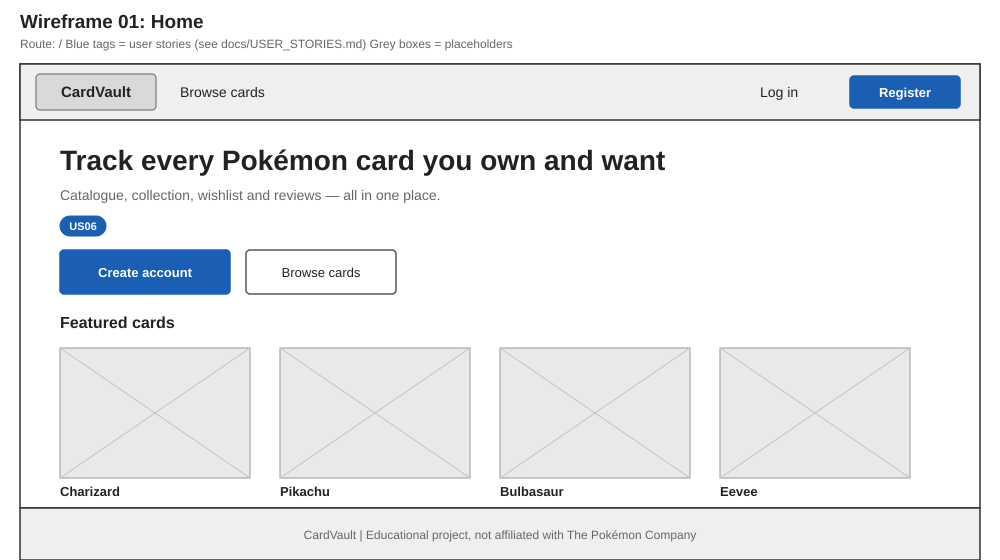

Blue tags on every wireframe (e.g. `US11`) link that part of the
screen back to its user story in `docs/USER_STORIES.md`.

Wireframes 4 and 5 still show a card price and a collection value.
Prices were dropped on 15 October 2026
([issue #48](https://github.com/J-Codes-Walkz/CardVault/issues/48)),
so the built pages differ there; the wireframes are kept as the
record of the original plan.

### Brand and design

Agreed with Jamie in a design session on 15 October 2026 (issues
#59 to #63). The aim: a premium **collector's vault**, calm enough
that the card artwork is always the star, with small Game Boy-style
red, yellow and blue accents.

<p>
  
  &nbsp;
  
</p>

- **Emblem and logo:** an original card back (navy, a soft swirl and a
  gold oval) with an old-school ship-wheel vault lock in the centre,
  beside the wordmark Card**Vault**. Inspired by the back of a
  Pokémon card, not a copy of it.
- **Favicon:** an original Poké Ball-style icon (SVG, 32px PNG, an
  Apple touch icon and `favicon.ico`).
- **Colours, each with one job:**

  | Colour | Light mode | Dark mode | Used for |
  |---|---|---|---|
  | Navy | `#0f1f3d` | `#060c18` | Header, emblem, cosmic hero |
  | Red | `#c8102e` | `#e0283d` | Buttons, active tab, Poké Ball ratings, "Vault" |
  | Blue | `#1d4ed8` | `#8ab4ff` | Links and the keyboard focus outline |
  | Yellow | `#f5c518` | `#ffd23f` | Small highlights only: the line under the header, Rare Holo badges |
  | Ink | `#162034` | `#e8edf6` | Text |
  | Page | `#f5f7fb` | `#0b1220` | Background |

  Every text colour pair passes WCAG AA in both modes (see
  [TESTING.md](./TESTING.md#brand-and-design-testing)). Yellow is
  never used for text on white.
- **Light and dark mode:** follows the device setting, with a
  sun/moon toggle in the header that the browser remembers. A
  high-contrast style switches on when the device asks for more
  contrast, in both modes.
- **Typography:** Poppins (bold, rounded and geometric) for headings
  and the logo, served from this site; the device's own system font
  for body text, so pages stay fast.
- **Ratings:** Poké Balls instead of stars, full or empty, and five
  clickable balls on the review form.
- **Rarity badges:** the 1999 Base Set symbols with the word: ●
  Common, ◆ Uncommon, ★ Rare, ★ Rare Holo (gold).
- **Movement, kept small:** card tiles lift on hover or keyboard
  focus, Rare Holo cards shimmer once, and the home page plays a
  short Poké Ball intro on a visitor's first visit (skippable). The
  faint rarity symbols behind the home page banner float slowly, each
  on its own path, with a "Pause animation" button in the corner
  (WCAG 2.2.2). All of it switches off when the device asks for
  reduced motion.
- **Layout:** a responsive grid for card tiles (4 columns desktop, 2
  tablet, 1 mobile), and a table for My Cards on wide screens that
  becomes stacked cards below 900px.

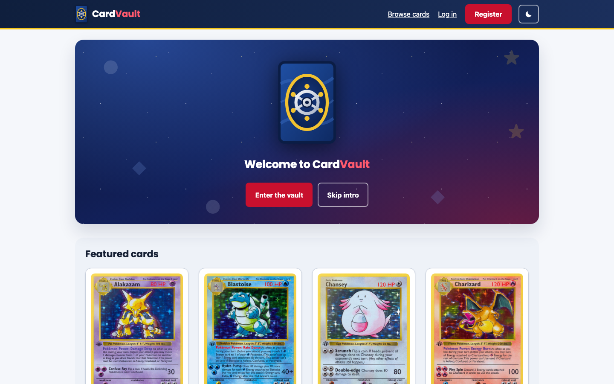

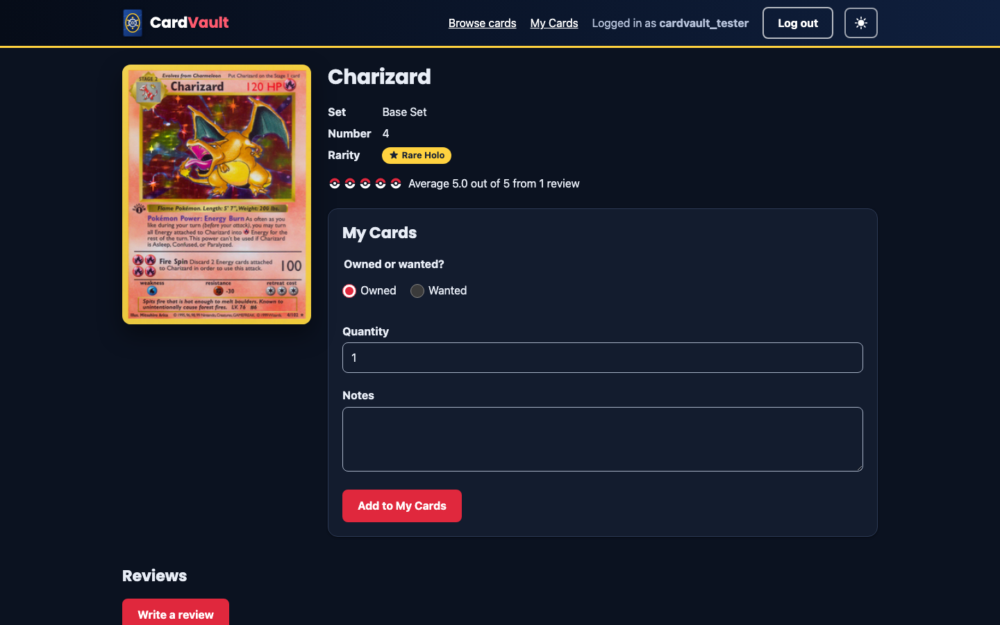

## Database design

PostgreSQL in every environment, reached entirely through Django's
ORM. Full write-up, the entity-relationship diagram and the reasoning
behind each constraint are in
**[docs/DATABASE_SCHEMA.md](./docs/DATABASE_SCHEMA.md)**.

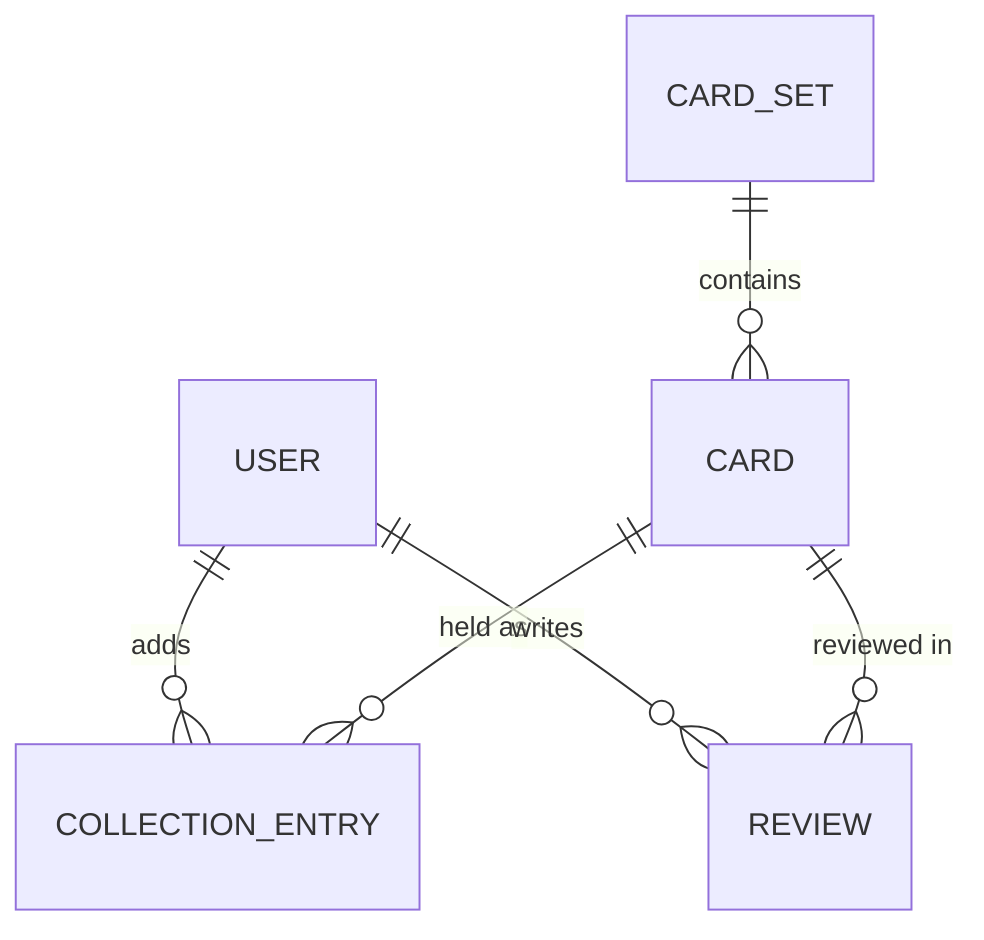

Five tables, deliberately kept simple: `User` (Django's built-in auth,
with no custom fields), `CardSet` and `Card` (shared reference data,
seeded from a fixture or Django admin rather than user-entered), and
two user-owned tables that carry full CRUD &mdash; `CollectionEntry`
(a card the user owns or wants, told apart by a `status` field) and
`Review`. The models live in `cards/models.py` and
`collection/models.py`. What was considered and set aside (a custom
user model, and owned/wanted as two tables instead of one), and why
`CardSet` was cut and then brought back, is explained in
[Why simplify](./docs/DATABASE_SCHEMA.md#why-simplify).

## Architecture

How CardVault fits together, in three views: the whole system, how
the Django code is organised, and one request from start to finish.
The [Security architecture](#security-architecture) section below
shows the protections a request passes through, and the
[database design](#database-design) above shows the tables.

### The whole system

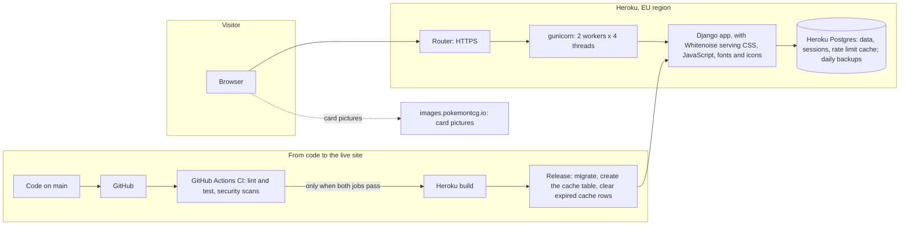

The live site never calls the Pokémon TCG API: the card data was
fetched once into a fixture. Only the card pictures come from the
API's image server, straight to the visitor's browser.

### How the code is organised

One Django project, `cardvault`, and four apps. Each arrow means
"uses code from".

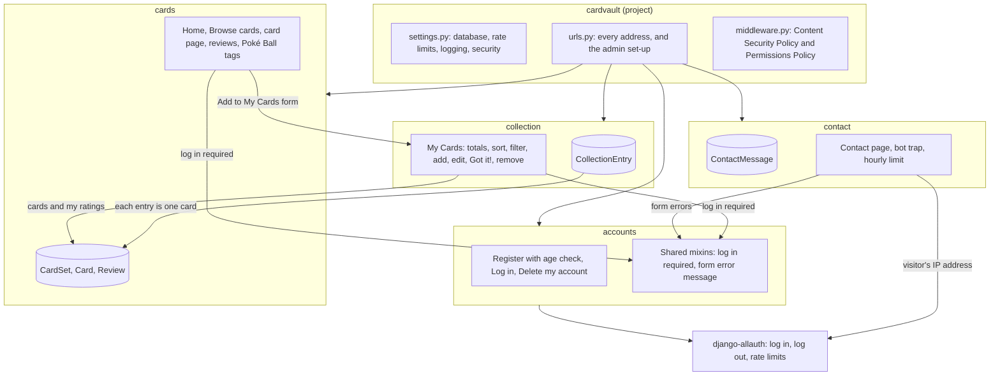

| App | Responsible for | Main files |
|---|---|---|
| `cardvault` | Settings, URLs, security headers, error pages, logging | `settings.py`, `urls.py`, `middleware.py`, `templates/` |
| `accounts` | Registration with the age check, log in through django-allauth, deleting an account, the admin log in, the cache clean-up command | `forms.py`, `views.py`, `adapter.py`, `mixins.py` |
| `cards` | The catalogue, the card page, reviews and the Poké Ball rating | `models.py`, `views.py`, `templatetags/card_extras.py` |
| `collection` | My Cards: owned and wanted cards, totals, sorting, Got it! | `models.py`, `views.py`, `forms.py` |
| `contact` | The Contact page and its spam protection | `models.py`, `views.py`, `forms.py` |

### One request: adding a card to My Cards

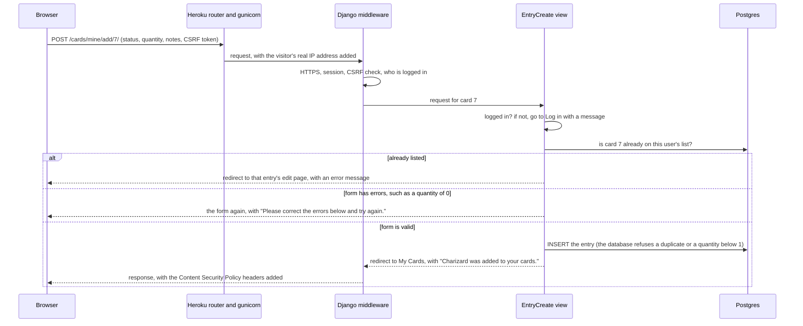

## Security architecture

CardVault is built in layers, so that if one protection fails another
still stands. Every request passes through each layer in turn:

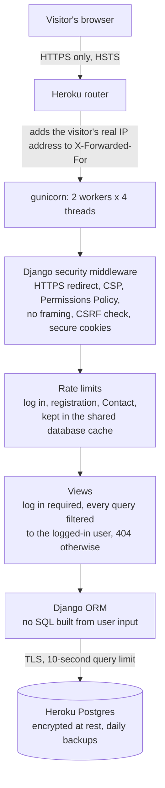

The full list of protections, and how to report a problem privately,
is in [SECURITY.md](./SECURITY.md). This section explains the main
decisions.

### Stopping password guessing

| Attack | Protection |
|---|---|
| Guessing one person's password | **3 wrong passwords lock that username for 15 minutes**, whichever computers the guesses come from. At most 12 guesses an hour, against a password that must pass Django's checks (8+ characters, not one of the 20,000 most common, not all numbers, not like the username). |
| One computer trying thousands of log ins | One IP address may get **5 passwords wrong a minute and 20 an hour**, across any usernames, and try to log in **10 times a minute**. After that it sees "Too many failed log in attempts" until the time is up. |
| Mass account creation | **10 registrations an hour** per IP address; anything more gets a "Too many attempts" page (HTTP 429). |
| Bots flooding the Contact form | A hidden trap field and **5 messages an hour** per visitor. |
| Finding out which usernames exist | A failed log in always says "Invalid username or password", never which part was wrong. |
| Guessing the admin password | The Django admin's own log in page is switched off; admins log in through the same rate-limited page. |

The limits are counted in a cache table in the database, shared by
every web process and kept across restarts. Each limit is counted per
visitor because `ALLAUTH_TRUSTED_PROXY_COUNT = 1` tells django-allauth
to use the address Heroku's router adds to `X-Forwarded-For`. That
address cannot be faked: a visitor can send their own
`X-Forwarded-For`, but the router always adds the real address last.
Before this setting, every visitor shared one count
([bug #66](https://github.com/J-Codes-Walkz/CardVault/issues/66)).

**The trade-off:** locking a username after 3 wrong passwords means
someone who knows your username can keep your account locked by
getting your password wrong on purpose. They still cannot get in, and
each wrong password stops counting after 15 minutes, so they would
have to keep trying every few minutes; attempts made while locked do
not count. For a hobby site
this is the right balance; a bank would add a second factor instead
(see [POTENTIAL_UPSCALE.md](./docs/POTENTIAL_UPSCALE.md)).

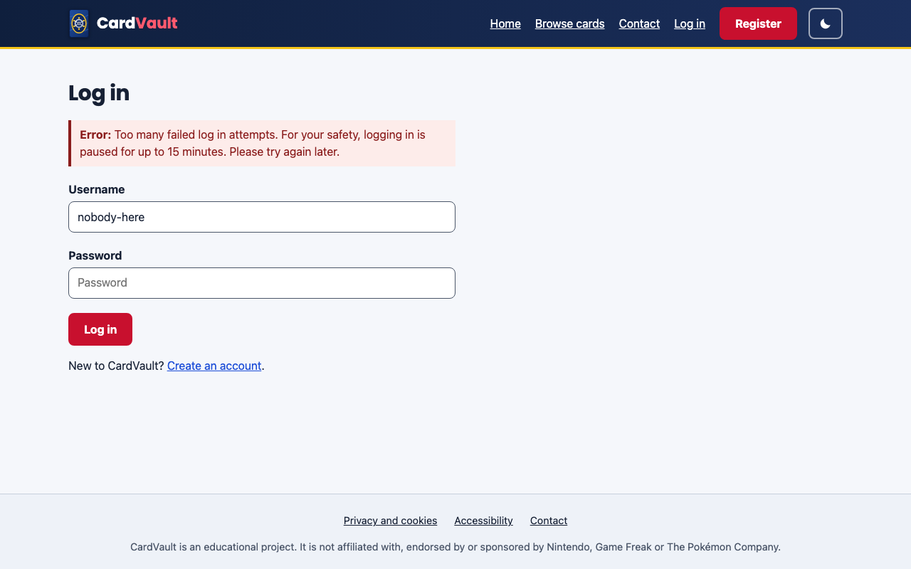

### Handling heavy traffic

- **More requests at once:** gunicorn runs 2 worker processes with 4
  threads each, so one web dyno serves 8 requests at the same time
  instead of 2. Each worker restarts after about 1,000 requests, so a
  slow memory leak can never build up.
- **Database connections are reused** for up to 10 minutes and
  checked before reuse, rather than opened fresh for every page. At
  most 8 connections per dyno, well inside the plan's limit of 20.
- **No query can run away:** Postgres stops any query still running
  after 10 seconds, and searches are cut to 100 characters and 5
  words, as each word adds a filter
  ([bug #67](https://github.com/J-Codes-Walkz/CardVault/issues/67)).
- **Efficient pages:** lists use `select_related` and a fixed number
  of queries however many cards there are (tested), and are split
  into pages of 12.
- **Static files** (CSS, JavaScript, fonts, icons) are compressed and
  served by Whitenoise with long cache times, so returning visitors
  load them from their own browser.
- **Card pictures** come from the Pokémon TCG image server, not from
  CardVault, so the heaviest files never touch our dyno.

**Load test, 19 October 2026:** 2,000 page visits to the live site,
25 at a time, spread across the home page, Browse cards, a search and
a card page: **all 2,000 succeeded, about 112 pages a second, median
0.21 seconds, 95% within 0.33 seconds**. At 50 at a time, 50 of
3,000 requests timed out, so about 25 at once is this single dyno's
comfortable limit. Details in [TESTING.md](./TESTING.md#load-testing).

**To grow further**, Heroku can run more dynos (`heroku ps:scale
web=2`) or bigger ones, and the database plan can be upgraded, without
changing any code.

### Database security management

| Area | How CardVault handles it |
|---|---|
| Access | The database address and password exist only in Heroku's config vars (`DATABASE_URL`) and, for the local database, in a `.env` file that git ignores. Neither is ever in the code or its history. |
| Connection | Encrypted with TLS (`sslmode=require`) on the live site. |
| Storage | Heroku Postgres encrypts the data on disk. |
| Queries | Only through Django's ORM, which sends every value separately from the SQL, so SQL injection is not possible. The one hand-written statement is a fixed clean-up in `clear_expired_cache`, which takes no user input. |
| Rate limit notes | The log in limits keep IP addresses in the cache table. Django only clears expired rows once there are more than 300, so `clear_expired_cache` deletes them on every release (see the `Procfile`). |
| Integrity | Rules are enforced by the database itself, not only by forms: one entry per user per card, quantities of at least 1, ratings from 1 to 5, unique card numbers per set. |
| Least data | No email address or real name for an account (django-allauth's add-an-email and password reset pages are switched off, bug #72); the date of birth is checked and thrown away; passwords are stored only as salted PBKDF2 hashes. |
| Deletion | Deleting an account deletes its My Cards entries and reviews with it (`on_delete=CASCADE`). Contact messages are deleted once handled. |
| Backups | A full backup every day at 03:00 (UK time), set up with `heroku pg:backups:schedule`, plus Heroku's own continuous protection. The first backup (19 October 2026) was checked: it contains all 18 tables. Restore with `heroku pg:backups:restore`. |
| If the password leaked | `heroku pg:credentials:rotate` issues a new database password and Heroku updates `DATABASE_URL` and restarts the app. |
| Admin | Only superusers can open the Django admin, through the rate-limited log in page. Contact messages are read-only there. |
| Errors | A database error shows the plain 500 page, never the error itself, and the full traceback goes to Heroku's logs (`heroku logs --tail`) for investigation. |

**Known limits:** the Essential database plan has a single database
user, so the app cannot have a separate read-only login, and it has
no point-in-time rollback. Both come with Heroku's Standard plans.

## Project mind map

A knowledge graph of the whole project (code, templates, docs and
wireframes) is kept in `graphify-out/`, built with
[graphify](https://github.com/Graphify-Labs/graphify). It is used as a
mind map: it shows which models, tests, user stories and wireframes
connect to each other, and which parts everything else depends on.

| File | What it is |
|---|---|
| [graphify-out/graph.html](./graphify-out/graph.html) | The interactive graph. GitHub shows this file as source code, so download it (or clone the repo) and open it in a browser. It loads one script from the internet, so it needs a connection. |
| [graphify-out/GRAPH_REPORT.md](./graphify-out/GRAPH_REPORT.md) | A plain-language report: the most connected nodes, surprising connections and questions worth asking. |
| [graphify-out/graph.json](./graphify-out/graph.json) | The raw graph data. |

**How it grew**, refreshed at the end of each stage of the project:

| Date | Stage | Nodes | Links | Clusters |
|---|---|---|---|---|
| 12 October 2026 | Sprint 1: models, accounts, planning docs | 336 | 578 | 19 |
| 14 October 2026 | After the front-end CRUD | 597 | 1,120 | 48 |
| 29 October 2026 | Sprints 2 and 3 complete: every story built | 1,052 | 1,614 | 99 |

<p>
  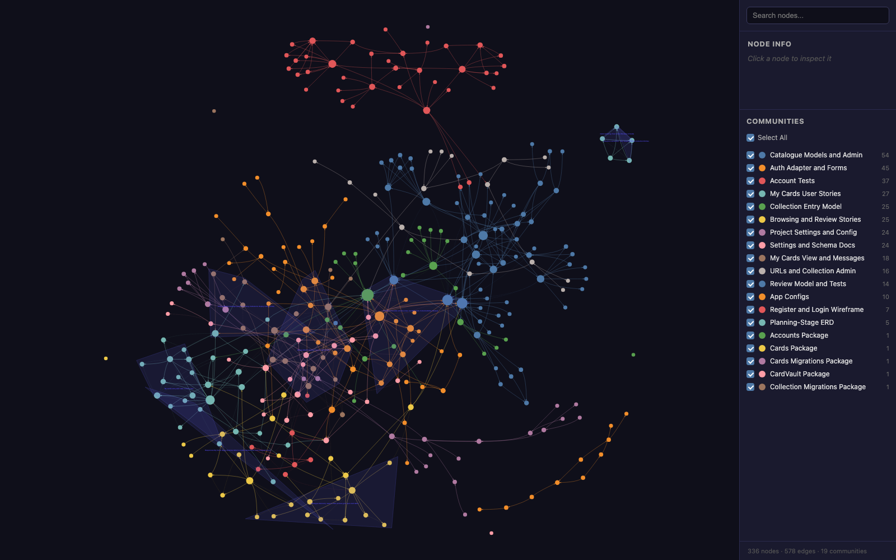
  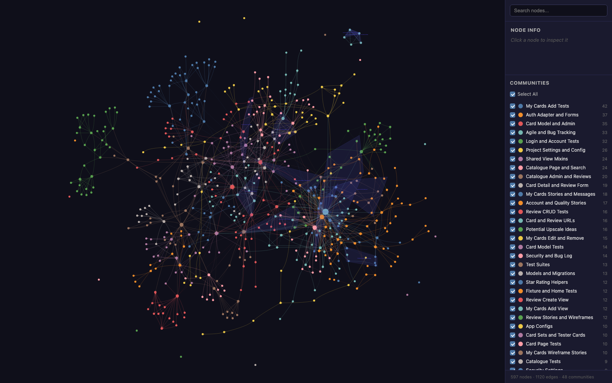
  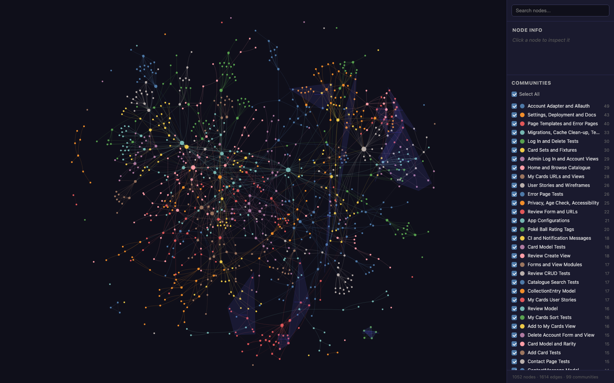
</p>

The 29 October refresh read 86 changed files: the 47 code files by
parsing them directly (free), and 39 documents and templates with AI.
It added 582 nodes and removed 127 that no longer exist, such as the
card price fields dropped in issue #48. Many of the 99 clusters are a
single file, for example each `__init__.py` package marker and each
package in `requirements.txt`; about 50 are real features.

**How it was used.** The most connected nodes are the user stories
and the `Card`, `CardSet`, `CollectionEntry` and `Review` models,
which confirmed early on that everything rests on those four tables,
so they were designed and tested first. The clusters line up with the
features (accounts, the catalogue, My Cards, reviews, Contact, CI and
security), and each test class sits in its feature's cluster, which
made gaps in testing easy to spot. Its "surprising connections" were
mostly right: for example, it found that the card page's My Cards
panel shares data with `CollectionEntryForm` and `CollectionEntry`,
which is exactly how adding a card from its page works.

**Where it was wrong.** Links the report marks as "inferred" are the
AI's reasoning, not read from a file. It linked the Log in template
to `LoginForm` as "shares data", which is right in spirit, but the
real connection runs through django-allauth's view, not the template.
A few nodes from the 14 October reading of the templates (such as
"Card list pagination") survived the merge as separate single-node
clusters, though they describe parts of the pages that do still
exist. The planning-stage ERD image still shows the `market_price`
field removed later; the graph faithfully records the old picture.
So the graph is a guide, not a complete or perfectly current map.

**Checking it: how far can the graph be trusted?** The report flagged
that `Card` has 19 "inferred" links and asked whether they are right.
On 29 October 2026 each one was checked against the code with a
script that reads every class and function for a reference to
`Card`:

| Question | Result |
|---|---|
| Are the 19 links the graph claims real? | **19 of 19 correct**: each class or function does refer to `Card`, at the lines the script listed |
| Does the graph miss any real uses of `Card`? | **Yes, 2**: `CardAdmin` and the `Review` model |
| Why? | Two blind spots in how graphify reads Python, both confirmed on other models: a reference **inside a decorator** is never linked (all four admin classes, such as `@admin.register(Card)`), and a reference to a class **in the same file** is never linked (`Card` to `CardSet` and `Review` to `Card`, all in `cards/models.py`). A reference from another file through an import, such as `CollectionEntry` to `Card`, is always linked |

So its links about the code are trustworthy, but a missing link does
not prove two things are unconnected: within one file, or through a
decorator, the code must be read directly.

Screenshots, icons and the font licence are left out of the graph
(see `.graphifyignore`): they are evidence or brand assets, not
project structure. To refresh it after new work, run
`/graphify . --update` in Claude Code. Only the three files above are
committed; the cache stays local (see `.gitignore`).

## Features

Everything below is live on
[the Heroku site](https://cardvault-0a18b8d773ca.herokuapp.com/) and
was tested there (see [TESTING.md](./TESTING.md)). The first features
were tested on 14 October 2026 and the rest as each was built, so
earlier screenshots show the header before the Home and Contact links
were added. They use the Base Set and the AAA, BBB and CCC tester
cards.

### Accounts

- **Register** (US01): username, password and password confirmation
  through django-allauth. A new user is logged in straight away with
  "Your account has been created. Welcome to CardVault,
  &lt;username&gt;!". A taken username, a weak password (naming the
  rule it broke) or mismatched passwords each show an error and
  create no account.
- **Log in and log out** (US02, US03): "Welcome back,
  &lt;username&gt;!" and "You have been logged out. See you soon!".
  A wrong password shows one generic error that does not reveal
  which part was wrong. Log out is a POST form with a CSRF token.
- **Always know if you are logged in** (US04): the navigation shows
  "Logged in as &lt;username&gt;", My Cards and Log out, or Log in
  and Register.
- **Private data stays private** (US05): logged-out visitors are sent
  to Log in with "Please log in to view that page.", and another
  user's entries and reviews return a 404 page.

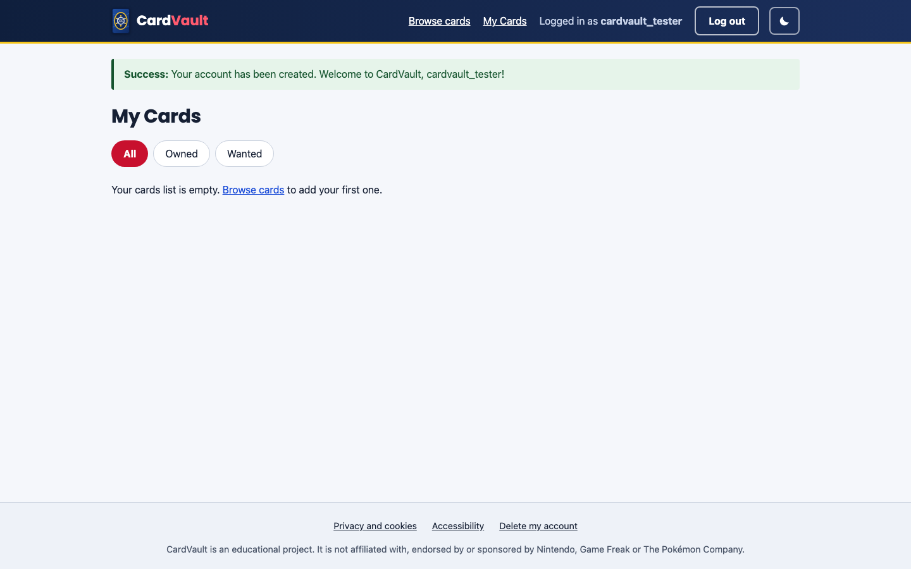

### Browsing cards

- **Home page** (US06): says what the site is for, with Create
  account and Browse cards buttons (Go to My Cards when logged in)
  and a row of featured cards.
- **Catalogue** (US07): a responsive grid, 12 cards a page with
  page links; a placeholder image when a card has no picture.
- **Search** (US08): type any part of a card's name, set or rarity,
  in any order: "char" finds Charizard, Charmeleon and Charmander;
  "holo", "holo rare" and "rare holo" all find the holo cards;
  "common" finds Commons but not Uncommons. Shows a result count and
  a clear link.
- **Filters** (US09): Rarity and Set dropdowns that combine with the
  search and stay selected when moving between pages.
- **Card page** (US10): set, number, rarity, average Poké Ball rating and
  every review.

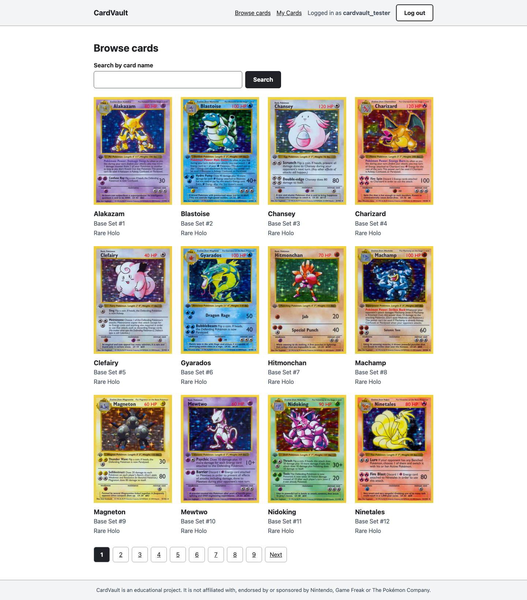

### My Cards: full front-end CRUD

From any card's page a logged-in user can:

- **Create** (US11): add the card to My Cards as Owned or Wanted, with
  a quantity (at least 1) and notes. Adding a card already on the
  list goes to that entry's edit page instead of creating a second
  one.
- **Read** (US12): My Cards lists every entry with All, Owned and
  Wanted tabs. Each row shows your own Poké Ball rating for the card (or a
  Rate it link) and a one-line preview of your notes; hover for the
  whole note, or open Edit. On phones and small tablets each row
  stacks into a labelled card showing the full note.
- **Update** (US13): change the status, quantity or notes.
- **Delete** (US14): remove the entry after a confirmation page that
  names the card. The card itself stays in the catalogue.

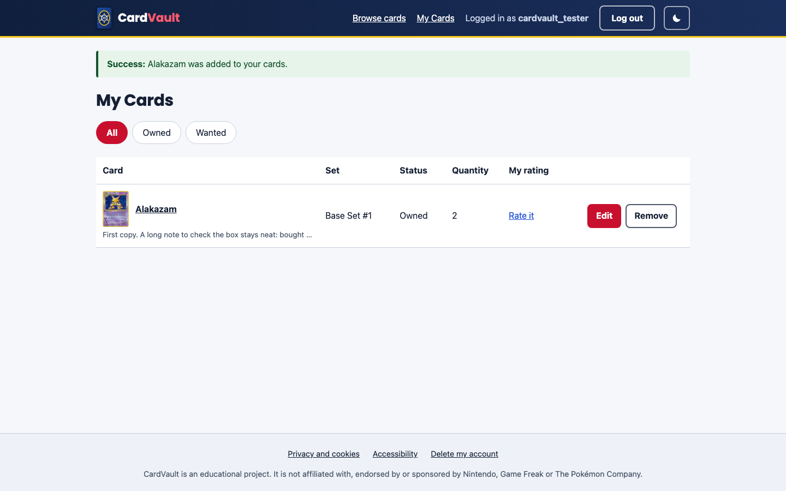

On top of the CRUD, My Cards helps with a growing collection:

- **Collection summary** (US15): three totals at the top: cards owned
  (every copy counted), different cards owned, and cards on the
  wanted list. Wanted cards are never counted as owned. All three
  come from one database query.
- **Sort and filter** (US16): sort by newest or oldest added, by name,
  or by set and card number, and filter to one set (only sets you
  have cards from are offered). The choices go in the address, so the
  page can be bookmarked, and the All, Owned and Wanted tabs keep
  them. Only the four listed sort orders are accepted; anything else
  typed into the address is ignored.
- **Got it!** (US17): every Wanted card has a Got it! button. It asks
  how many you got (already filled in with the number you wanted),
  then moves the card to Owned, keeping its notes, and shows
  "Charizard moved to your collection." Owned cards and other users'
  cards cannot be "got" (404).

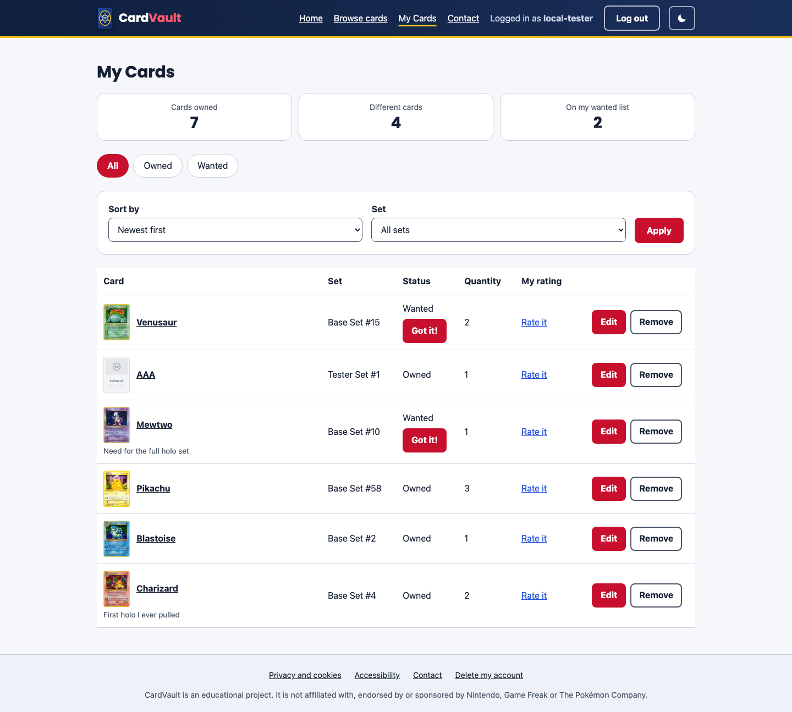

<p>
  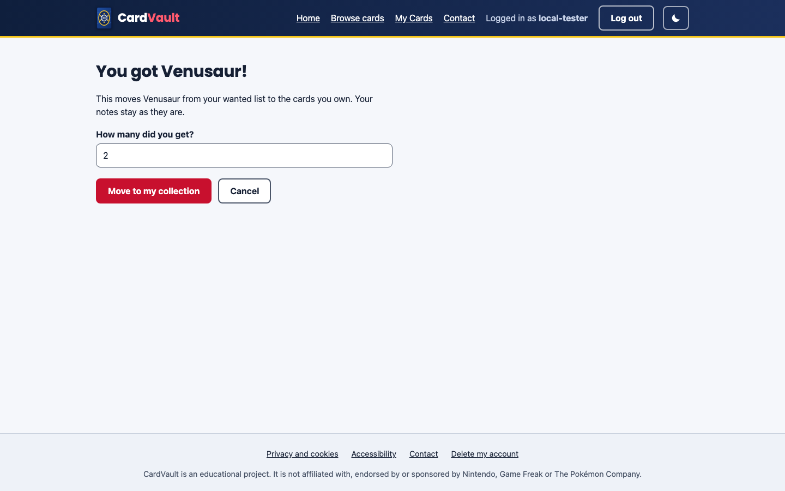
  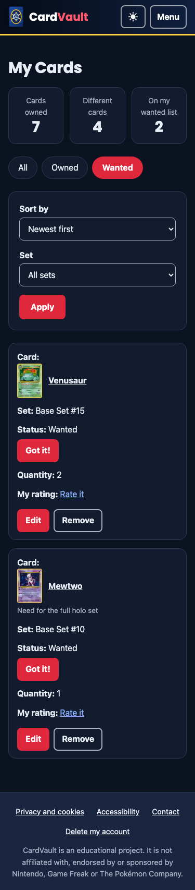
</p>

### Reviews: comments and Poké Ball ratings

- **Create** (US18): press Write a review on a card's page, then rate
  it from 1 to 5 Poké Balls and write a comment on the review page. Each
  page has only one form, so nothing you type can be lost. Each user
  reviews a card once; after that the button is replaced by their
  review with Edit and Delete buttons.
- **Read** (US21): reviews are listed newest first with the
  username, Poké Ball rating, date and comment, under the card's average rating.
- **Update** (US19): edit your own review; it is then marked
  "(edited)".
- **Delete** (US20): delete your own review after a confirmation
  page.

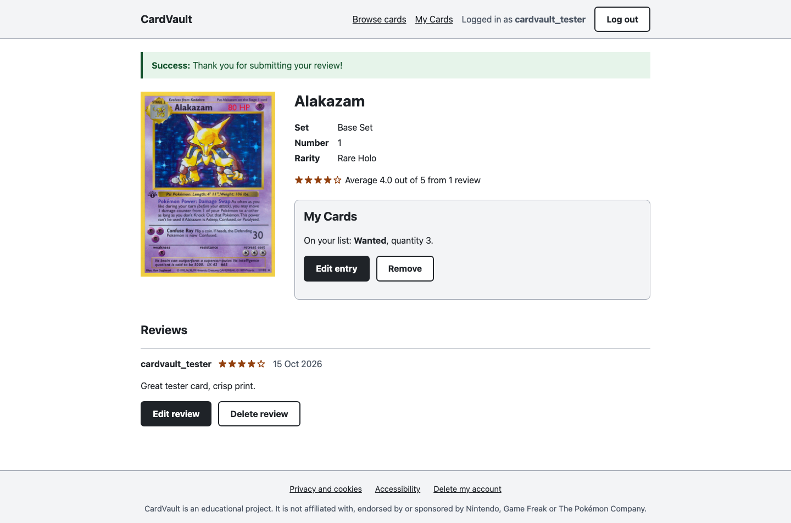

### Privacy, safety and accessibility

- **Age check** (US29): registration asks for a date of birth and
  refuses anyone under 13 ("Sorry, you need to be 13 or older to
  create a CardVault account."), then stays closed for that browser
  session. The date is checked and thrown away, never stored. This
  follows COPPA in the US and the UK Children's Code.
- **Delete my account** (US30): a footer link, a page listing what
  will be deleted, and a password check; then the account, its cards
  and reviews are deleted.
- **Privacy and cookies** (US31): a plain-English page listing what is
  stored, the only two cookies (`sessionid` and `csrftoken`, both
  strictly necessary, so no cookie banner is needed) and the other
  services involved.
- **Accessibility** (US32): works at 200% zoom, switches to a
  high-contrast style when the device asks for it, passes an automated
  WCAG 2.2 AA check on every page, and has an accessibility statement.
  CardVault has no audio or video, so nothing depends on hearing.

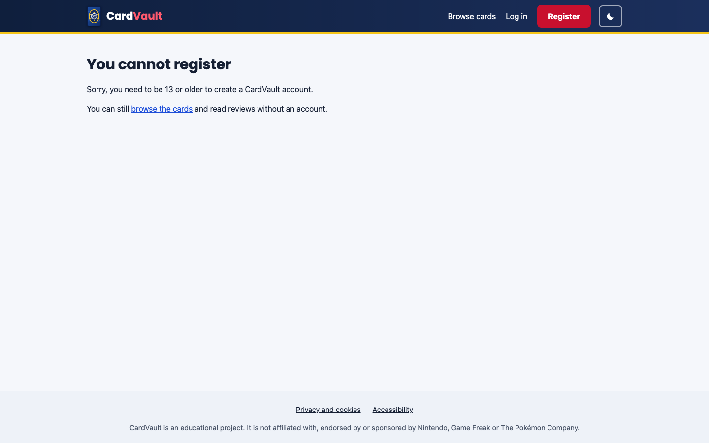

### Navigation and contact

- **Home link** (US33): "Home" is the first link in the header on
  every page, as well as the logo. The link for the page you are on
  has a yellow underline and `aria-current="page"` for screen readers.
- **Contact page** (US34): linked in the header and footer. It asks
  for a name, email address and message (logged-in users find their
  username already filled in), then returns to the home page with:
  "Thank you for your enquiry. We aim to reply within 2 to 3 days. If
  nothing arrives in your inbox, please check your junk or spam
  folder." Messages are saved in a `ContactMessage` table and read in
  the Django admin, where they can be marked as handled but not
  changed. Replies are sent by hand, so the site itself sends no email
  and holds no mail password. A dedicated CardVault mailbox to reply
  from is planned; see [POTENTIAL_UPSCALE.md](./docs/POTENTIAL_UPSCALE.md).
- **Spam protection:** a hidden trap field that bots fill in and
  people never see (bots get the same thank you, but nothing is
  saved), and a limit of 5 messages an hour per visitor, counted
  against a one-way hash of the IP address. An automatic email reply
  was considered and left out on purpose; see
  [POTENTIAL_UPSCALE.md](./docs/POTENTIAL_UPSCALE.md).

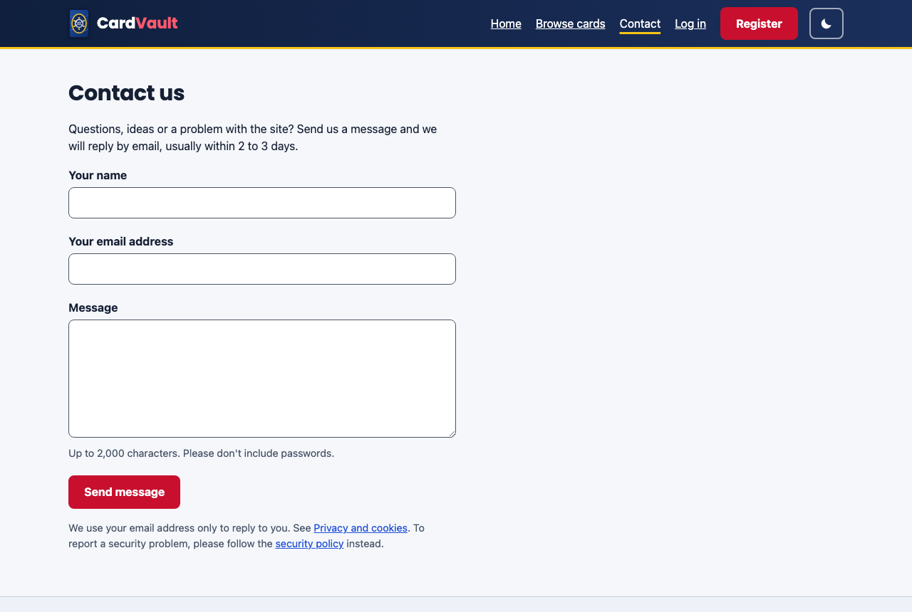

### Quality and security

- **Responsive** (US22): mobile first, no sideways scrolling from
  320px up. Below 1024px the navigation collapses behind a Menu button,
  and the footer sits at the bottom of the window on short pages.
- **Feedback on every action** (US24): a success, error or info
  message with a word ("Success:", "Error:") as well as colour, and
  `role="status"` or `role="alert"` for screen readers.
- **Secrets and debug** (US26): every secret read from environment
  variables, `DEBUG` off by default, and a [security policy](./SECURITY.md)
  for reporting vulnerabilities privately.
- **Django admin** (US28): the site owner manages the catalogue,
  reviews, My Cards entries and Contact messages from the admin; see
  [Running the site: the Django admin](#running-the-site-the-django-admin).
- **Helpful error pages** (US25): branded pages for every error a
  visitor can meet, each in plain language with a way back, and never
  any technical detail:

  | Error | When | Page says |
  |---|---|---|
  | 404 | The address does not exist, or the card or entry does not (or is someone else's) | "We couldn't find that page", with a card search |
  | 403 | A logged-in user who is not a superuser opens the admin | "You don't have permission to see this page" |
  | 403 (form expired) | A form is sent after its session ended, for example after logging out in another tab | "This form has expired", and how to fix it |
  | 400 | A malformed request, such as an unknown web address for the site | "Something about that request wasn't right" |
  | 429 | Too many log in or registration attempts | "Too many attempts" |
  | 500 | Something breaks on the server | "Something went wrong on our side" |

  The 500 page is plain HTML with every link written out, as Django
  shows it without any context: whatever broke (even the database)
  cannot break the error page too. Every crash is written to Heroku's
  logs with its traceback
  ([bug #69](https://github.com/J-Codes-Walkz/CardVault/issues/69)).

<p>
  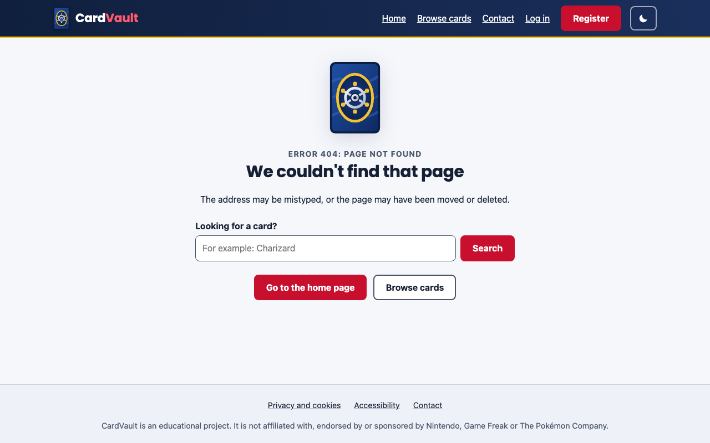
  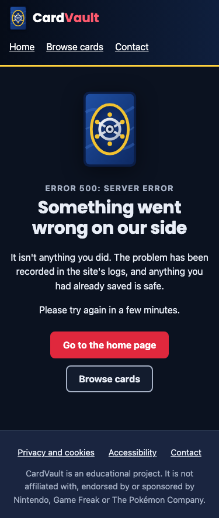
</p>

<p>
  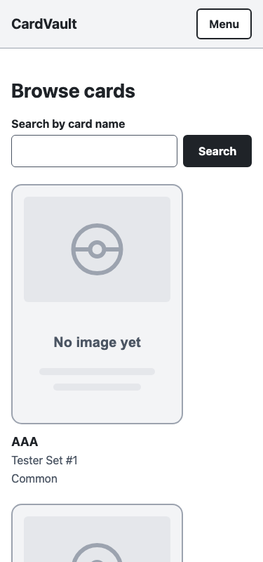
  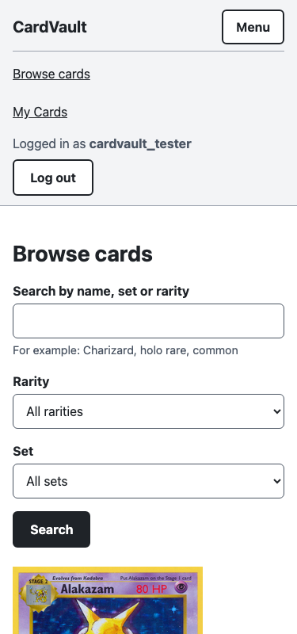
  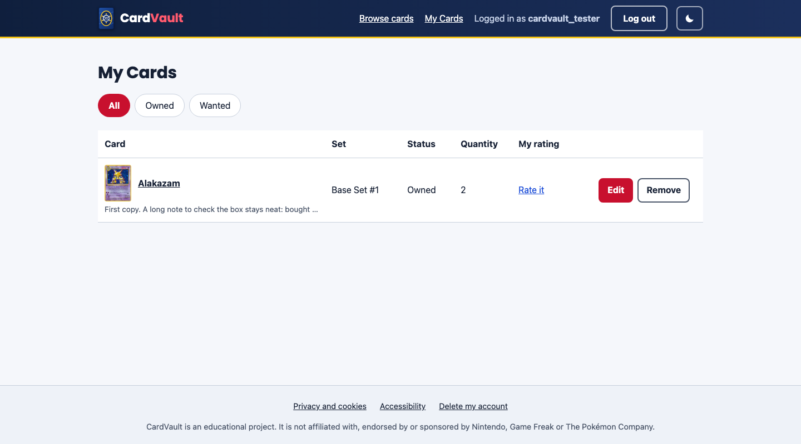
</p>

### Running the site: the Django admin

The public pages look the same for everyone. The site owner's tools
are in the **Django admin**, at
[/admin/](https://cardvault-0a18b8d773ca.herokuapp.com/admin/) (US28).

**Who can use it:** only **superusers**. Django normally lets any
"staff" account in; CardVault narrows that to superusers. Everyone
logs in through the same rate-limited Log in page (the admin's own
log in form is switched off), and anyone else who opens the admin
sees the 403 "You don't have permission" page. A superuser sees an
**Admin** link in the header; nobody else does.

The site owner keeps two accounts: an everyday account, whose
username appears next to reviews, and a separate superuser that is
never shown anywhere, so the account with the most power is the
hardest to target. A superuser is created on Heroku with
`heroku run python manage.py createsuperuser`, and its password
changed with `heroku run python manage.py changepassword <username>`.

**What the admin is for:**

| Section | What the owner can do |
|---|---|
| Card sets and Cards | Correct a card's name, number, rarity or picture link, or add cards. Cards can be searched by name or set and filtered by set and rarity. |
| Reviews | Read every review, and edit or delete one that breaks the rules. |
| Collection entries | See and correct any user's My Cards entries, filtered by status or set. |
| Contact messages | Read enquiries and tick **Handled** once replied to. Messages are read-only, and cannot be added from the admin: they only ever come from visitors. |
| Users | See accounts, and give or remove superuser access. |

django-allauth's own "Email addresses" section is removed, as
CardVault never collects email addresses.

**Walkthrough: correcting a card**

1. Log in as the superuser and press **Admin** in the header.
2. Under **Cards**, open **Cards** and search, for example, `charizard`.
3. Open the card, correct the field (the **Picture** preview shows the
   image link working), and press **Save**.
4. Press **View on site** to see the change on the card's page.

<p>
  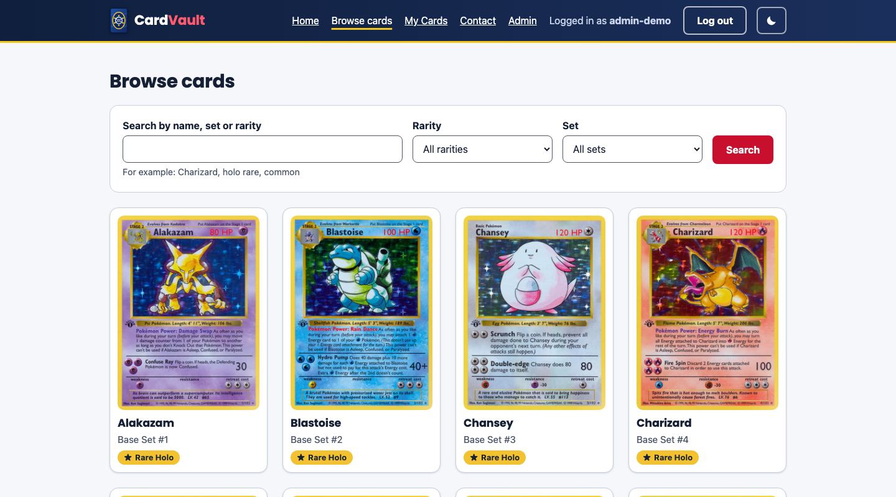
  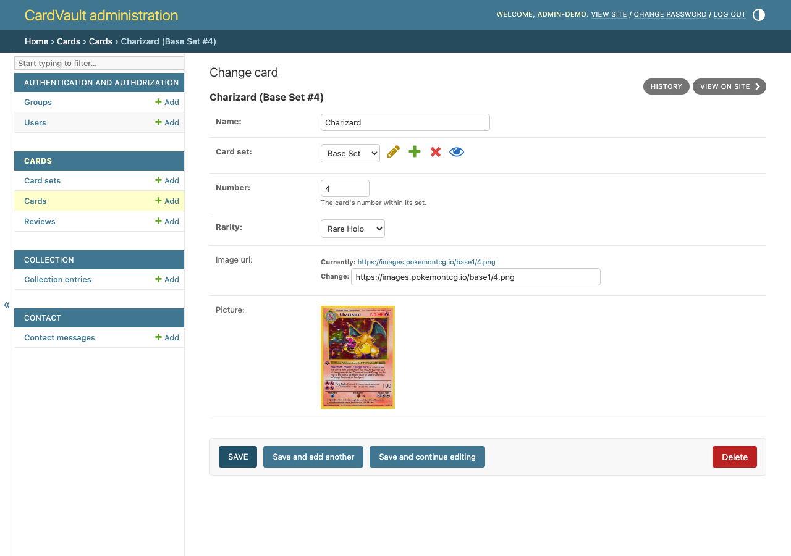
</p>

**Walkthrough: handling a review or a Contact message**

- **A review:** open **Reviews**, tick the review, choose **Delete
  selected reviews** from the Action menu and press **Go**, then
  confirm.
- **A Contact message:** open **Contact messages**, read the message,
  reply by email, then tick **Handled** and press **Save**. Once dealt
  with, delete it, as the Privacy page promises.

<p>
  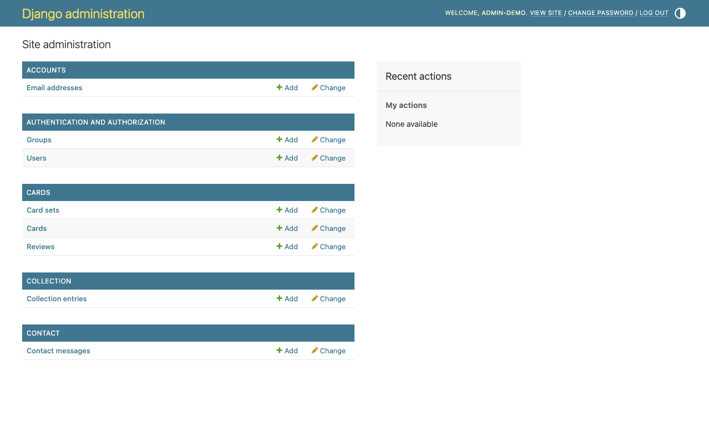
  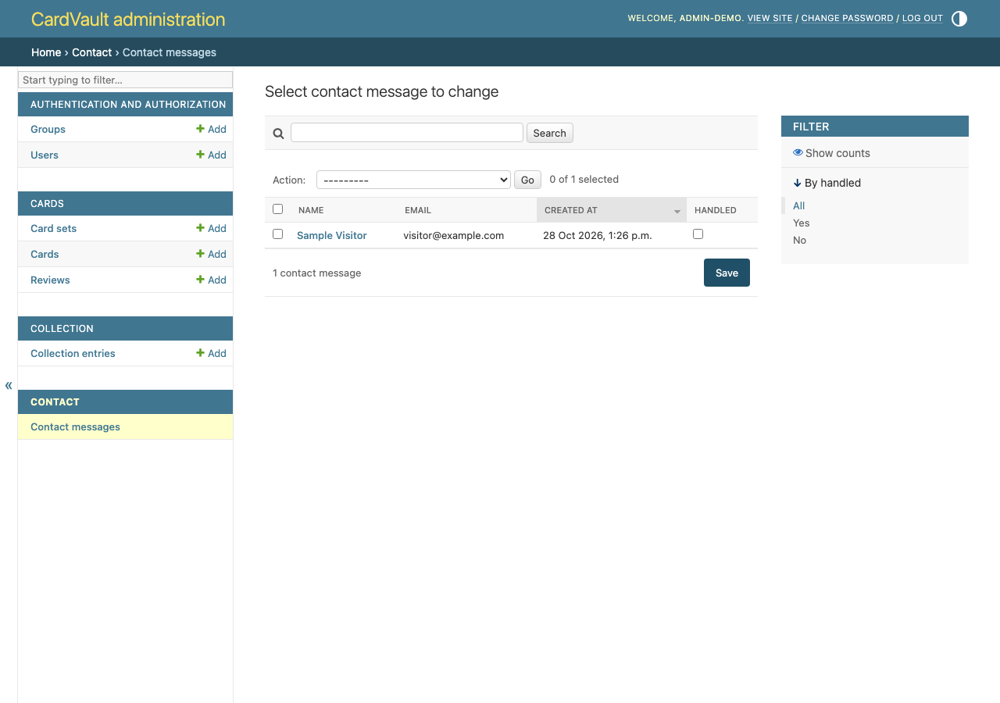
</p>

### Still to build

Nothing: all 34 user stories are built and tested, including on a
real phone. Ideas for after the submission are in
[docs/POTENTIAL_UPSCALE.md](./docs/POTENTIAL_UPSCALE.md).

Every notification message the app shows (login success, duplicate
username, "thank you for your review", and so on) is written out
exactly in **[docs/NOTIFICATION_MESSAGES.md](./docs/NOTIFICATION_MESSAGES.md)**,
so the wording stays the same everywhere it appears.

## Agile methodology

CardVault was planned and tracked on a public **GitHub Projects**
board, with one GitHub issue per user story, development task and bug.

**Project board:
[github.com/users/J-Codes-Walkz/projects/5](https://github.com/users/J-Codes-Walkz/projects/5)**

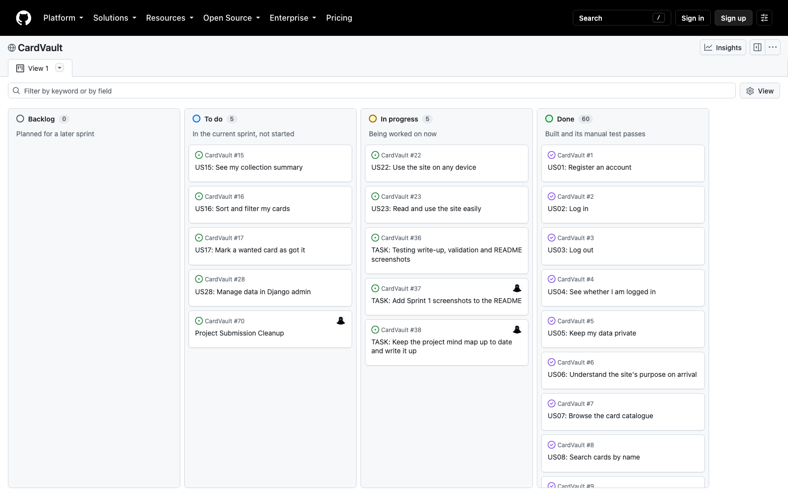

**The board over time.** Jamie's own screenshots show it moving: on
14 October most stories were still in Backlog, with the assessor's
bugs in progress; by 19 October the Sprint 2 work had moved across.
The milestones page on 19 October shows Sprint 1 a few days overdue
(one hand-taken screenshot task left), which is recorded honestly in
the sprints table below.

<p>
  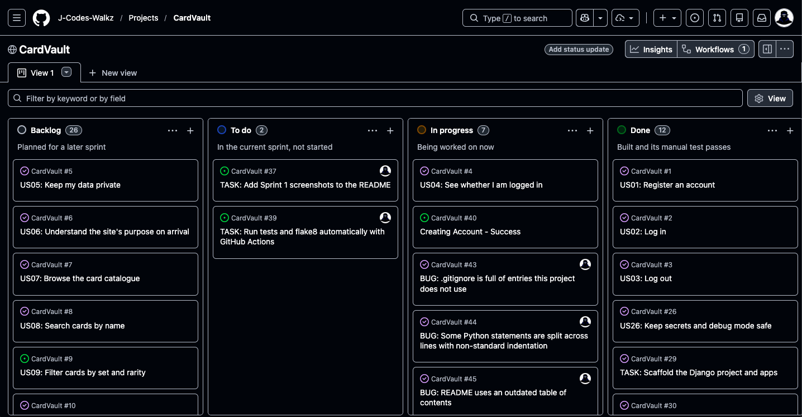
  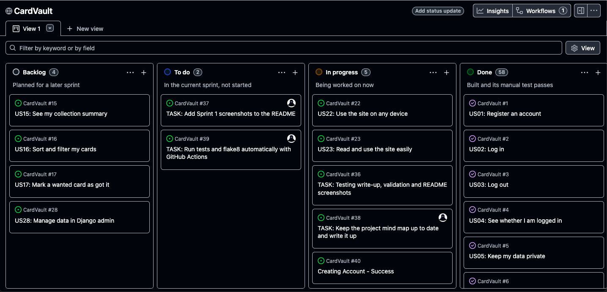
</p>

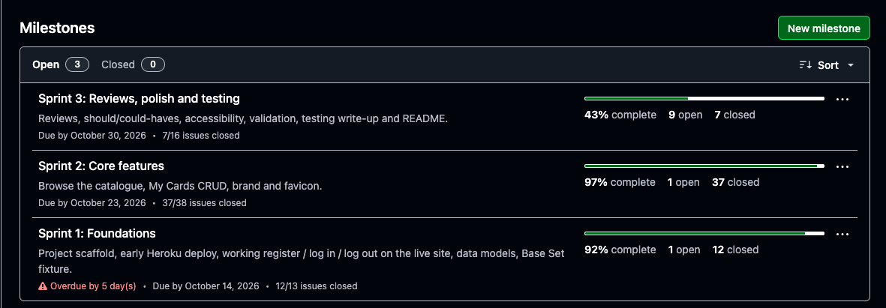

**How the board was set up**

- **Four columns:** `Backlog` (planned for a later sprint), `To do`
  (in the current sprint), `In progress` and `Done` (built, and its
  manual test passed). Cards moved across as the work did.
- **72 issues:** 34 user stories, 21 development tasks and 15 bugs,
  plus Jamie's own testing note (#40) and the submission checklist
  (#70). Each story's issue title starts with its ID (for example
  `US01: Register an account`) and holds its acceptance criteria and
  tasks as a checklist, ticked as they were done.
- **Labels** show the MoSCoW priority (`priority:must`, `should`,
  `could`) and the epic (`epic:accounts-and-authentication` and six
  more), so the board can be grouped or filtered by either.
- **Milestones** group the issues into the three sprints, plus a final
  "Day of Submission Check List" milestone for the last checks.

**How the issues were created.** The first 28 stories were written in
[docs/USER_STORIES.md](./docs/USER_STORIES.md), exported to
[docs/github-issues.csv](./docs/github-issues.csv) and created in one
go on 12 October 2026 by
[scripts/create_github_issues.py](./scripts/create_github_issues.py),
using the GitHub CLI (it has a `--dry-run` preview). New stories were
added as the project grew: US29 to US32 (age check, delete my
account, privacy, accessibility) on 15 October, and US33 and US34
(Home link and Contact page) on 16 October, each in a new epic.

**Bugs as issues.** Every bug found, by testing, by the assessor's
masterclass feedback or by Jamie's own use of the site, was logged as
an issue labelled `bug`, fixed, and closed by the commit that fixed
it; [TESTING.md](./TESTING.md#bugs) lists all of them.

### Sprints

Three sprints, tracked as GitHub milestones, ending before the
submission deadline of Monday 2 November 2026, 12:00 midday:

| Sprint | Due | Goal | Outcome |
|---|---|---|---|
| 1: Foundations | Wed 14 Oct | Project scaffold, early Heroku deploy, register / log in / log out on the live site, data models, Base Set fixture | All built on time and live on 14 October. The milestone closed on 26 October, when the last hand-taken screenshots (#37) were added |
| 2: Core features | Fri 23 Oct | Browse the catalogue, My Cards CRUD, brand and favicon | 39 issues closed, including the security hardening, the Home link and Contact page, and CI, added along the way. US15 to US17 (My Cards totals, sorting, Got it!) were moved into Sprint 3 |
| 3: Reviews, polish and testing | Fri 30 Oct | Reviews, should/could-haves, accessibility, validation, testing write-up | All 17 issues closed on 29 October, a day early |

Work runs roughly in epic order, since later epics depend on earlier ones
(you need accounts before My Cards CRUD means anything, and cards
in the catalogue before reviews mean anything):

1. Accounts and authentication (US01&ndash;US05)
2. Browsing cards (US06&ndash;US10), after seeding the catalogue
   (US27)
3. My Cards (US11&ndash;US17)
4. Reviews (US18&ndash;US21)
5. Quality, security and content (US22&ndash;US28): partly ongoing
   throughout (feedback messages and keeping secrets safe were
   checked on every change, and CI checks every push since 19
   October), partly finished at the end (Lighthouse, the admin)
6. Privacy, safety and accessibility (US29&ndash;US32), and
   navigation and contact (US33, US34), added mid-project

## Testing

Lighthouse scores **100 for Accessibility and SEO on every page**,
mobile and desktop, with Performance 95 to 100 (see
[Lighthouse in TESTING.md](./TESTING.md#lighthouse)).

The full testing write-up is in **[TESTING.md](./TESTING.md)**: manual tests for every user story, the automated test suite, validator results (HTML, CSS, Python) and every bug found, each logged as a GitHub issue labelled [`bug`](https://github.com/J-Codes-Walkz/CardVault/issues?q=label%3Abug).

### Continuous integration

Every push and pull request to `main` runs the
[CI workflow](./.github/workflows/ci.yml) on GitHub Actions (the badge
at the top of this README shows the latest result). It can also be
run by hand with the **Run workflow** button in the Actions tab. It has two jobs,
which run side by side:

| Job | Checks | Fails if |
|---|---|---|
| Lint and test | `flake8 .`, `python manage.py check`, `makemigrations --check`, then the full test suite against a temporary PostgreSQL 18 database | Any PEP8 problem, a system check error, a model change without a migration, or any failing test |
| Security scans | [Bandit](https://bandit.readthedocs.io/) on the Python code, and [pip-audit](https://pypi.org/project/pip-audit/) on `requirements.txt` | A possible security problem in the code, or a package with a known vulnerability |

The workflow uses a throwaway `SECRET_KEY` and database written into
the file itself: they protect nothing real, so no repository secrets
are needed. Heroku's **Wait for CI to pass before deploy** setting is
on, so a push only reaches the live site once both jobs pass.

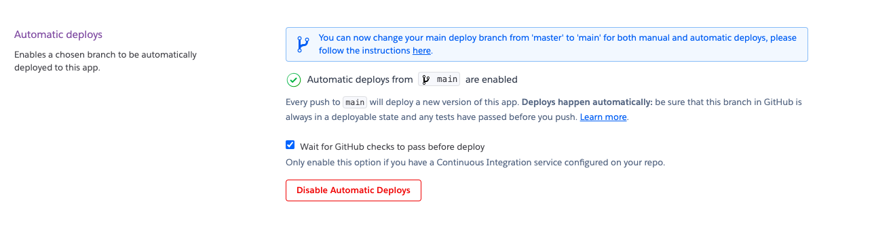

Bandit skips the test files, whose made-up passwords it would flag.
Every other line it flags but that is safe carries a `# nosec` marker
with a comment saying why, so each exception can be checked.

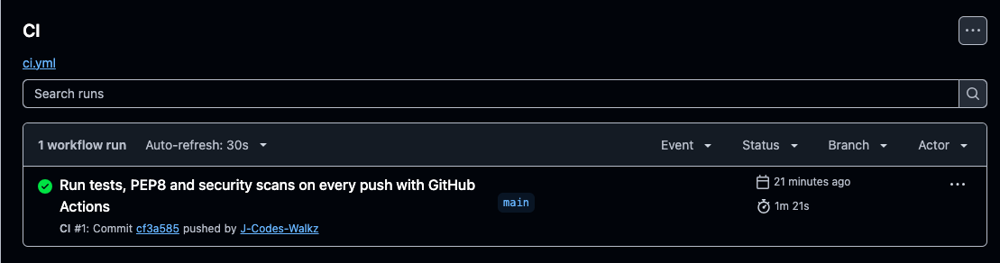

## Deployment

### Local setup

```bash
python -m venv .venv
source .venv/bin/activate          # Windows: .venv\Scripts\activate
pip install -r requirements.txt
createdb cardvault                 # a local PostgreSQL database
# create .env with the four variables below
python manage.py migrate
python manage.py loaddata pokemon_cardsets
python manage.py loaddata base_set_cards
python manage.py loaddata tester_cards
python manage.py createsuperuser
python manage.py test
python manage.py runserver
```

The `.env` file holds four variables, one per line in the form
`NAME=value`:

| Variable | Locally | On Heroku |
|---|---|---|
| `SECRET_KEY` | A new random key (see step 3 of the Heroku steps below for the command) | A config var |
| `DEBUG` | `True` | `False`, or not set |
| `DATABASE_URL` | The address of your local PostgreSQL database, with your own database username and password | Set by Heroku Postgres itself |
| `ALLOWED_HOSTS` | Not needed while `DEBUG` is `True` | The app's address, for example `your-app-name.herokuapp.com` |

`.env` is never committed: `.gitignore` ignores every `.env` file.
(An example file with blank values, `.env.example`, was removed on
30 October 2026 on an assessor's advice, so that no file named like
an environment file is in the public repository; see
[issue #73](https://github.com/J-Codes-Walkz/CardVault/issues/73).)
The settings that read these variables are in
**[docs/SETTINGS_SNIPPET.md](./docs/SETTINGS_SNIPPET.md)**.

### Heroku

**Deployed on 12 October 2026** as the app `cardvault` (EU region,
Basic dyno, Heroku Postgres `essential-0`) at
[https://cardvault-0a18b8d773ca.herokuapp.com/](https://cardvault-0a18b8d773ca.herokuapp.com/).
The steps below are the ones that were followed, using the Heroku
CLI. After the first deploy the live site was checked for: HTTP
redirecting to HTTPS, static files loading, a non-existent URL
returning a plain 404 rather than a debug page, and a full register,
log out and log in.

1. **Create the app.**
   ```bash
   heroku create your-app-name
   ```
2. **Add Heroku Postgres** (the Essential tier is the cheapest paid
   option; there is no longer a free tier):
   ```bash
   heroku addons:create heroku-postgresql:essential-0
   ```
   This sets the `DATABASE_URL` config var automatically &mdash; you
   don't set it yourself.
3. **Set the remaining config vars:**
   ```bash
   heroku config:set SECRET_KEY="$(python -c 'from django.core.management.utils import get_random_secret_key; print(get_random_secret_key())')"
   heroku config:set DEBUG=False
   heroku config:set ALLOWED_HOSTS=your-app-name.herokuapp.com
   ```
4. **Push to deploy:**
   ```bash
   git push heroku main
   ```
   The `Procfile`'s `release` line runs `migrate` automatically on
   every deploy, so the schema stays in sync without a manual step.

   **Since 14 October 2026 deploys are automatic from GitHub.** On the
   app's Deploy tab in the Heroku dashboard, the deployment method is
   GitHub (repository `J-Codes-Walkz/CardVault`), with **Automatic
   deploys** from `main`. Every push to `main` on GitHub now deploys by itself,
   so `git push heroku main` is no longer needed. Each deploy is also
   recorded on GitHub, under **Deployments** on the repository's main
   page and as an environment under Settings &rarr; Environments.

   **Bug found while setting this up:** **Wait for CI to pass before
   deploy** was ticked, but the repository had no CI yet. GitHub then
   reports every commit's checks as "pending" for ever, so Heroku
   received each push and never deployed it. The option was switched
   off until the GitHub Actions workflow (issue #39) was running, then
   switched back on on 19 October 2026, so a commit with failing tests
   can never reach the live site (see
   [Continuous integration](TESTING.md#continuous-integration)).
5. **Create a superuser on Heroku** (one-off, after the first
   deploy):
   ```bash
   heroku run python manage.py createsuperuser
   ```
6. **Seed the catalogue** (US27) from
   `cards/fixtures/pokemon_cardsets.json`:
   ```bash
   heroku run python manage.py loaddata pokemon_cardsets
   heroku run python manage.py loaddata base_set_cards
   heroku run python manage.py loaddata tester_cards
   ```
   The tester cards (AAA, BBB and CCC) were loaded on the live site on
   14 October 2026 for front-end CRUD testing.
   (Or add the cards through `/admin/` instead &mdash; see
   [Populating the catalogue](./docs/DATABASE_SCHEMA.md#populating-the-catalogue).)
7. **Verify production settings**: visit a URL that doesn't exist on
   the live app and confirm you get the custom 404 page, not a Django
   debug page. If you see a debug page, `DEBUG` is still `True` on
   Heroku &mdash; fix the config var before doing anything else.

### Forking/cloning

```bash
git clone https://github.com/<your-username>/<your-repo>.git
cd <your-repo>
# then follow "Local setup" above
```

## Credits

### Code

- Built with [Django](https://www.djangoproject.com/) 5.2 LTS and
  [PostgreSQL](https://www.postgresql.org/).
- Register, log in and log out use
  [django-allauth](https://docs.allauth.org/). Its templates, message
  wording and login form are overridden in `templates/account/`,
  `accounts/adapter.py` and `accounts/forms.py`.
- Deployment uses [Whitenoise](https://whitenoise.readthedocs.io/)
  for static files and [Gunicorn](https://gunicorn.org/) as the
  application server, following
  [Heroku's Python support docs](https://devcenter.heroku.com/categories/python-support).
- The sticky-footer CSS (`html, body` at full height, with the main
  content growing to push the footer down) came from Jamie's Code
  Institute mentor; one selector in it was corrected from `.html,
  body` to `html, body`.
- Patterns followed from the official documentation rather than
  copied snippets: Django's class-based views and `get_queryset()`
  for limiting every page to the logged-in user's own records
  ([Django docs](https://docs.djangoproject.com/en/5.2/topics/class-based-views/)),
  django-allauth's rate limits and `ALLAUTH_TRUSTED_PROXY_COUNT`
  ([allauth docs](https://docs.allauth.org/en/latest/account/rate_limits.html)),
  and the CSS `:has()` selector and `prefers-reduced-motion`,
  `prefers-contrast` and `prefers-color-scheme` media queries
  ([MDN Web Docs](https://developer.mozilla.org/en-US/docs/Web/CSS)).
- Colour contrast was calculated with the WCAG 2.2 formula for
  relative luminance ([W3C](https://www.w3.org/TR/WCAG22/#dfn-contrast-ratio)).

### Tools used for testing

- [axe-core](https://github.com/dequelabs/axe-core),
  [Lighthouse](https://developer.chrome.com/docs/lighthouse) and
  [WAVE](https://wave.webaim.org/) for accessibility and performance;
  the [W3C Nu HTML Checker](https://validator.w3.org/nu/) and
  [Jigsaw CSS validator](https://jigsaw.w3.org/css-validator/).
- [flake8](https://flake8.pycqa.org/),
  [Bandit](https://bandit.readthedocs.io/),
  [pip-audit](https://pypi.org/project/pip-audit/) and
  [coverage.py](https://coverage.readthedocs.io/) for the Python code.
- [graphify](https://github.com/Graphify-Labs/graphify) for the
  project mind map.

### Content

- Card data and card images: the
  [Pok&eacute;mon TCG API](https://pokemontcg.io), a free,
  community-run, unofficial API. It was called **once**, by
  `scripts/build_base_set_fixture.py`, to build
  `cards/fixtures/base_set_cards.json` (the 102 Base Set cards). The
  live site never calls the API, so it keeps working if the API goes
  down. Card pictures are linked from the API's image host,
  `images.pokemontcg.io`; if that server cannot be reached, a small
  script (`static/js/image-fallback.js`) shows CardVault's own
  placeholder instead. Pok&eacute;mon card names
  and artwork belong to their owners (see the disclaimer at the top of
  this README).
- Emblem, favicon, Poké Ball rating icons and the placeholder card
  image: original drawings made for this project as SVG. The Poké
  Ball design itself belongs to Nintendo, Creatures and Game Freak;
  it is used here in a simple fan-made style for a non-commercial,
  educational project (see the disclaimer at the top of this README).
- Rarity symbols (● ◆ ★): the shapes used on 1999 Base Set cards.
- Font: [Poppins](https://github.com/itfoundry/Poppins) by the
  Indian Type Foundry, under the SIL Open Font License
  (`static/fonts/OFL.txt`), served from this site.

### Acknowledgements

- Learning outcomes and checklist: Code Institute, *CI Bootcamps |
  Capstone Project &mdash; Pre-Submission Checklist*.
- Project concept inspired by [Collectr](https://app.getcollectr.com/)
  (not affiliated; CardVault is an independent, from-scratch build
  for a learning capstone, not a clone of Collectr's code or design).

## Usage of AI

AI (Claude, via Claude.ai for planning and Claude Code for building) was used throughout this project as a
collaborator for planning, debugging, and reviewing &mdash; not as a
replacement for understanding the code. Screenshots of the conversations themselves, 50 of them in date order
with what each one shows, are in
**[docs/AI_CONVERSATIONS.md](./docs/AI_CONVERSATIONS.md)**.

The log below covers the
three areas the checklist asks about, **debugging**, **developing
features** and **automated tests**, plus planning, design, security
and code quality. Each entry names the actual problem, what the AI
suggested, and what was checked or changed as a result, including
the AI's own mistakes.

| Date | Used for | What happened |
|---|---|---|
| 2026-10 | Planning | Designed the initial PostgreSQL schema (6 tables, constraints and relationships) from a plain-language feature description; generated the ERD, the 32 MoSCoW user stories, low-fidelity wireframes for 8 key screens, and this documentation set (README, database/testing/deployment docs) against the Code Institute capstone checklist. |
| 2026-10 | Planning | Simplified the schema from 6 tables to 4 (dropped the custom `User` model, the `CardSet` table, and merged `CollectionItem`/`WishlistItem` into one `CollectionEntry` with a `status` field) after judging the original over-engineered for what the checklist actually asks for; regenerated the ERD, the user stories (32 &rarr; 28), the wireframes, this README and the rest of `docs/` to match. |
| 2026-10-12 | Planning (Agile) | Claude Code created the GitHub labels, three sprint milestones, 28 user-story issues and 8 task issues from `docs/github-issues.csv`, then built the public Projects board with the GitHub CLI. Claude proposed which stories go in which sprint; I set the Wednesday target for Sprint 1 and supplied the submission deadline. |
| 2026-10-12 | Developing features | Claude Code scaffolded the Django project and the `accounts`, `cards` and `collection` apps, wrote the settings, the four models and their admin, and the django-allauth templates. I chose django-allauth rather than hand-written auth views. I left the `CardSet` decision to Claude, which brought the table back to match my Base Set fixture. Changed from the original plan: a new user is logged in straight after registering (allauth's normal behaviour) instead of being sent to the login page, so US01 and the notification messages were updated to match. |
| 2026-10-12 | Debugging | Caught before it bit: the planned static-file setting (Whitenoise's hashed-filename storage everywhere) breaks any test that renders a template, because the test runner never runs `collectstatic`. Fix: use that storage only in production and Django's plain storage when `DEBUG` or the test runner is active. Also removed allauth's "Forgot your password?" link, which pointed at an email reset that cannot work without email addresses. |
| 2026-10-12 | Automated tests | Claude Code wrote 45 tests alongside the Sprint 1 code. Verified by running `python manage.py test` (all pass) and by a real register, log out, failed log in and log in against the running site. |
| 2026-10-12 | Deployment | Claude Code created the Heroku app and Postgres add-on with the Heroku CLI, set the config vars (a new `SECRET_KEY` generated straight into Heroku, `DEBUG=False`, `ALLOWED_HOSTS`), deployed with `git push heroku main` and loaded the Base Set fixture. It then tested the live site by registering, logging out and logging in with a throwaway account, which it deleted afterwards. I signed in to GitHub and Heroku myself; no password or key was shared with the AI. |
| 2026-10-12 | Planning (mind map) | Used the graphify skill in Claude Code to build a knowledge graph of the project (`graphify-out/`). Code was parsed structurally; docs, templates and wireframes were read by AI sub-agents. Before committing, the outputs were scanned to confirm they contain no secrets and no local file paths. |
| 2026-10-14 | Debugging | Heroku stopped deploying after the GitHub connection was made. Claude Code checked GitHub's webhook deliveries (Heroku received every push) and the commit status ("pending", with no checks at all), and found "Wait for CI to pass" was waiting for a CI that does not exist yet. Logged as bug #41 and fixed by switching the option off until #39. |
| 2026-10-14 | Debugging | Acted on an assessor's masterclass feedback: logged each point as a bug issue (#43 to #46), then fixed them (trimmed `.gitignore`, single-line Python, no table of contents, capitalised Markdown names). Claude also spotted that the mentor's sticky-footer CSS selector `.html, body` should be `html, body`. |
| 2026-10-14 | Developing features | Claude Code built the front-end CRUD (browse and search cards, card pages, add/edit/remove My Cards entries, 1 to 5 star reviews with comments) and the responsive header and footer. I chose the scope (frontend CRUD with tester cards AAA, BBB, CCC) and the sticky footer. |
| 2026-10-14 | Automated tests | Claude Code wrote 51 more tests (96 in total), including two-user tests proving one user cannot edit or delete another's records. It then drove a real Chrome browser through every user action on the live site (39 checks, all passing) and took the screenshots used in this README and TESTING.md. It found and fixed a table layout bug on My Cards that the unit tests could not see. |
| 2026-10-15 | Developing features | Decided with Claude to drop card prices (currencies and exchange rates were out of proportion to the project) and to build the Base Set once from the Pokémon TCG API. Claude Code wrote `scripts/build_base_set_fixture.py`; when the API kept returning server errors it switched to pages of 25 with retries, and when the API gave the six Energy cards no rarity it marked them Common, as printed, rather than guessing silently. |
| 2026-10-15 | Debugging | The browser test reported only 4 of 12 card pictures loading. Rather than accept or hide it, Claude checked each image: all 12 load in a fresh tab, and the headless browser was treating the long-running test tab as in the background, so lazy images never started. Fixed in the test harness (focus emulation), not the site. |
| 2026-10-15 | Security | Asked Claude to review security end to end. It added a Content Security Policy and Permissions Policy, routed the Django admin log in through allauth's rate limiting, moved rate limits to a shared database cache, scanned the git history for secrets, ran `pip-audit`, and turned on Dependabot, CodeQL and a branch rule on GitHub. 12 security tests added. |
| 2026-10-15 | Design | Used the grilling skill in Claude Code to agree the brand in four short rounds of questions (look, colours, dark mode, logo, ratings, badges, motion, intro). Jamie chose dark mode against my first recommendation, asked for a card-back emblem with a ship-wheel vault lock instead of a Poké Ball logo, and the 1999 rarity symbols. Claude checked every colour pair for contrast before writing any CSS, drew the emblem and icons as SVG, and kept the intro from becoming a gate page. |
| 2026-10-15 | Debugging | A keyboard-only test of the new Poké Ball picker found that Tab landed on the 5th ball and the left arrow moved right, a side effect of the CSS trick first used to fill the balls. Rebuilt with the CSS `:has()` selector in natural 1 to 5 order (after checking the CSS validator accepts it), then re-tested with real key presses and mouse clicks. |
| 2026-10-16 | Design | Asked Claude to make the rarity symbols in the home page banner float rather than sit still. Claude pointed out that endless movement needs a way to pause it (WCAG 2.2.2) and that the Accessibility page promised movement "never loops", so it added a "Pause animation" button, updated that page, and checked that the button never covers the banner's text from 320px up, that pausing really stops the symbols, and that reduced motion still switches everything off. |
| 2026-10-16 | Developing features | Asked Claude for a Home link and a Contact page (name, email, message, and a thank-you banner telling people to check their junk folder), and whether an automatic no-reply email was worth it. Claude advised against the email for now: anyone can type any address, so the form could be used to send mail to strangers, new senders often land in junk, and it would mean keeping a mail password on Heroku. I agreed to save messages for the admin instead and reply by hand from a dedicated mailbox. Claude built a `contact` app with a hidden bot trap and a 5-an-hour limit (storing a hash of the IP address, not the address), 19 tests, and updated the Privacy page, which had said we never ask for an email address. A browser check found the extra links pushed the logged-in header onto two rows at tablet widths, so the Menu button now appears below 1024px. |
| 2026-10-19 | Security | Asked Claude to harden the site against password guessing and heavy traffic, cut log in tries to 3, and manage the database properly. Claude found that the existing per-IP limits never saw real visitors on Heroku: every request arrives from Heroku's router, so all visitors shared one count and 10 wrong passwords could pause logging in for everyone (bug #66). It set `ALLAUTH_TRUSTED_PROXY_COUNT`, wrote tests proving a faked `X-Forwarded-For` does not help, capped searches that could build huge queries (bug #67), added a 10-second query limit, threaded gunicorn workers and a branded 429 page, and found the live database had no backups, so scheduled daily ones and checked the first contained every table. It load tested the live site and, when a heavier run stalled, checked Heroku's router logs and concluded the stalled requests never reached Heroku. That turned out to be wrong (see the 29 October entry on the conversation screenshots). |
| 2026-10-19 | Developing features | Built the custom error pages (US25) with Claude. Claude made the 500 page plain HTML because Django renders it without context, and noticed while writing it that the page's promise ("the problem has been recorded") was untrue: with `DEBUG` off, Django logged nothing, so live crashes left no trace (bug #69). It added logging, then ran the site locally in production mode, starting a second copy pointed at a database that does not exist to cause a real 500. A first run showed every page failing; rather than change the site, Claude traced it to its own mistake (static files collected with `DEBUG` on) and redid the check properly. |
| 2026-10-19 | Automated tests | Asked Claude to set up the CI workflow (#39), adding free security scans because CodeQL stops while the repo is private. Before writing the workflow, Claude ran Bandit and pip-audit locally and went through all 21 Bandit findings: 12 were made-up passwords in tests (tests excluded from the scan), and the other 9 were checked line by line and each marked `# nosec` with the reason it is safe. When Bandit said one marker was unnecessary, Claude removed it, saw the finding come back, and restored it rather than trusting the warning. The workflow passed first time: 191 tests in 40 seconds. |
| 2026-10-26 | Developing features | Built US15 to US17 (My Cards totals, sort and filter, Got it!) with Claude, following the acceptance criteria already in the user stories. Claude worked out the database cost first (an existing test fixes how many queries My Cards makes) and kept it fixed, with the totals in one query. Its browser check measured every Got it! button against its table cell and found the button spilling into the Quantity column on wide screens, which the tests could not see; it moved the button onto its own line and re-measured at five widths. A first HTML check validated an error page by mistake (the test client was refused by the host check); Claude noticed the expected content was missing and redid it. |
| 2026-10-28 | Developing features | Built US28 with Claude after I realised I did not know how to reach or use the Django admin myself. Claude limited the admin to superusers (Django lets any "staff" account in), added an Admin link only superusers see, renamed the admin for CardVault, removed allauth's always-empty Email addresses section, added a picture preview for checking card fixes, and wrote the walkthrough above so I can run the site and show an assessor how. Its screenshots showed an "Add contact message" button, which made no sense for messages that only come from visitors, so that was removed and tested too. Checking my own superuser on the live site was blocked by Claude Code's permission rules for reading production data, so I ran the commands myself. |
| 2026-10-28 | Debugging | Ran Lighthouse on every public page with Claude. Google's PageSpeed service had run out of its shared daily allowance, so Claude installed Node and Lighthouse into the test folder (checksum-verified, nothing installed system-wide). The batch runs then failed twice with "command not found". Claude first blamed the background shell's environment, then traced the real cause: the script used a variable called `path`, which zsh ties to the command search path, so every run wiped it. Renaming the variable fixed it. Lighthouse asked for higher-resolution card images; Claude measured them (845 KB against 161 KB) and advised keeping the small ones, recording the 96 Best Practices score as a trade-off. WAVE flagged one contrast error, which Claude proved was the intro button being measured while still invisible. |
| 2026-10-29 | Automated tests | Ran Lighthouse on My Cards with Claude, which needs a logged-in user. Claude's first script registered a throwaway account but failed to delete it afterwards (it looked for the delete form by an `action` attribute the form does not have), and the random password was lost with the browser, so the leftover account had to be deleted by hand in the Django admin, by me as the site owner. Claude fixed the script to save the password until the account was gone, use the real delete button, and prove the deletion by trying to log in again. My Cards then scored 100 in every category on mobile and desktop. |
| 2026-10-29 | Code quality | Asked Claude to bring the code commenting up to the standard assessors look for. Claude audited every Python file with a script and found 99 modules, classes and functions without docstrings, then added PEP 257 docstrings, each describing what that particular override does rather than repeating the code. Its first pass put two docstrings between a decorator and its function, a syntax error flake8 caught at once, so it rolled back and fixed the script. A second check then found its own blank lines above class docstrings and some awkwardly wrapped lines, which it also fixed. Every template gained a `{# #}` header comment, checked not to reach the browser. |
| 2026-10-29 | Planning (mind map) | Refreshed the knowledge graph with Claude for the end of the sprints (#38). Claude recovered the 12 and 14 October graphs from the git history to screenshot them, so the README shows how the map grew. To save tokens it left icons and the font licence out of the graph, and had two helpers read the 39 changed documents in parallel (134,463 tokens). Before committing it checked the three output files contain no local file paths, email addresses, secrets or admin usernames, and recorded where the graph's inferred links are wrong. |
| 2026-10-29 | Planning (mind map) | Asked Claude to check whether the mind map can be trusted, starting with the 19 links it guessed for the `Card` model. Claude wrote a script that reads every class and function in the code for a reference to `Card`, and compared the two: all 19 claimed links were correct, but the graph missed 2 real uses. Rather than stop there, it formed two explanations and tested them on the other models: graphify never links a reference inside a decorator (none of the four admin classes) or to a class in the same file (`Card` to `CardSet`), but always links one made through an import. Recorded in the mind map section. |
| 2026-10-29 | Automated tests | Finished the testing write-up (#36) with Claude. It ran a coverage report for the first time (99% of the site's code; the rest is production-only settings) and found three small untested paths, which it covered with new tests. It added a table giving every user story's manual test and result, and re-checked three stories with fresh evidence: reviews on the live site (US21), loading the catalogue twice into a brand-new database with no duplicates (US27), and a full secret scan of all 60 commits (US26). A link check then exposed a mistake from its own earlier edit: adding the Load testing section had deleted the Validators heading, which it restored. |
| 2026-10-29 | Documentation | Asked Claude for an architecture diagram and a tidy of the Agile section for the submission checklist (#70). Claude first read which apps actually import from which, then drew three Mermaid diagrams (the whole system, how the code is organised, and one request from start to finish) and rendered all five diagrams in the README in Chrome with the same Mermaid library GitHub uses, to prove they draw. It rewrote the Agile section from setup instructions into an account of what was done, with the real issue and milestone counts from GitHub; checking those against GitHub caught one error before it was committed (the error pages were in Sprint 3, not Sprint 2). |
| 2026-10-30 | Debugging | Final review before submission with Claude. It re-ran every check (229 tests, flake8, the W3C validators on nine live pages, every link and image in the docs, the live security headers and backups) and found the docs out of date in places: USER_STORIES.md had every acceptance criterion unticked although each was ticked on its GitHub issue (Claude compared all 267 one by one before ticking 266; the VoiceOver check stays unticked, as it was not done), and some pages still described ratings as stars. While validating, it noticed allauth's password reset page still answered, although bug #42 had removed its link. Testing it locally showed that sending the form crashes (the site has no mail server), and that a logged-in user could add an email address at `/accounts/email/`, against the Privacy page. Logged as bug #72; those pages now show the 404 page, the site cannot send email at all, and 5 new tests failed before the fix and pass after it. |
| 2026-10-30 | Security | An assessor advised removing `.env.example` from the public repository, even though it held only blank values and placeholders. Claude logged it as issue #73, stopped tracking the file (keeping my local copy, now ignored by git), removed the `.gitignore` exception so no `.env` file of any kind can be committed, and moved the variable names into a table in Local setup so the setup steps still work. It pointed out that the file stays in the git history, holding no secrets, and advised against rewriting the history so close to the deadline: that would need a force push past the branch rule and would break the commit links in these docs. |
| 2026-10-29 | Documentation | Gave Claude my folders of screenshots from the project to sort for the submission. Claude read all 56 conversation screenshots one by one, kept 50 with a description of each in docs/AI_CONVERSATIONS.md, and chose 10 of my 44 manual-test screenshots for TESTING.md. It covered personal details with a script using the Mac's own text recognition (my email, the Mac's username, a one-time login code), then scanned every image again, including the 90 already in the repo, and found the Mac's username in two terminal screenshots committed earlier, which it replaced. Reading Heroku's metrics from that week, it noticed they contradict its own 19 October conclusion about the load test: the 50 stalled requests most likely did reach Heroku and timed out. It corrected TESTING.md and the README rather than leave the earlier claim. |
