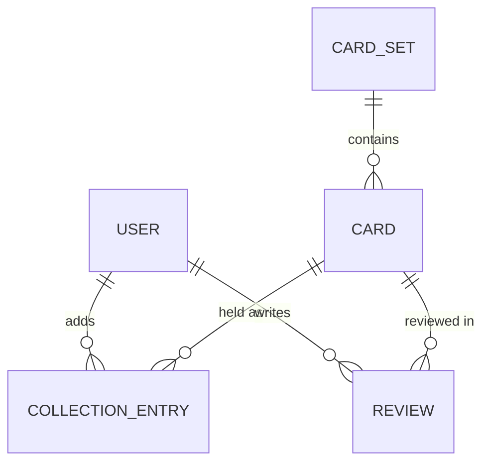

# CardVault

A full-stack web app for Pok&eacute;mon card collectors: track the
cards you own, keep a wishlist of the ones you want, and read and
write reviews &mdash; built with Django and PostgreSQL, and deployed
to Heroku. The project exists to demonstrate full CRUD (Create, Read,
Update, Delete) behind a real login system, as the Code Institute
capstone checklist requires.

**Live site: [cardvault-0a18b8d773ca.herokuapp.com](https://cardvault-0a18b8d773ca.herokuapp.com/)**

Found a bug? Open an issue with the **Bug report** template. Found a
security problem? Please report it privately, as described in the
[security policy](./SECURITY.md).

> Educational project. Not affiliated with, endorsed by or
> sponsored by Nintendo, Game Freak or The Pok&eacute;mon Company.
> "Pok&eacute;mon" and all card names are trademarks of their
> respective owners, used here for identification only.

## UX design

### Purpose and audience

CardVault is for Pok&eacute;mon TCG collectors who currently track
their collection in a spreadsheet, a notes app, or memory. The site
has one job on arrival: make it obvious that you can create an
account and start tracking cards in under a minute. Every page
answers three questions the checklist asks for directly: what is this
for, can I tell if I'm logged in, and can I get back to where I need
to be.

### User stories

The full set of 32 user stories, written as `As a / I want / so that`
with acceptance criteria, development tasks and a manual test for
each, lives in **[docs/USER_STORIES.md](./docs/USER_STORIES.md)**.
They're prioritised with MoSCoW:

| Priority | Count |
|---|---|
| Must have | 24 |
| Should have | 6 |
| Could have | 2 |

Ideas that came up but were deliberately left out of this submission
are in **[docs/POTENTIAL_UPSCALE.md](./docs/POTENTIAL_UPSCALE.md)**
("Should if / Could if / Won't if"), answering the "what ifs" a tutor
is likely to ask.

### Wireframes

Low-fidelity wireframes for the core screens, covering desktop and
mobile layouts, logged-in and logged-out states, and the success/error
messages from each user story:

| # | Screen | |
|---|---|---|
| 1 | Home (logged out) | [docs/wireframes/01-home.svg](./docs/wireframes/01-home.svg) |
| 2 | Register and log in | [docs/wireframes/02-register-login.svg](./docs/wireframes/02-register-login.svg) |
| 3 | Browse cards (catalogue, search, filters) | [docs/wireframes/03-catalogue.svg](./docs/wireframes/03-catalogue.svg) |
| 4 | Card detail (add to My Cards, reviews) | [docs/wireframes/04-card-detail.svg](./docs/wireframes/04-card-detail.svg) |
| 5 | My Cards (Owned/Wanted tabs, summary, table, CRUD) | [docs/wireframes/05-my-cards.svg](./docs/wireframes/05-my-cards.svg) |
| 6 | Edit/delete forms and message banners | [docs/wireframes/06-forms-confirmations.svg](./docs/wireframes/06-forms-confirmations.svg) |
| 7 | Mobile layouts (nav menu, stacked My Cards) | [docs/wireframes/07-mobile.svg](./docs/wireframes/07-mobile.svg) |

Home page, as an example:


Blue tags on every wireframe (e.g. `US11`) link that part of the
screen back to its user story in `docs/USER_STORIES.md`.

Wireframes 4 and 5 still show a card price and a collection value.
Prices were dropped on 15 October 2026
([issue #48](https://github.com/J-Codes-Walkz/CardVault/issues/48)),
so the built pages differ there; the wireframes are kept as the
record of the original plan.

*Replace the wireframes above with real screenshots here as each
screen is built, and keep the wireframes in `docs/wireframes/` for
the record of how the design evolved &mdash; the checklist's Features
section asks for screenshots of the finished site, not the plan.*

### Design notes

- **Palette:** neutral greys and a near-black primary action colour,
  so uploaded card images (which are already colourful) stay the
  visual focus rather than competing with a bright UI.
- **Typography:** one system sans-serif font stack, two weights
  (regular body text, bold for headings and card names) &mdash; kept
  deliberately simple so it is easy to re-skin later without a
  rewrite.
- **Layout:** a responsive grid for card tiles (4 columns desktop, 2
  tablet, 1 mobile), a conventional table for My Cards on
  desktop that becomes stacked cards on mobile (see wireframe 7).

## Database design

PostgreSQL in every environment, reached entirely through Django's
ORM. Full write-up, the entity-relationship diagram and the reasoning
behind each constraint are in
**[docs/DATABASE_SCHEMA.md](./docs/DATABASE_SCHEMA.md)**.



Five tables, deliberately kept simple: `User` (Django's built-in auth,
with no custom fields), `CardSet` and `Card` (shared reference data,
seeded from a fixture or Django admin rather than user-entered), and
two user-owned tables that carry full CRUD &mdash; `CollectionEntry`
(a card the user owns or wants, told apart by a `status` field) and
`Review`. The models live in `cards/models.py` and
`collection/models.py`. What was considered and set aside (a custom
user model, and owned/wanted as two tables instead of one), and why
`CardSet` was cut and then brought back, is explained in
[Why simplify](./docs/DATABASE_SCHEMA.md#why-simplify).

## Project mind map

A knowledge graph of the whole project (code, templates, docs and
wireframes) is kept in `graphify-out/`, built with
[graphify](https://github.com/Graphify-Labs/graphify). It is used as a
mind map: it shows which models, tests, user stories and wireframes
connect to each other, and which parts everything else depends on.

| File | What it is |
|---|---|
| [graphify-out/graph.html](./graphify-out/graph.html) | The interactive graph. GitHub shows this file as source code, so download it (or clone the repo) and open it in a browser. It loads one script from the internet, so it needs a connection. |
| [graphify-out/GRAPH_REPORT.md](./graphify-out/GRAPH_REPORT.md) | A plain-language report: the most connected nodes, surprising connections and questions worth asking. |
| [graphify-out/graph.json](./graphify-out/graph.json) | The raw graph data. |

First built on 12 October 2026 from 56 files (336 nodes, 578 links,
19 clusters) and updated on 14 October 2026 after the front-end CRUD
work: it now has 597 nodes, 1,120 links and 48 clusters. The most
connected nodes are the README, the user stories, TESTING.md and the
`Card`, `CollectionEntry`, `CardSet` and `Review` models, which
matches the design: the CRUD stories are built on those tables. Links
the report marks as "inferred" were reasoned by the AI rather than
read directly from a file, so treat the graph as a guide, not a
complete map. Screenshots are left out of the graph (see
`.graphifyignore`), because they are test evidence rather than
project structure.

To refresh it after new work, run `/graphify . --update` in Claude
Code. Only the three files above are committed; the cache stays local
(see `.gitignore`).

*Add a screenshot of the graph here.*

## Features

Everything below is live on
[the Heroku site](https://cardvault-0a18b8d773ca.herokuapp.com/) and
was tested there on 14 October 2026 (see [TESTING.md](./TESTING.md)).
Screenshots are from that test run, using the Base Set and the AAA, BBB and CCC tester
cards.

### Accounts

- **Register** (US01): username, password and password confirmation
  through django-allauth. A new user is logged in straight away with
  "Your account has been created. Welcome to CardVault,
  &lt;username&gt;!". A taken username, a weak password (naming the
  rule it broke) or mismatched passwords each show an error and
  create no account.
- **Log in and log out** (US02, US03): "Welcome back,
  &lt;username&gt;!" and "You have been logged out. See you soon!".
  A wrong password shows one generic error that does not reveal
  which part was wrong. Log out is a POST form with a CSRF token.
- **Always know if you are logged in** (US04): the navigation shows
  "Logged in as &lt;username&gt;", My Cards and Log out, or Log in
  and Register.
- **Private data stays private** (US05): logged-out visitors are sent
  to Log in with "Please log in to view that page.", and another
  user's entries and reviews return a 404 page.


### Browsing cards

- **Home page** (US06): says what the site is for, with Create
  account and Browse cards buttons (Go to My Cards when logged in)
  and a row of featured cards.
- **Catalogue** (US07): a responsive grid, 12 cards a page with
  page links; a placeholder image when a card has no picture.
- **Search** (US08): partial, case-insensitive name search with a
  result count and a clear-search link.
- **Card page** (US10): set, number, rarity, average star rating and
  every review.


### My Cards: full front-end CRUD

From any card's page a logged-in user can:

- **Create** (US11): add the card to My Cards as Owned or Wanted, with
  a quantity (at least 1) and notes. Adding a card already on the
  list goes to that entry's edit page instead of creating a second
  one.
- **Read** (US12): My Cards lists every entry with All, Owned and
  Wanted tabs. On phones each row stacks into a labelled card.
- **Update** (US13): change the status, quantity or notes.
- **Delete** (US14): remove the entry after a confirmation page that
  names the card. The card itself stays in the catalogue.


### Reviews: comments and star ratings

- **Create** (US18): rate a card from 1 to 5 stars and write a
  comment. Each user reviews a card once; after that the form is
  replaced by their review with Edit and Delete buttons.
- **Read** (US21): reviews are listed newest first with the
  username, stars, date and comment, under the card's average rating.
- **Update** (US19): edit your own review; it is then marked
  "(edited)".
- **Delete** (US20): delete your own review after a confirmation
  page.


### Privacy, safety and accessibility

- **Age check** (US29): registration asks for a date of birth and
  refuses anyone under 13 ("Sorry, you need to be 13 or older to
  create a CardVault account."), then stays closed for that browser
  session. The date is checked and thrown away, never stored. This
  follows COPPA in the US and the UK Children's Code.
- **Delete my account** (US30): a footer link, a page listing what
  will be deleted, and a password check; then the account, its cards
  and reviews are deleted.
- **Privacy and cookies** (US31): a plain-English page listing what is
  stored, the only two cookies (`sessionid` and `csrftoken`, both
  strictly necessary, so no cookie banner is needed) and the other
  services involved.
- **Accessibility** (US32): works at 200% zoom, switches to a
  high-contrast style when the device asks for it, passes an automated
  WCAG 2.2 AA check on every page, and has an accessibility statement.
  CardVault has no audio or video, so nothing depends on hearing.


### Quality and security

- **Responsive** (US22): mobile first, no sideways scrolling from
  320px up. On phones the navigation collapses behind a Menu button,
  and the footer sits at the bottom of the window on short pages.
- **Feedback on every action** (US24): a success, error or info
  message with a word ("Success:", "Error:") as well as colour, and
  `role="status"` or `role="alert"` for screen readers.
- **Secrets and debug** (US26): every secret read from environment
  variables, `DEBUG` off by default, and a [security policy](./SECURITY.md)
  for reporting vulnerabilities privately.

<p>
  
  
  
</p>

### Still to build

- Filter the catalogue by set and rarity (US09)
- My Cards totals, sorting and a one-click "Got it!" (US15 to US17)
- Custom 404, 403 and 500 pages (US25)
- The favicon and brand (#35)

Every notification message the app shows (login success, duplicate
username, "thank you for your review", and so on) is written out
exactly in **[docs/NOTIFICATION_MESSAGES.md](./docs/NOTIFICATION_MESSAGES.md)**,
so the UI text stays consistent across views as it's built.

## Agile methodology

This project is tracked with a public **GitHub Projects** board and
GitHub Issues, one issue per user story.

**Project board:
[github.com/users/J-Codes-Walkz/projects/5](https://github.com/users/J-Codes-Walkz/projects/5)**
&mdash; four columns (`Backlog`, `To do`, `In progress`, `Done`), with
every user story and development task as an
[issue](https://github.com/J-Codes-Walkz/CardVault/issues), labelled by
MoSCoW priority and epic, and grouped into three sprint
[milestones](https://github.com/J-Codes-Walkz/CardVault/milestones).

1. **Create the board.** On the repository, go to the Projects tab
   and create a new board. Set its visibility to **public** (Settings
   on the board &rarr; Visibility) &mdash; the checklist specifically
   asks for this.
2. **Give it at least three columns.** `Backlog`, `In progress` and
   `Done` is the minimum; `To do` as a fourth (between Backlog and In
   progress) makes sprint planning easier.
3. **Create one issue per user story.** Each issue title starts with
   the story ID, e.g. `US01: Register an account`, with the
   acceptance criteria and tasks from `docs/USER_STORIES.md` pasted
   into the issue body as a checklist. **[docs/github-issues.csv](./docs/github-issues.csv)**
   has every story pre-formatted (title, epic, priority, body), and
   **[scripts/create_github_issues.py](./scripts/create_github_issues.py)**
   creates them all with the GitHub CLI instead of typing 28 issues
   by hand. Create the labels it expects first, preview with
   `--dry-run`, then run it for real:

   ```bash
   gh auth login        # once, if you haven't already

   # Create the labels the script applies (one-off, per repo):
   for lbl in priority:must priority:should priority:could \
              epic:accounts-and-authentication epic:browsing-cards \
              epic:my-cards-owned-and-wanted \
              epic:card-reviews epic:quality-security-and-content; do
     gh label create "$lbl" --color "ededed" 2>/dev/null || true
   done

   python scripts/create_github_issues.py --dry-run   # preview, creates nothing
   python scripts/create_github_issues.py              # actually create all 28
   ```

   Add `--only US01 US02` to create just specific stories.

   **Done on 12 October 2026:** all 28 stories now exist as issues
   #1 to #28 (issue #1 is US01, and so on), followed by eight
   development-task issues, #29 to #36, each naming the stories it
   supports. Running the script again would create duplicates. The
   issues were added to the board with the GitHub CLI
   (`gh project item-add`).

   **Added on 15 October 2026:** four more stories, US29 to US32
   (age check, delete my account, privacy and cookies, accessibility),
   in a sixth epic, "Privacy, safety and accessibility". They are
   issues #52 to #55, so from here on the issue number and the story
   number differ; each issue title still starts with its story ID.
4. **Move cards as you work**: `Backlog` &rarr; `To do` when you
   start a sprint/session, `In progress` while coding, `Done` once
   its manual test passes. The `priority:*` and `epic:*` labels from
   step 3 make the MoSCoW breakdown visible directly on the board,
   not just in the docs &mdash; group or filter the board by label.
5. **Link this README** to the board once it exists, and update the
   "GitHub Projects board" link near the top of
   `docs/USER_STORIES.md`.

### Sprints

Three sprints, tracked as GitHub milestones, ending before the
submission deadline of Monday 2 November 2026, 12:00 midday:

| Sprint | Due | Goal |
|---|---|---|
| 1: Foundations | Wed 14 Oct | Project scaffold, early Heroku deploy, register / log in / log out on the live site, data models, Base Set fixture |
| 2: Core features | Fri 23 Oct | Browse the catalogue, My Cards CRUD, brand and favicon |
| 3: Reviews, polish and testing | Fri 30 Oct | Reviews, should/could-haves, accessibility, validation, testing write-up |

Work runs roughly in epic order, since later epics depend on earlier ones
(you need accounts before My Cards CRUD means anything, and cards
in the catalogue before reviews mean anything):

1. Accounts and authentication (US01&ndash;US05)
2. Browsing cards (US06&ndash;US10) &mdash; needs the catalogue
   seeded first (US27)
3. My Cards (US11&ndash;US17)
4. Reviews (US18&ndash;US21)
5. Quality, security and content polish (US22&ndash;US28) &mdash;
   some of this (US24, US26) is really ongoing throughout, not a
   final step; treat it as a checklist you run against every PR.

## Testing

The full testing write-up is in **[TESTING.md](./TESTING.md)**: manual tests for every user story, the automated test suite, validator results (HTML, CSS, Python) and every bug found, each logged as a GitHub issue labelled [`bug`](https://github.com/J-Codes-Walkz/CardVault/issues?q=label%3Abug).

## Deployment

### Local setup

```bash
python -m venv .venv
source .venv/bin/activate          # Windows: .venv\Scripts\activate
pip install -r requirements.txt
createdb cardvault                 # a local PostgreSQL database
cp .env.example .env               # then fill in SECRET_KEY and DATABASE_URL
python manage.py migrate
python manage.py loaddata pokemon_cardsets
python manage.py loaddata base_set_cards
python manage.py loaddata tester_cards
python manage.py createsuperuser
python manage.py test
python manage.py runserver
```

`.env` is never committed (see `.gitignore`); `.env.example` lists
the variable names only. The settings that read these variables are
in **[docs/SETTINGS_SNIPPET.md](./docs/SETTINGS_SNIPPET.md)**.

### Heroku

**Deployed on 12 October 2026** as the app `cardvault` (EU region,
Basic dyno, Heroku Postgres `essential-0`) at
[https://cardvault-0a18b8d773ca.herokuapp.com/](https://cardvault-0a18b8d773ca.herokuapp.com/).
The steps below are the ones that were followed, using the Heroku
CLI. After the first deploy the live site was checked for: HTTP
redirecting to HTTPS, static files loading, a non-existent URL
returning a plain 404 rather than a debug page, and a full register,
log out and log in.

1. **Create the app.**
   ```bash
   heroku create your-app-name
   ```
2. **Add Heroku Postgres** (the Essential tier is the cheapest paid
   option; there is no longer a free tier):
   ```bash
   heroku addons:create heroku-postgresql:essential-0
   ```
   This sets the `DATABASE_URL` config var automatically &mdash; you
   don't set it yourself.
3. **Set the remaining config vars:**
   ```bash
   heroku config:set SECRET_KEY="$(python -c 'from django.core.management.utils import get_random_secret_key; print(get_random_secret_key())')"
   heroku config:set DEBUG=False
   heroku config:set ALLOWED_HOSTS=your-app-name.herokuapp.com
   ```
4. **Push to deploy:**
   ```bash
   git push heroku main
   ```
   The `Procfile`'s `release` line runs `migrate` automatically on
   every deploy, so the schema stays in sync without a manual step.

   **Since 14 October 2026 deploys are automatic from GitHub.** On the
   app's Deploy tab in the Heroku dashboard, the deployment method is
   GitHub (repository `J-Codes-Walkz/CardVault`), with **Automatic
   deploys** from `main`. Every push to `main` on GitHub now deploys by itself,
   so `git push heroku main` is no longer needed. Each deploy is also
   recorded on GitHub, under **Deployments** on the repository's main
   page and as an environment under Settings &rarr; Environments.

   **Bug found while setting this up:** **Wait for CI to pass before
   deploy** was ticked, but the repository had no CI yet. GitHub then
   reports every commit's checks as "pending" for ever, so Heroku
   received each push and never deployed it. The option was switched
   off; it goes back on once the GitHub Actions workflow (issue #39)
   is running, so that a commit with failing tests can never reach the
   live site.
5. **Create a superuser on Heroku** (one-off, after the first
   deploy):
   ```bash
   heroku run python manage.py createsuperuser
   ```
6. **Seed the catalogue** (US27) from
   `cards/fixtures/pokemon_cardsets.json`:
   ```bash
   heroku run python manage.py loaddata pokemon_cardsets
   heroku run python manage.py loaddata base_set_cards
   heroku run python manage.py loaddata tester_cards
   ```
   The tester cards (AAA, BBB and CCC) were loaded on the live site on
   14 October 2026 for front-end CRUD testing.
   (Or add the cards through `/admin/` instead &mdash; see
   [Populating the catalogue](./docs/DATABASE_SCHEMA.md#populating-the-catalogue).)
7. **Verify production settings**: visit a URL that doesn't exist on
   the live app and confirm you get the custom 404 page, not a Django
   debug page. If you see a debug page, `DEBUG` is still `True` on
   Heroku &mdash; fix the config var before doing anything else.

### Forking/cloning

```bash
git clone https://github.com/<your-username>/<your-repo>.git
cd <your-repo>
# then follow "Local setup" above
```

## Credits

### Code

- Built with [Django](https://www.djangoproject.com/) 5.2 LTS and
  [PostgreSQL](https://www.postgresql.org/).
- Register, log in and log out use
  [django-allauth](https://docs.allauth.org/). Its templates, message
  wording and login form are overridden in `templates/account/`,
  `accounts/adapter.py` and `accounts/forms.py`.
- Deployment uses [Whitenoise](https://whitenoise.readthedocs.io/)
  for static files and [Gunicorn](https://gunicorn.org/) as the
  application server, following
  [Heroku's Python support docs](https://devcenter.heroku.com/categories/python-support).
- *(Add any tutorial, Stack Overflow answer, or snippet you lean on
  directly, with a link, as you build &mdash; the checklist wants
  externally used code credited specifically, not just frameworks.)*

### Content

- Card data and card images: the
  [Pok&eacute;mon TCG API](https://pokemontcg.io), a free,
  community-run, unofficial API. It was called **once**, by
  `scripts/build_base_set_fixture.py`, to build
  `cards/fixtures/base_set_cards.json` (the 102 Base Set cards). The
  live site never calls the API, so it keeps working if the API goes
  down. Card pictures are linked from the API's image host,
  `images.pokemontcg.io`; if that server cannot be reached, a small
  script (`static/js/image-fallback.js`) shows CardVault's own
  placeholder instead. Pok&eacute;mon card names
  and artwork belong to their owners (see the disclaimer at the top of
  this README).
- Placeholder/UI imagery: *(credit here if you use any stock icons or
  illustrations)*.

### Acknowledgements

- Learning outcomes and checklist: Code Institute, *CI Bootcamps |
  Capstone Project &mdash; Pre-Submission Checklist*.
- Project concept inspired by [Collectr](https://app.getcollectr.com/)
  (not affiliated; CardVault is an independent, from-scratch build
  for a learning capstone, not a clone of Collectr's code or design).

## Usage of AI

AI (Claude, via Claude.ai for planning and Claude Code for building) was used throughout this project as a
collaborator for planning, debugging, and reviewing &mdash; not as a
replacement for understanding the code. Keep adding to this log as
you build, covering all three areas the checklist asks about:
**debugging**, **developing features**, and **automated tests**. A
short line per session is enough; specificity is what makes this
section credible to an assessor.

| Date | Used for | What happened |
|---|---|---|
| 2026-10 | Planning | Designed the initial PostgreSQL schema (6 tables, constraints and relationships) from a plain-language feature description; generated the ERD, the 32 MoSCoW user stories, low-fidelity wireframes for 8 key screens, and this documentation set (README, database/testing/deployment docs) against the Code Institute capstone checklist. |
| 2026-10 | Planning | Simplified the schema from 6 tables to 4 (dropped the custom `User` model, the `CardSet` table, and merged `CollectionItem`/`WishlistItem` into one `CollectionEntry` with a `status` field) after judging the original over-engineered for what the checklist actually asks for; regenerated the ERD, the user stories (32 &rarr; 28), the wireframes, this README and the rest of `docs/` to match. |
| 2026-10-12 | Planning (Agile) | Claude Code created the GitHub labels, three sprint milestones, 28 user-story issues and 8 task issues from `docs/github-issues.csv`, then built the public Projects board with the GitHub CLI. Claude proposed which stories go in which sprint; I set the Wednesday target for Sprint 1 and supplied the submission deadline. |
| 2026-10-12 | Developing features | Claude Code scaffolded the Django project and the `accounts`, `cards` and `collection` apps, wrote the settings, the four models and their admin, and the django-allauth templates. I chose django-allauth rather than hand-written auth views. I left the `CardSet` decision to Claude, which brought the table back to match my Base Set fixture. Changed from the original plan: a new user is logged in straight after registering (allauth's normal behaviour) instead of being sent to the login page, so US01 and the notification messages were updated to match. |
| 2026-10-12 | Debugging | Caught before it bit: the planned static-file setting (Whitenoise's hashed-filename storage everywhere) breaks any test that renders a template, because the test runner never runs `collectstatic`. Fix: use that storage only in production and Django's plain storage when `DEBUG` or the test runner is active. Also removed allauth's "Forgot your password?" link, which pointed at an email reset that cannot work without email addresses. |
| 2026-10-12 | Automated tests | Claude Code wrote 45 tests alongside the Sprint 1 code. Verified by running `python manage.py test` (all pass) and by a real register, log out, failed log in and log in against the running site. |
| 2026-10-12 | Deployment | Claude Code created the Heroku app and Postgres add-on with the Heroku CLI, set the config vars (a new `SECRET_KEY` generated straight into Heroku, `DEBUG=False`, `ALLOWED_HOSTS`), deployed with `git push heroku main` and loaded the Base Set fixture. It then tested the live site by registering, logging out and logging in with a throwaway account, which it deleted afterwards. I signed in to GitHub and Heroku myself; no password or key was shared with the AI. |
| 2026-10-12 | Planning (mind map) | Used the graphify skill in Claude Code to build a knowledge graph of the project (`graphify-out/`). Code was parsed structurally; docs, templates and wireframes were read by AI sub-agents. Before committing, the outputs were scanned to confirm they contain no secrets and no local file paths. |
| 2026-10-14 | Debugging | Heroku stopped deploying after the GitHub connection was made. Claude Code checked GitHub's webhook deliveries (Heroku received every push) and the commit status ("pending", with no checks at all), and found "Wait for CI to pass" was waiting for a CI that does not exist yet. Logged as bug #41 and fixed by switching the option off until #39. |
| 2026-10-14 | Debugging | Acted on an assessor's masterclass feedback: logged each point as a bug issue (#43 to #46), then fixed them (trimmed `.gitignore`, single-line Python, no table of contents, capitalised Markdown names). Claude also spotted that the mentor's sticky-footer CSS selector `.html, body` should be `html, body`. |
| 2026-10-14 | Developing features | Claude Code built the front-end CRUD (browse and search cards, card pages, add/edit/remove My Cards entries, 1 to 5 star reviews with comments) and the responsive header and footer. I chose the scope (frontend CRUD with tester cards AAA, BBB, CCC) and the sticky footer. |
| 2026-10-14 | Automated tests | Claude Code wrote 51 more tests (96 in total), including two-user tests proving one user cannot edit or delete another's records. It then drove a real Chrome browser through every user action on the live site (39 checks, all passing) and took the screenshots used in this README and TESTING.md. It found and fixed a table layout bug on My Cards that the unit tests could not see. |
| 2026-10-15 | Developing features | Decided with Claude to drop card prices (currencies and exchange rates were out of proportion to the project) and to build the Base Set once from the Pokémon TCG API. Claude Code wrote `scripts/build_base_set_fixture.py`; when the API kept returning server errors it switched to pages of 25 with retries, and when the API gave the six Energy cards no rarity it marked them Common, as printed, rather than guessing silently. |
| 2026-10-15 | Debugging | The browser test reported only 4 of 12 card pictures loading. Rather than accept or hide it, Claude checked each image: all 12 load in a fresh tab, and the headless browser was treating the long-running test tab as in the background, so lazy images never started. Fixed in the test harness (focus emulation), not the site. |
| 2026-10-15 | Security | Asked Claude to review security end to end. It added a Content Security Policy and Permissions Policy, routed the Django admin log in through allauth's rate limiting, moved rate limits to a shared database cache, scanned the git history for secrets, ran `pip-audit`, and turned on Dependabot, CodeQL and a branch rule on GitHub. 12 security tests added. |
| | Debugging | *(log each real debugging session: what broke, what you asked AI, what the actual fix was and why &mdash; "AI suggested X, but the real cause was Y" is a stronger log entry than "AI fixed it")* |
| | Developing features | *(log which views/templates/models you built with AI assistance, and what you changed or rejected from its suggestions)* |
| | Automated tests | *(log where AI helped write or review test cases, and how you verified the tests actually test the right thing)* |

A good entry names the actual prompt or problem, not just "used AI
for X" &mdash; for example: *"Asked Claude to review the ownership
check in `CollectionEntryUpdateView`; it pointed out the original
`get_queryset` didn't filter by `request.user`, which would have let
any logged-in user edit any other user's entries by guessing the ID.
Fixed by adding `.filter(user=self.request.user)` and added US05's
two-user test to catch a regression."*
