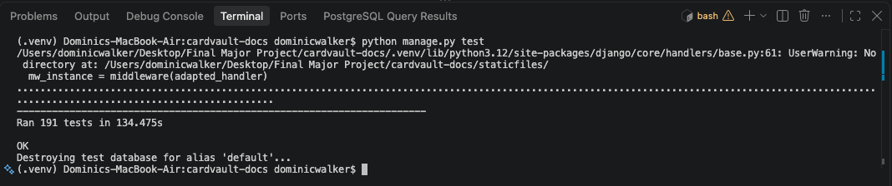
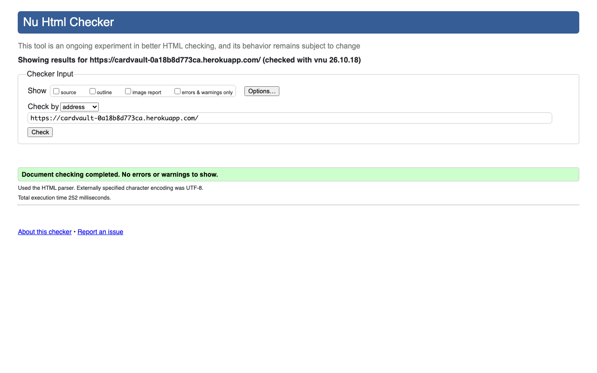
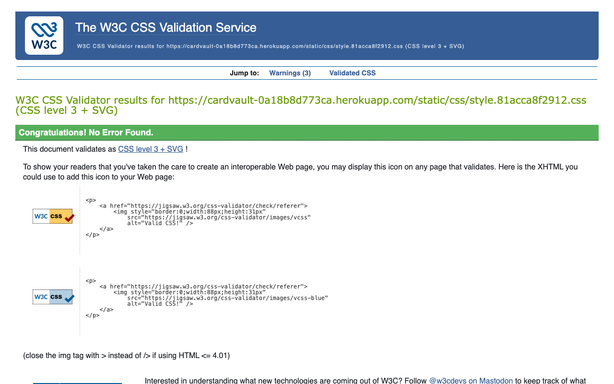
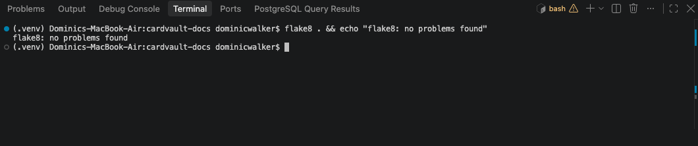

# Testing

Testing for [CardVault](./README.md). Live site:
[cardvault-0a18b8d773ca.herokuapp.com](https://cardvault-0a18b8d773ca.herokuapp.com/).

CardVault is tested in these ways:

| Method | What it covers | Result |
|---|---|---|
| [Manual testing](#manual-testing) | Every front-end action a user can take, done in a real browser on the live site | 57 of 57 checks passed |
| [Responsive testing](#responsive-testing) | Layout at 320, 375, 768, 1024 and 1440px | No sideways scrolling at any width |
| [Automated testing](#automated-testing) | 212 Django tests, including two-user ownership and security tests | 212 passed |
| [Continuous integration](#continuous-integration) | flake8, Django checks, the tests, Bandit and pip-audit on every push, on GitHub Actions | Passing since 19 October 2026 |
| [Load testing](#load-testing) | 2,000 visits to the live site, 25 at a time | All succeeded; median 0.21 seconds |
| [Accessibility testing](#accessibility-testing) | axe (WCAG 2.2 AA) on every page, 200% zoom, high contrast, keyboard only | No violations (one keyboard bug found and fixed) |
| [Security testing](#security-testing) | Headers, log in limits, admin access, secrets, dependencies, code scanning | No issues found |
| [Validators](#validators) | HTML (W3C), CSS (Jigsaw), JavaScript, Python (PEP8) | 0 errors |

Every bug found is logged as a GitHub issue labelled `bug`; see
[Bugs](#bugs).

## Manual testing

### How the tests were run

Each test below follows a user story's "Manual test" in
[docs/USER_STORIES.md](./docs/USER_STORIES.md), using only the front
end (no Django admin). The tests were run on the live Heroku site on
15 October 2026 (first run 14 October) by driving a real Chrome browser with a script: it
typed into the same fields and pressed the same buttons a person
would, checked what the page showed afterwards, and took the
screenshots linked below. A throwaway account, `cardvault_tester`,
was registered for the run and deleted afterwards.

Catalogue: the 102 Base Set cards from `cards/fixtures/base_set_cards.json`
and the three tester cards **AAA**, **BBB** and **CCC** from
`cards/fixtures/tester_cards.json` (see
[Populating the catalogue](./docs/DATABASE_SCHEMA.md#populating-the-catalogue)).
The run added the first card in the catalogue, Alakazam.

Jamie also registered, logged out and logged in by hand on the live
site on 12 October 2026, with the expected message at each step
([issue #40](https://github.com/J-Codes-Walkz/CardVault/issues/40)).

### Accounts (US01 to US05)

| Story | Test | Expected | Result | Screenshot |
|---|---|---|---|---|
| US05 | Open My Cards while logged out | Sent to Log in with "Please log in to view that page." | Pass | [login-required-message](./docs/images/screenshots/login-required-message.png) |
| US01 | Open Register | Username, date of birth and two password fields, with the password rules listed | Pass | [register-form](./docs/images/screenshots/register-form.png) |
| US01 | Register with a username that is already taken (live site, 26 October 2026) | No account; "That username is already taken. Please choose another." under the username | Pass | [register-username-taken](./docs/images/screenshots/register-username-taken.png) |
| US01 | Register with the password `abc12` | No account; error names the rule broken ("too short") | Pass | [register-weak-password](./docs/images/screenshots/register-weak-password.png) |
| US01 | Register with two different passwords | No account; "You must type the same password each time." | Pass | [register-password-mismatch](./docs/images/screenshots/register-password-mismatch.png) |
| US01 | Register with a new username and a strong password | Logged in, "Your account has been created. Welcome to CardVault, cardvault_tester!" | Pass | [register-success](./docs/images/screenshots/register-success.png) |
| US04 | Look at the navigation after registering | "Logged in as cardvault_tester", My Cards and Log out | Pass | [register-success](./docs/images/screenshots/register-success.png) |
| US03 | Log out | "You have been logged out. See you soon!" | Pass | [logout-success](./docs/images/screenshots/logout-success.png) |
| US02 | Open Log in (live site, 26 October 2026) | Username and password fields, and a link to register; no password reset link | Pass | [login-form](./docs/images/screenshots/login-form.png) |
| US02 | Log in with a wrong password | "Invalid username or password. Please try again." | Pass | [login-invalid](./docs/images/screenshots/login-invalid.png) |
| US02 | Log in with the right password | "Welcome back, cardvault_tester!" and My Cards | Pass | [login-success](./docs/images/screenshots/login-success.png) |

### Browsing cards (US06 to US10)

| Story | Test | Expected | Result | Screenshot |
|---|---|---|---|---|
| US06 | Open the home page logged out | Headline says what the site is for; Create account and Browse cards buttons; featured cards | Pass | [home-logged-out](./docs/images/screenshots/home-logged-out.png) |
| US07 | Open Browse cards | 12 Base Set cards on page 1 (Alakazam first), each with its picture, set, number and rarity; all 12 pictures load | Pass |
| US08 | Search for `aaa` | Only the tester card AAA, which shows the placeholder image | Pass | | [catalogue](./docs/images/screenshots/catalogue.png) |
| US08 | Search for `bb` | Only BBB, with "1 card found" | Pass | [search-result](./docs/images/screenshots/search-result.png) |
| US08 | Search for `zzz` | 'No cards match "zzz". Try a different name, set or rarity.' | Pass | |
| US08 | Search for `Holo`, then `Holo Rare` (Jamie's manual test, 15 October) | Before the fix: 0 results, because only names were searched. After: the 16 Base Set holos plus tester card CCC | Pass after fix | [search-1440](./docs/images/screenshots/search-1440.png) |
| US09 | Search `holo rare` with Set: Base Set | "16 cards found", Rarity and Set dropdowns keep their choices, no sideways scrolling at 375px | Pass | |
| US10 | Open a card | Image, set, number, rarity, rating summary, add and review forms | Pass | [card-detail](./docs/images/screenshots/card-detail.png) |

### My Cards: create, read, update, delete (US11 to US14)

| Story | Test | Expected | Result | Screenshot |
|---|---|---|---|---|
| US11 | Add a card with quantity 0 | Not saved; "Please correct the errors below and try again." | Pass | [add-card-invalid-quantity](./docs/images/screenshots/add-card-invalid-quantity.png) |
| US11 | Add a card as Owned, quantity 2, with a note | "Alakazam was added to your cards." and it is listed in My Cards | Pass | [add-card-success](./docs/images/screenshots/add-card-success.png) |
| US12 | View My Cards with a long note at 320, 375, 768, 900, 1024 and 1440px | No sideways scrolling; below 900px each entry stacks as a labelled card; from 900px the card name never overlaps the Set column, Edit and Remove sit side by side inside the table (notes were later moved to a one-line preview; see the next row) | Pass after fix (bug #57) | [my-cards-mobile](./docs/images/screenshots/my-cards-mobile.png) |
| US12 | View My Cards after reviewing one card but not another (Jamie asked to replace the large notes box with stars, 15 October) | A My rating column with my stars, or a Rate it link; notes as a one-line preview under the card name (full note on hover, on the Edit page and on phones); rows about 100px tall instead of about 260px | Pass | |
| US11 | Open the same card again | Card page says "On your list" instead of showing the add form | Pass | |
| US11 | Try to add the same card again | Sent to that entry's edit page with "You already have Alakazam on your list. Edit that entry to change it." | Pass | |
| US13 | Edit the entry to Wanted, quantity 3 | "Your entry for Alakazam was updated." and the list shows Wanted, 3 | Pass | [edit-card-form](./docs/images/screenshots/edit-card-form.png), [edit-card-success](./docs/images/screenshots/edit-card-success.png) |
| US12 | Open the Owned tab | "You have no owned cards yet." | Pass | |
| US14 | Remove the entry | Confirmation page names the card; then "Alakazam was removed from your cards." and the list is empty | Pass | [remove-card-confirm](./docs/images/screenshots/remove-card-confirm.png), [remove-card-success](./docs/images/screenshots/remove-card-success.png) |

### My Cards: summary, sorting and Got it! (US15 to US17)

Run on 26 October 2026 in Chrome against a local copy of the site,
logged in as a test account with four owned cards (7 copies) and two
wanted cards, from two sets.

| Story | Test | Expected | Result | Screenshot |
|---|---|---|---|---|
| US15 | Open My Cards | "Cards owned 7", "Different cards 4", "On my wanted list 2" | Pass | [my-cards-summary](./docs/images/screenshots/my-cards-summary.png) |
| US15 | Switch to the Wanted tab | The totals stay the same; only the list changes | Pass | |
| US16 | Sort by Name, A to Z, choose Base Set, press Apply | Only Base Set cards, in name order; the address shows `?sort=name&set=1` | Pass | [my-cards-sorted](./docs/images/screenshots/my-cards-sorted.png) |
| US16 | Look at the tab links after sorting | Each tab keeps `sort=name&set=1` | Pass | |
| US16 | Choose a set with none of my cards (typed into the address) | "None of your cards are from that set." and a link to show all | Pass | |
| US17 | Press Got it! on a wanted card | "You got Venusaur!" with "How many did you get?" filled in with 2 | Pass | [got-it-form](./docs/images/screenshots/got-it-form.png) |
| US17 | Press Move to my collection | The Owned tab, with "Success: Venusaur moved to your collection." | Pass | [got-it-success](./docs/images/screenshots/got-it-success.png) |
| US15 to US17 | My Cards at 375, 768, 900, 1024 and 1440px, light and dark | No sideways scrolling; no button outside its table cell | Pass after fix (see below) | [my-cards-wanted-mobile](./docs/images/screenshots/my-cards-wanted-mobile.png) |

**Found and fixed during this run:** from 900px up, the Got it!
button sat beside "Wanted" and spilled into the Quantity column, as
the Status column is set not to wrap. The browser check measures each
Got it! button against its table cell; it now sits on its own line
under "Wanted", and the check passed at all five widths.

### Reviews: comment and star rating (US18 to US21)

| Story | Test | Expected | Result | Screenshot |
|---|---|---|---|---|
| US18 | Open a card's page | At most one form on the page (Add to My Cards), plus a Write a review button, so nothing typed can be lost by submitting another form | Pass after fix (bug #58) | |
| US18 | Press Write a review, then submit it empty | The review page opens; the browser blocks the empty form (rating and comment are required) | Pass | [review-form](./docs/images/screenshots/review-form.png) |
| US18 | Give 4 stars with a comment | "Thank you for submitting your review!"; the review shows ★★★★☆ and the comment; the average updates | Pass | [review-success](./docs/images/screenshots/review-success.png) |
| US19 | Edit the review to 5 stars | "Your review was updated successfully." and ★★★★★ | Pass | [review-edit-form](./docs/images/screenshots/review-edit-form.png) |
| US20 | Delete the review | Confirmation page; then "Your review was deleted." and "No reviews yet" | Pass | [review-delete-confirm](./docs/images/screenshots/review-delete-confirm.png) |

### Privacy, safety and accessibility (US29 to US32)

| Story | Test | Expected | Result | Screenshot |
|---|---|---|---|---|
| US29 | Register with a date of birth in 2020 | "Sorry, you need to be 13 or older to create a CardVault account." and no account | Pass | |
| US29 | Open Register again in the same browser | The registration-closed page, with no form | Pass | [signup-under-13](./docs/images/screenshots/signup-under-13.png) |
| US30 | Delete my account with a wrong password | "That password is not correct." and nothing deleted | Pass | [delete-account](./docs/images/screenshots/delete-account.png) |
| US30 | Delete my account with the right password | "Your account, cards and reviews have been deleted.", logged out | Pass | [delete-account-success](./docs/images/screenshots/delete-account-success.png) |
| US30 | Log in again with the deleted account | "Invalid username or password." | Pass | |
| US31 | Open Privacy and cookies from the footer | Lists what is stored and the two cookies, `sessionid` and `csrftoken` | Pass | [privacy](./docs/images/screenshots/privacy.png) |
| US32 | Open Accessibility from the footer | The accessibility statement (WCAG 2.2 AA) | Pass | [accessibility](./docs/images/screenshots/accessibility.png) |

The account used for the live run was deleted by the run itself,
through Delete my account.

### Navigation and contact (US33, US34)

Run on 16 October 2026 in Chrome against a local copy of the site,
logged out and logged in.

| Story | Test | Expected | Result |
|---|---|---|---|
| US33 | Look at the header on any page, logged out and logged in | Home is the first link; the current page's link has a yellow underline | Pass |
| US33 | Click Home from the Contact page | The home page opens with Home underlined | Pass |
| US34 | Open Contact from the header, logged in | The form, with my username already in "Your name" | Pass |
| US34 | Send with a bad email address | "Error: Please correct the errors below and try again." and the typed message kept | Pass |
| US34 | Correct the email and send | Back on the home page with "Success: Thank you for your enquiry. We aim to reply within 2 to 3 days. If nothing arrives in your inbox, please check your junk or spam folder." | Pass |
| US34 | Look for the bot trap field | Not visible and not reachable with Tab | Pass |
| US34 | Contact page in dark mode at 375px | Readable, no sideways scrolling | Pass |
| US34 | On the live site, send a message from "Claude deploy check" (`test@example.com`, a reserved address that belongs to nobody) | Back on the home page with the thank you message, and the message saved in the admin | Pass. The message is deliberately kept in the live admin as visible evidence of this test |

### Error pages (US25)

Run on 19 October 2026 in Chrome against the site running locally
with `DEBUG` off, as on Heroku. A second copy was pointed at a
database that does not exist, to cause a real server error.

| Test | Expected | Result | Screenshot |
|---|---|---|---|
| Open an address that does not exist | The 404 page (status 404), with a card search and links home | Pass | [error-404](./docs/images/screenshots/error-404.png) |
| Send a form with no CSRF token (a form built in the browser and posted to Log in) | "This form has expired" (status 403) | Pass | [error-form-expired](./docs/images/screenshots/error-form-expired.png) |
| Request the site under an unknown host name | The 400 page (status 400) | Pass | |
| Open a made-up address on the live site (26 October 2026) | The branded 404 page, not Django's debug page, so `DEBUG` is off | Pass | [test-404-no-debug](./docs/images/screenshots/test-404-no-debug.png) |
| Load the home page with the database unreachable | The 500 page (status 500), styled, with no technical detail; the full traceback in the server log | Pass | [error-500-mobile](./docs/images/screenshots/error-500-mobile.png) |
| Each page at 375 and 1280px, light and dark | No sideways scrolling | Pass | |

### Security checks (US05)

Changing the ID in the address bar to another user's entry or review
is covered by automated two-user tests (see
[Automated testing](#automated-testing)): every such request returns
a 404 page and changes nothing.

## Responsive testing

Run in the same live browser session (US22):

| Check | Expected | Result | Screenshot |
|---|---|---|---|
| Browse cards at 320, 375, 768, 1024 and 1440px | No sideways scrolling at any width | Pass (0px overflow at each) | |
| My Cards at 320 and 375px | No sideways scrolling | Pass | [my-cards-mobile](./docs/images/screenshots/my-cards-mobile.png) |
| Phone width: navigation | Links hidden behind a Menu button | Pass | [mobile-menu-closed](./docs/images/screenshots/mobile-menu-closed.png) |
| Phone width: press Menu | Links appear; the button reports `aria-expanded="true"` | Pass | [mobile-menu-open](./docs/images/screenshots/mobile-menu-open.png) |
| Header logged in and out at 768, 900, 1024 and 1440px (US33) | One row at every width: Menu button below 1024px, every link in a line from 1024px | Pass (header 68 to 69px tall at each) | |
| Phone and tablet width: Menu open, logged in | Home, Browse cards, My Cards, Contact, then Log out | Pass | |
| Short page (Log out) at 1440 x 900 | Footer's bottom edge at the bottom of the window (900px) | Pass | [logout-success](./docs/images/screenshots/logout-success.png) |

## Automated testing

Run with:

```bash
python manage.py test
```

212 tests, all passing on 26 October 2026. Jamie ran the suite in his
own terminal earlier that day, before US15 to US17 added 21 tests:



The yellow "No directory at … staticfiles" line is a harmless warning
from Whitenoise: it looks for the folder that `collectstatic` creates
on Heroku, which does not exist on a development machine.


| File | Tests | What they check |
|---|---|---|
| `accounts/tests.py` | 57 | Register (valid, taken username, each of the four password rules, mismatched passwords), log in (valid, wrong password, unknown username, return to the requested page, no password-reset link), log out (POST logs out, GET does not), navigation in both states; security headers (CSP, Permissions Policy, no framing, no inline scripts), log in rate limiting (a third wrong password is an ordinary error, the fourth is blocked, even a correct one while locked; the lock follows the username across addresses; one address cannot guess across many usernames; other visitors can still log in; a faked first `X-Forwarded-For` entry does not help), the eleventh registration in an hour gets the 429 page, expired cache rows are deleted, the 10-second query limit, and the admin log in going through django-allauth (staff in, others refused, unsafe `next` addresses ignored); the age check (13 today allowed, one day short refused, registration then closed for the session, future dates rejected, date of birth not stored), deleting an account (password check, everything of yours deleted, other users untouched), the privacy and accessibility pages and footer links, and no `messages` cookie, and an email address refused as a username, the privacy page's browser-storage section, and `/favicon.ico` |
| `cards/tests.py` | 69 | Model constraints (unique set names, unique number per set, rating 1 to 5 in the form and the database, one review per user per card), the Base Set (102 cards, matching the printed set) and tester fixtures (load twice without duplicates), the star filter, the "edited" marker, catalogue paging and search, the card page logged in and out, average rating, and review create, edit and delete, including another user's review returning 404; search across name, set and rarity in any order ("holo rare", "rare holo", "holos"; "common" not matching Uncommon), the Rarity and Set filters alone and combined, unknown filter values ignored, filters kept in page links; Poké Ball ratings (full, empty, rounded averages, hidden from screen readers), the five-ball picker on the review form, the 1999 rarity symbols and which cards shimmer, and searches cut to 100 characters and 5 words |
| `collection/tests.py` | 55 | Entry constraints (one per user per card, quantity at least 1), My Cards tabs and empty states, add (owned, wanted, quantity 0, duplicate, unknown card, logged out), edit and remove, including another user's entry returning 404 and staying unchanged; My Cards shows my own rating (not other people's) or a Rate it link, the notes preview, and a fixed number of database queries however long the list; the collection totals (owned copies, different cards, wanted not counted, unaffected by tab or filters, hidden when empty), sorting (newest, oldest, name, set and number; unknown sorts ignored), the set filter (only my sets offered; unknown values ignored; an empty set says so), choices kept in the tabs, and Got it! (button only on wanted entries, quantity filled in, moves to owned keeping notes, quantity below 1 refused, owned and other users' entries 404, logged out sent to log in) |
| `contact/tests.py` | 19 | The Contact page for anyone, every field required, a bad email address and a message over 2,000 characters refused, a valid message saved with the thank you message, the username filled in when logged in, the bot trap (thanked but not saved), the 5-an-hour limit and that it is per visitor, the IP address hashed and taken from the address Heroku adds, the admin (message read-only, only "handled" editable), Home and Contact links on every page with `aria-current="page"` on the current one, and the Privacy page's Contact section |
| `cardvault/tests.py` | 12 | The error pages (US25): an unknown address and an unknown card show the 404 page, which links home, offers a card search, keeps the logged-in header and shows no technical detail; a non-staff user opening the admin gets the 403 page; a form sent without a valid CSRF token gets the "This form has expired" page; an unknown host gets the 400 page; a forced crash gets the 500 page with no technical detail, is logged with its traceback, and the 500 page uses no template tags |

The two-user tests are the most important: they prove one user
cannot view, change or delete another user's records by guessing an
ID, which is a security boundary rather than just a feature.

## Continuous integration

Since 19 October 2026 every push and pull request to `main` runs the
[CI workflow](./.github/workflows/ci.yml) on GitHub Actions
([issue #39](https://github.com/J-Codes-Walkz/CardVault/issues/39)),
and Heroku waits for it to pass before deploying.

| Job | Steps | First run (commit `cf3a585`) |
|---|---|---|
| Lint and test | flake8; `manage.py check`; `makemigrations --check --dry-run`; `manage.py test` against PostgreSQL 18 | Passed in 76 seconds; 191 tests in 40 seconds |
| Security scans | Bandit (test files skipped); pip-audit on `requirements.txt` | Passed in 20 seconds: "No issues identified", "No known vulnerabilities found" |


**Heroku waits for CI**, checked on 19 October 2026 after switching on
"Wait for CI to pass before deploy": CI passed for commit `0bf1b4c` at
17:17:28 (UK time), Heroku started the build 33 seconds later, at
17:18:01, and it was live as release v31 at 17:18:18. Runs pushed during
a GitHub Actions incident that afternoon waited in the queue and ran
once GitHub recovered; nothing was deployed until they passed.

Before the workflow was added, Bandit was run locally and reported 21
possible problems, none high severity. Each was checked:

| Finding | Where | Decision |
|---|---|---|
| Possible hard-coded password (12) | Made-up passwords in the test files | Test files are skipped by the scan |
| Possible hard-coded password | The message "That password is not correct." in `accounts/forms.py` | A message, not a password: `# nosec` |
| `mark_safe` could allow cross-site scripting (4) | The Poké Ball rating tags | Only our own SVG template with fixed values; no user text reaches it: `# nosec` |
| SQL built from a string | `clear_expired_cache` | Table name from settings, time passed as a parameter: `# nosec` |
| `urlopen` and `subprocess` (3) | The one-off scripts in `scripts/` | A fixed `https` address, and the GitHub CLI run with no shell: `# nosec` |

For a coverage report:

```bash
pip install coverage
coverage run --source='.' manage.py test
coverage report -m
```

## Accessibility testing

Run on 15 October 2026 for US32, in Chrome. axe-core 4.10.2 is the
same accessibility engine Lighthouse uses; it was run with every WCAG
2.0, 2.1 and 2.2 A and AA rule.

| Check | Pages | Result |
|---|---|---|
| axe (WCAG 2.2 AA), logged out | Home, Browse cards, a search with no results, a card page, Log in, Register, Privacy, Accessibility (locally and on the live site) | 0 violations |
| axe (WCAG 2.2 AA), logged in | Home, a card page with my entry and review, My Cards, Add card, Delete my account (with and without an error), Log out | 0 violations |
| 200% zoom (a 1280px window at 200%, so 640 CSS pixels) | Home, Browse cards, a card page, My Cards, Privacy | No sideways scrolling |
| High contrast (`prefers-contrast: more` emulated) | A card page | Text switches to black, borders darken and thicken |
| Keyboard only: real Tab key presses, checking each stop's focus outline | Home, a card page, Register, Log in, Privacy (live site) | Every link, field and button reachable in a logical order; one stop without an outline (bug #56, fixed) |
| axe (WCAG 2.2 AA), light and dark, 16 October 2026 | Contact (logged out, logged in, with errors), Home with the Menu open at 900px | 0 violations |
| axe (WCAG 2.2 AA), light and dark, at 375 and 1280px, 19 October 2026 | The 404, form expired and 500 pages | 0 violations |
| axe (WCAG 2.2 AA), light and dark, 26 October 2026 | My Cards with totals and Got it! buttons (1440 and 375px), the Got it! page | 0 violations |
| Sound | Whole site | No audio or video; every message is on-screen text |

**Still to do by hand:** a pass with VoiceOver (the Mac's built-in
screen reader), and Lighthouse's performance and best-practice scores
(US22, US23, US32).

## Brand and design testing

Run on 15 October 2026 for the new design (issues #59 to #63).

### Colour contrast, before writing any CSS

Every colour pair was calculated against WCAG 2.2 before use:

| Pair | Light mode | Dark mode | Needed |
|---|---|---|---|
| Text on page | 15.17 | 15.94 | 4.5 |
| Secondary text on page | 7.02 | 8.76 | 4.5 |
| White text on red buttons | 5.88 | 4.63 | 4.5 |
| Links on page | 6.25 | 8.96 | 4.5 |
| Header text on navy | 16.36 | 19.56 | 4.5 |
| Ink text on the gold Rare Holo badge | 9.71 | 11.27 | 4.5 |
| White text on the Uncommon / Rare / Common badges | 6.70 / 16.36 / 5.88 | 4.63 / 10.32 / 5.88 | 4.5 |
| Success / error / info messages | 8.02 / 8.11 / 9.04 | 9.79 / 9.60 / 9.50 | 4.5 |
| Focus outline against the page | 6.25 | 8.96 | 3 |
| Red ball against its background | 5.88 | 3.68 | 3 |

The one pair that failed, the red "Vault" in the logo on the navy
header in light mode (2.78), was changed to a brighter red before it
was used.

### Checks in Chrome

| Check | Result |
|---|---|
| W3C HTML on home (logged in and out), Browse cards, a card page, the review form (with and without errors), My Cards, Register, Privacy | 0 errors, 0 warnings |
| Jigsaw on the new stylesheet | 0 errors; 2 warnings, both for the system font names (`system-ui`, `-apple-system`), which are deliberate |
| axe (WCAG 2.2 AA, including colour contrast) on every page, logged in and out, **light mode** | 0 violations |
| The same in **dark mode** | 0 violations |
| High contrast, light and dark | Text switches to pure black or pure white |
| Console errors on every page, light and dark | None |
| Theme toggle | Switches theme, remembered after a reload, `aria-pressed` updates; works with the mouse, Enter and Space |
| Ball picker with the keyboard | Tab reaches ball 1 with a visible outline; Space selects; Right and Left move one ball at a time, filling to match |
| Ball picker with the mouse | Hovering previews a rating; clicking selects it |
| Intro, first visit | The ball drops, opens and reveals the emblem and Enter the vault; Enter (or Skip, also by keyboard) closes it and moves focus to the home page heading |
| Intro, second visit | Does not play |
| Intro with reduced motion | No animation; the finished scene with the Enter button is shown straight away |
| Intro without JavaScript | Never shown; the home page appears as normal |
| Floating rarity symbols in the home banner | Each drifts slowly on its own path and speed after floating in |
| Pause animation button | Stops the symbols where they are and changes to Play animation; pressing again restarts them; reached by keyboard after the banner's buttons |
| Pause animation button at 320, 375, 768, 1024 and 1440px | Never covers the banner's text, emblem or buttons; no sideways scrolling |
| Floating symbols with reduced motion | Still; the Pause animation button is hidden as there is nothing to pause |
| Floating symbols without JavaScript | Float in once and then stay still, as there would be no way to pause them; the Pause animation button is hidden |
| Phone width (375px), light and dark | No sideways scrolling |

### Bug found and fixed while building

- **The ball picker went the wrong way for keyboard users.** The
  first version listed the balls 5 to 1 in the page so CSS could
  fill "this ball and every ball before it", which meant Tab landed
  on the 5th ball and the left arrow moved right. Rebuilt with the
  CSS `:has()` selector in natural 1 to 5 order and re-tested with
  real key presses.

## Security testing

Reviewed on 15 October 2026
([issue #50](https://github.com/J-Codes-Walkz/CardVault/issues/50));
what each protection does is explained in [SECURITY.md](./SECURITY.md).

| Check | How | Result |
|---|---|---|
| Secrets in the repository | Every commit in the git history searched for the real `SECRET_KEY`, GitHub and AWS tokens, private keys and database URLs with passwords | None found (only the placeholder URL in `.env.example`) |
| Secret scanning | GitHub secret scanning with push protection | On; 0 alerts |
| Dependencies | `pip-audit -r requirements.txt` and Dependabot alerts | No known vulnerabilities; 0 alerts |
| Code scanning | GitHub CodeQL on the Python and JavaScript | 0 results |
| Code scanning on every push | Bandit and pip-audit in the CI workflow (19 October 2026) | No issues; no known vulnerabilities |
| Deployment settings | `python manage.py check --deploy` with production settings | No issues |
| Security headers on the live site | `curl -I` on the home page | `Content-Security-Policy`, `Permissions-Policy`, `Strict-Transport-Security` and `X-Frame-Options: DENY` all present |
| Content Security Policy breaks nothing | Every public, logged-in and admin page loaded in Chrome, watching the console | No violations; the only console error was the missing favicon (#35) |
| Card picture server unreachable | Locally pointed one card at an unreachable host and another at a missing file, then loaded the catalogue and card pages in Chrome | Unreachable host: CardVault's placeholder shown. Missing file: the image server sends its own "not found" picture, which the browser shows. Other pictures unaffected |
| Admin log in | Open `/admin/login/` on the live site while logged out | Redirected to the rate-limited Log in page |
| Password guessing | Automated tests (see above), and on the live site on 19 October 2026: 4 wrong passwords for a made-up username | Attempts 1 to 3: "Invalid username or password." Attempt 4: "Too many failed log in attempts. For your safety, logging in is paused for up to 15 minutes." [login-locked](./docs/images/screenshots/login-locked.png) |
| Registration limit | Locally, 11 registrations from one address in a minute | The 11th gets the branded "Too many attempts" page, HTTP 429. [too-many-attempts](./docs/images/screenshots/too-many-attempts.png) |
| Real IP address behind Heroku | Automated tests sending `X-Forwarded-For` as Heroku's router does | Each visitor is counted separately; changing the first entry does not escape a limit (bug #66, fixed) |
| Database backups | `heroku pg:backups:capture`, then `heroku pg:backups:info b001` | Completed; the backup log lists all 18 tables. Daily schedule at 03:00 UK time confirmed with `heroku pg:backups:schedules` |
| Query time limit | `SHOW statement_timeout` through Django, locally and in an automated test | `10s` |
| Other users' data | Two-user automated tests on every edit and delete page | 404 and nothing changed |

## Load testing

Run on 19 October 2026 against the live site (one Basic dyno, gunicorn
with 2 workers x 4 threads), from a script that loads the home page,
Browse cards, a search and a card page in turn. Read-only: nothing
was created or changed.

| Run | Visits | At a time | Result | Pages a second | Median | 95% within | Slowest |
|---|---|---|---|---|---|---|---|
| 1 | 2,000 | 25 | All 2,000 succeeded | 112 | 0.21s | 0.33s | 0.56s |
| 2 | 3,000 | 50 | 2,950 succeeded; 50 timed out on the test computer | 53 | 0.45s | 0.91s | 30s (the timeouts) |
| 3 | 1,000 | 25 | All 1,000 succeeded | 119 | 0.17s | 0.42s | 0.59s |

**What the 50 timeouts were:** Heroku's router logs every request it
receives. For run 2 they showed only successful responses (status
200), the slowest taking 0.66 seconds, with no errors. The 50 stalled
requests, exactly one per simultaneous connection, never reached
Heroku: they were stuck on the test computer opening 50 secure
connections at once. A repeat of run 2 stalled on the test computer
before sending anything (Heroku's logs showed no requests and the live
site kept answering in 0.16 seconds), so it was stopped, and run 3
confirmed the earlier result. The site's limit was not reached; 50 at
a time is the test computer's limit.


### HTML: W3C Nu validator

Every page was validated in each state a user can reach, using the
rendered source (logged-in pages need a session, so they cannot be
validated by URL). The logged-out pages (home, Browse cards, a search
with no results, two card pages, Log in and Register) were also
validated by URL on the live site: 0 errors, 0 warnings.

| Pages | Errors | Warnings |
|---|---|---|
| Home (logged out and logged in) | 0 | 0 |
| Browse cards (logged out, logged in, search with results, search with no results) | 0 | 0 |
| Card page (logged out, logged in with forms, logged in with own entry and review) | 0 | 0 |
| My Cards (with entries, empty tab) | 0 | 0 |
| My Cards with totals, sorted and filtered, a set with no cards; Got it! page, with and without an error (26 October 2026) | 0 | 0 |
| Add, edit and remove entry pages, including add with errors | 0 | 0 |
| Write, edit and delete review pages, including review with errors | 0 | 0 |
| Register (empty and with errors), Log in, Log out | 0 | 0 |
| Contact (16 October 2026) | 0 | 0 |
| Error pages: 400, 403, 403 form expired, 404, 429, 500 (19 October 2026) | 0 | 0 |

The validator first reported "Article lacks heading" on card tiles;
each card name is now a heading.

The live home page, validated by address on 26 October 2026:



### CSS: W3C Jigsaw

`static/css/style.css`: **0 errors**, checked again on the live site
on 26 October 2026. Three warnings remain, all expected:

- Two are for `system-ui` and `-apple-system` in the body and heading
  font lists, reported as vendor extensions. They are deliberate, so
  the site uses each device's own system font, with
  `Arial, sans-serif` as the fallback.
- One says CSS variables are not checked: the floating rarity symbols
  on the home page use variables for each symbol's path and speed.
  Jigsaw cannot check a value that is only known in the browser.



### JavaScript

`static/js/nav.js` (the Menu button) passes a syntax check with
JavaScriptCore. It uses `const`, strict equality and no globals.

### Python: PEP8

`flake8 .` reports nothing. Generated migrations are excluded in
`.flake8`. Statements are written on single lines where they fit;
lists and calls laid out one item per line use PEP8's standard
hanging indent (see [issue #44](https://github.com/J-Codes-Walkz/CardVault/issues/44)).

Run by Jamie on 26 October 2026 (the `echo` only prints if flake8
found nothing):



### Deployment settings

`python manage.py check --deploy` with production settings: no
issues.

### Still to do

Lighthouse (performance, accessibility, best practices, SEO) on
each main page, mobile and desktop, is still to be run and recorded
(US22, US23).

## Bugs

Every bug is a GitHub issue labelled
[`bug`](https://github.com/J-Codes-Walkz/CardVault/issues?q=label%3Abug),
closed by the commit that fixes it. Security problems are reported
privately, as described in [SECURITY.md](./SECURITY.md).

| Issue | Bug | Fix | Status |
|---|---|---|---|
| [#41](https://github.com/J-Codes-Walkz/CardVault/issues/41) | Heroku never deployed pushes from GitHub: "Wait for CI" was on, but there was no CI, so every commit stayed "pending" | Option switched off until the GitHub Actions workflow (#39) exists | Fixed |
| [#42](https://github.com/J-Codes-Walkz/CardVault/issues/42) | Log in page linked to a password reset that could never work (no email addresses are collected) | Link removed in `accounts/forms.py`; covered by a test | Fixed |
| [#43](https://github.com/J-Codes-Walkz/CardVault/issues/43) | `.gitignore` was GitHub's generic 240-line template | Cut to the 35 lines this project uses; the ignored files are unchanged | Fixed |
| [#44](https://github.com/J-Codes-Walkz/CardVault/issues/44) | Some Python statements were split across lines with non-standard indentation | Rewritten as single lines | Fixed |
| [#45](https://github.com/J-Codes-Walkz/CardVault/issues/45) | README used a hand-written table of contents | Removed; GitHub builds the outline from the headings | Fixed |
| [#46](https://github.com/J-Codes-Walkz/CardVault/issues/46) | Markdown file names were not in capitals | Renamed with `git mv`; testing moved into this file | Fixed |
| [#47](https://github.com/J-Codes-Walkz/CardVault/issues/47) | Footer floated mid-page on short pages; navigation did not collapse on phones | Sticky-footer CSS and a Menu button | Fixed |
| [#56](https://github.com/J-Codes-Walkz/CardVault/issues/56) | Date of birth field lost its focus outline when keyboard focus reached its calendar button | Outline kept on the whole field with `:focus-within`; re-tested with real Tab key presses | Fixed |
| [#57](https://github.com/J-Codes-Walkz/CardVault/issues/57) | My Cards table: card name overlapped the Set column, "Base Set #3" wrapped, Edit and Remove stacked, notes were loose text (Jamie's manual test) | Fixed column widths, one-line Set/Status/Quantity, compact buttons that still meet the 44px tap size, notes in a contained box, stacked layout below 900px; checked at six widths by the browser test, including that the buttons stay inside the table | Fixed |
| [#58](https://github.com/J-Codes-Walkz/CardVault/issues/58) | Card page lost typed text: submitting the review form threw away unsaved My Cards notes, and the other way round (Jamie's manual test) | One form per page: reviews are written on their own page via a Write a review button | Fixed |
| [#66](https://github.com/J-Codes-Walkz/CardVault/issues/66) | Log in limits were shared by every visitor on Heroku: django-allauth saw only the router's address, so 10 wrong passwords a minute from anyone could pause logging in for everyone | `ALLAUTH_TRUSTED_PROXY_COUNT = 1`, so the visitor's real address (added last by Heroku's router) is used; tests prove a faked header does not help | Fixed |
| [#67](https://github.com/J-Codes-Walkz/CardVault/issues/67) | A search with thousands of words built one huge, slow database query | Searches cut to 100 characters and 5 words; Postgres stops any query after 10 seconds | Fixed |
| [#69](https://github.com/J-Codes-Walkz/CardVault/issues/69) | Crashes on the live site left no trace in the logs: with `DEBUG` off, Django printed nothing | A `LOGGING` setting sends warnings and errors, with tracebacks, to the console that Heroku collects; tested | Fixed |

Found and fixed while building, before they reached the live site:

- **Adding Home and Contact pushed the logged-in header onto two
  rows** between 768 and 1023px, leaving the dark mode button on a
  line of its own. The links now collapse behind the Menu button below
  1024px instead of below 768px.
- **Edit and Remove buttons broke the My Cards table row** on desktop,
  because the table cell itself was made a flex container. The buttons
  now sit in a wrapper inside the cell.
- **The mentor's sticky-footer CSS used `.html, body`**, which targets
  a class called `html` rather than the `<html>` element, so the
  footer would not have moved. Corrected to `html, body`.

### Known bugs

None open.
