# AI conversations

Screenshots of the conversations with Claude (Claude Code in VS Code) that built CardVault, in the order they happened. They back up the [Usage of AI](../README.md#usage-of-ai) log in the README: the log says what happened, and these show it.

Jamie took the screenshots during the project and chose them; 56 were reviewed and 50 are here. Six were left out: two that show only a "thinking" indicator or an editor notice, one already in the README (the first CI run), and three that are Heroku screens, used in the README instead. Email addresses, the Mac's username and computer name, and a one-time GitHub login code are covered over, so the repository holds no personal details. Times are UK time.

## Monday 12 October 2026

**13:19**: Claude explains the simplified database: two tables a user owns (CollectionEntry, Review) built on User and Card

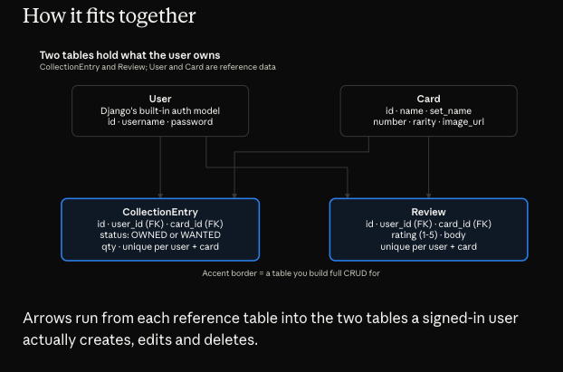

**20:55**: Asking Claude to set up Heroku: it asks for a one-time CLI login (no password in chat), plans the app, Postgres and config vars, and asks about cost and pushing to GitHub first

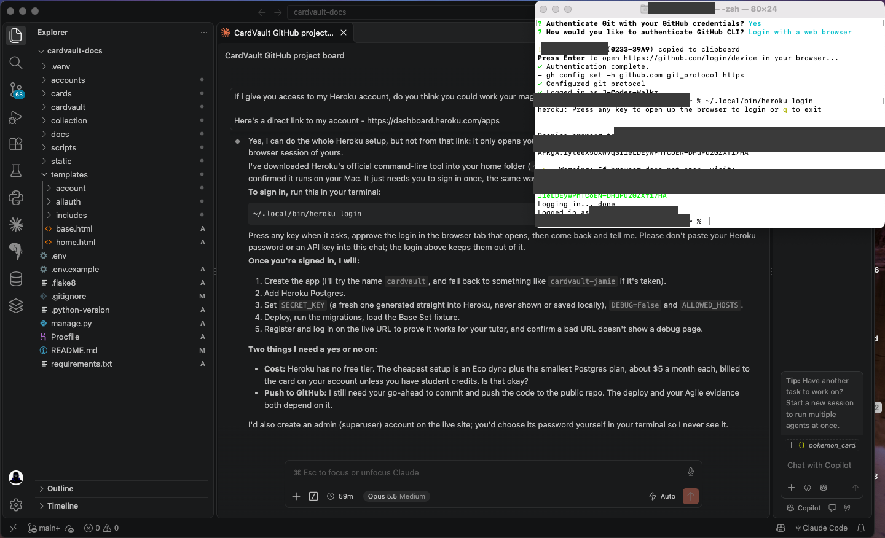

**20:57**: Claude creates the Heroku app in the EU region and sets the config vars without displaying the secret key

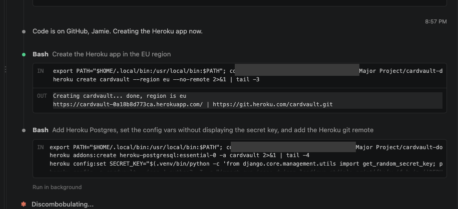

**21:40**: The first knowledge graph: 336 nodes, 578 links, 19 clusters, and the most connected models

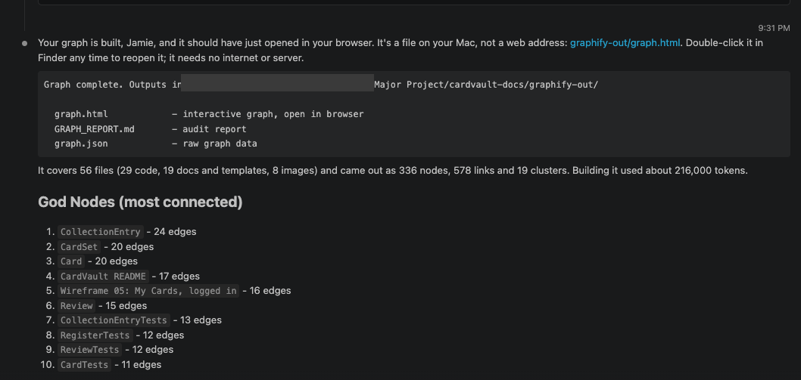

**21:41**: The first graph's suggested questions, and Claude's caveats: a health warning, inferred links are guesses, and a shortcut it took

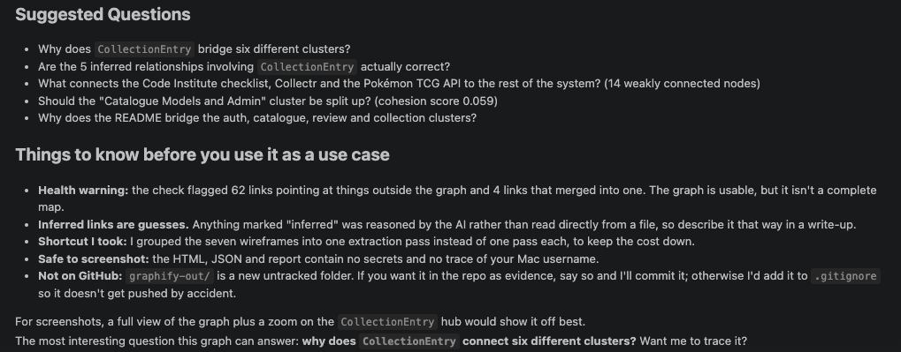

**21:41**: The first graph's most connected nodes and surprising connections

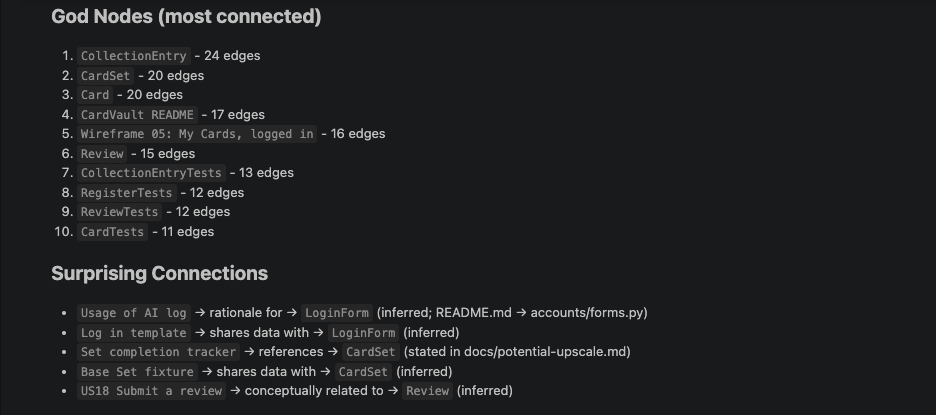

**21:51**: The mind map committed with only three safe files, after a scan for secrets and local paths; two corrections to what Claude said earlier

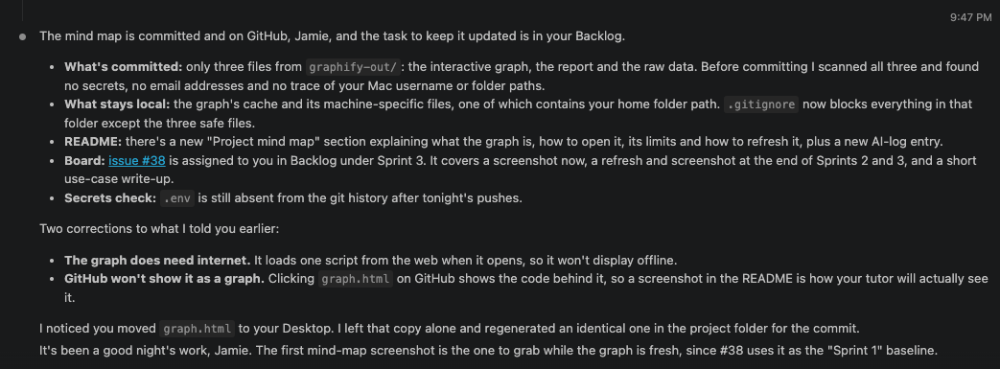

## Tuesday 13 October 2026

**16:29**: Claude Code running three helpers in parallel to read the docs, wireframes and ERD for the mind map

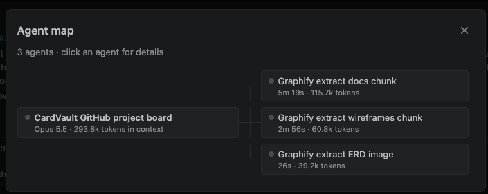

## Wednesday 14 October 2026

**16:57**: Bug #41 found and fixed: Heroku's "Wait for CI" setting blocked every deploy because no CI existed yet

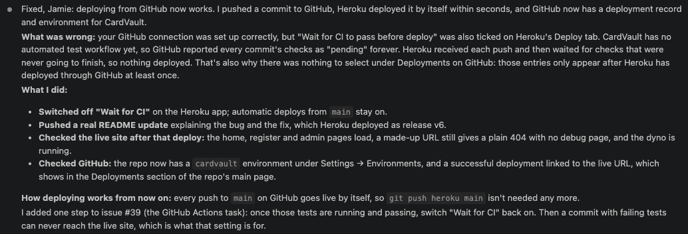

**18:12**: The assessor's points fixed and logged as bugs #43 to #46, and the front-end CRUD with the tester cards live

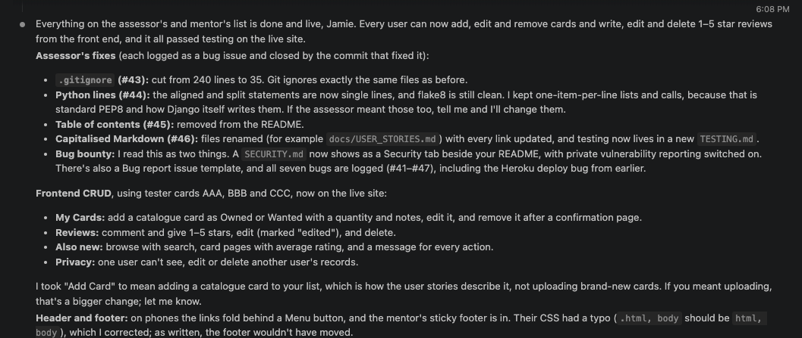

**18:12**: End of 14 October: 96 tests, a 39-check run on the live site, validators clean, a layout bug found only in the browser, and what was still open

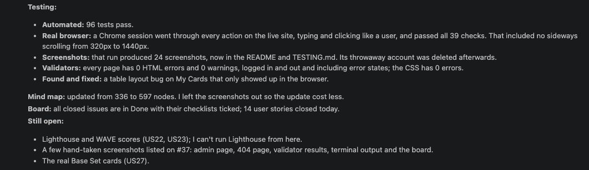

## Thursday 15 October 2026

**12:37**: The Pokémon TCG API returned a 502 error while building the fixture; Claude probes it before retrying

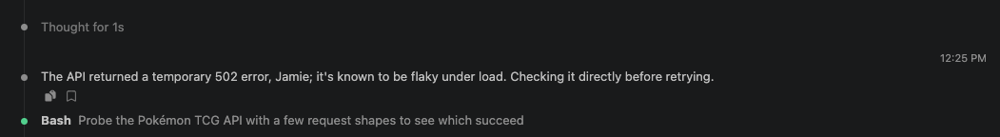

**12:38**: The API kept failing under load; Claude tests which request shapes get through before changing the script

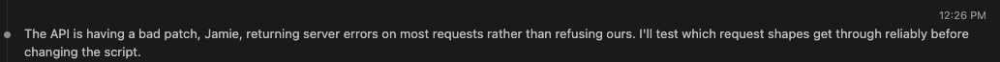

**12:39**: All 102 Base Set cards checked against the printed set (16 holo rares, 16 rares, 32 uncommons, 38 commons)

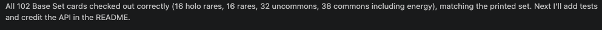

**12:40**: The security review (#50) begins: what already protects logins, and whether any package has a known vulnerability

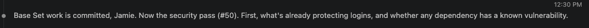

**12:41**: The hardening step: security headers, the shared rate limit cache, admin log in through allauth, an HttpOnly CSRF cookie, and security tests

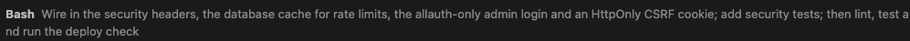

**12:41**: First findings: allauth already limits log ins, pip-audit finds no vulnerabilities, no secrets in the git history

**12:43**: 111 tests and the deploy check pass; next, checking in a real browser that the new Content Security Policy blocks nothing

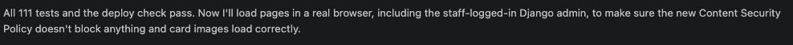

**12:44**: A failing browser check traced to correct behaviour: the catalogue now shows the real Base Set cards, so the check is updated to expect them

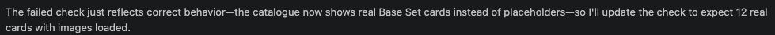

**12:44**: The browser check finds no Content Security Policy problems, only the missing favicon (#35), and the admin log in goes through the rate-limited page

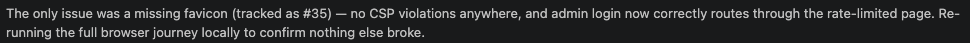

**12:45**: 41 of 41 browser checks pass; the security code is committed

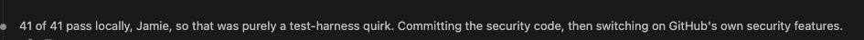

**12:45**: GitHub's Dependabot, CodeQL and a rule protecting main switched on; secret scanning with push protection was already on

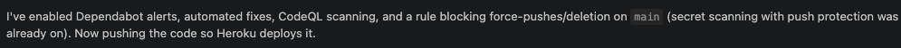

**13:11**: Reviewing a third-party Claude skills repo before installing it: is it safe, what it costs in tokens, which skills help, and why its setup step would break the assessor's rules

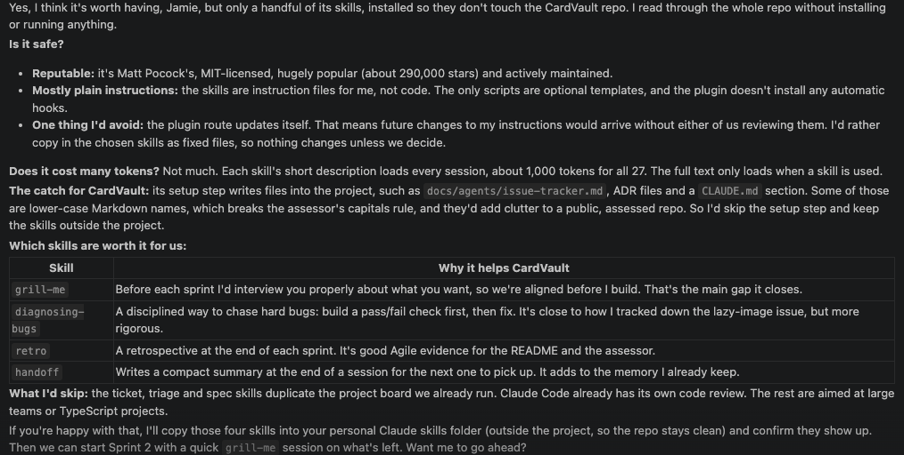

**13:14**: Four skills installed outside the repo as fixed copies; Claude corrects itself and drops one ("retro") after reading it closely

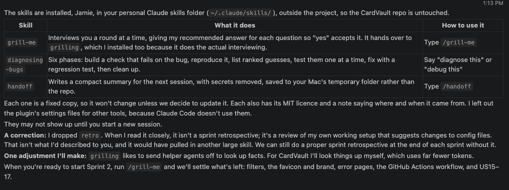

**13:50**: Claude's honest advice on Docker: worth a "what if", not worth building now, and why heavy image load and duplicate cards are already handled

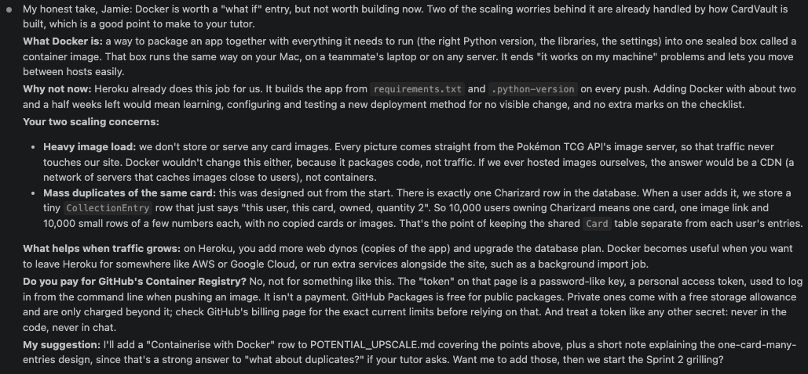

**14:25**: The card-picture fallback (#51) and scaling notes added, with how it was tested, one honest limit, and a talk piece for the tutor

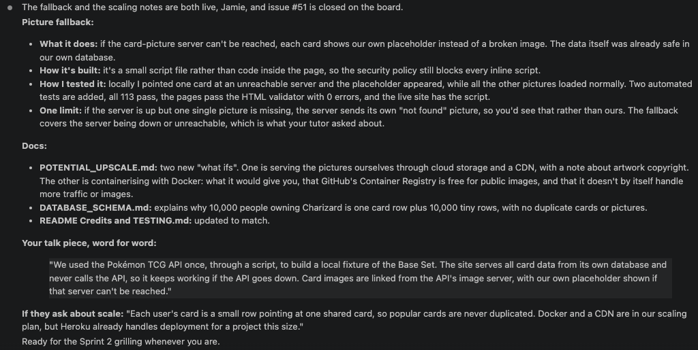

**16:09**: Jamie's manual test found searching "Holo" returned nothing; search now matches name, set or rarity in any order, and Jamie's email-address username needs a decision

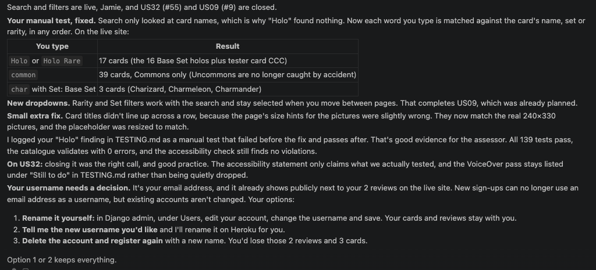

**16:41**: Claude reads Jamie's screenshot: two layout bugs and a data-loss bug (two forms on one page), with a recommendation for each

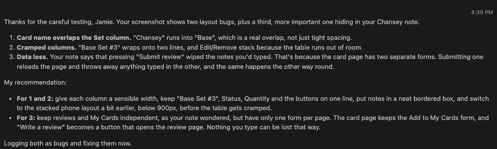

**16:59**: Bugs #57 and #58 fixed and tested at six widths; one failure traced to Claude's own test, and a deleted screenshot Claude restored

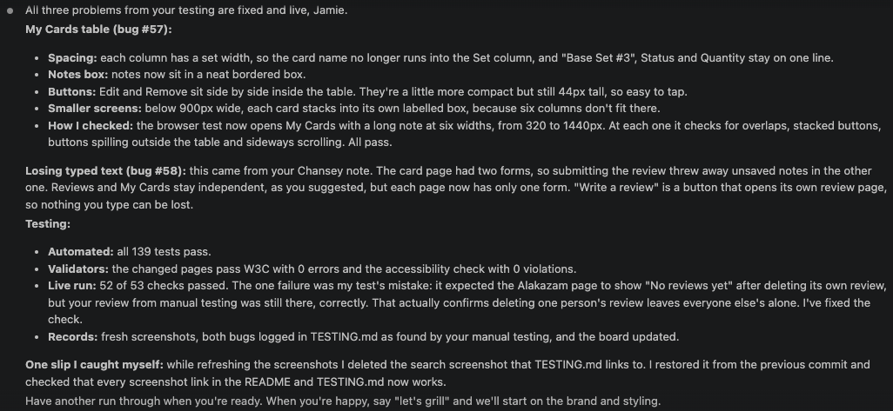

**17:49**: The agreed brand before building: colours with one job each, light and dark mode, fonts, the card-back emblem, Poké Ball ratings and rarity badges

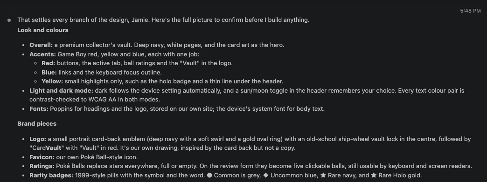

**17:50**: The planned movement, and one decision Claude asks Jamie to agree: two small notes kept in the browser, listed openly on the Privacy page

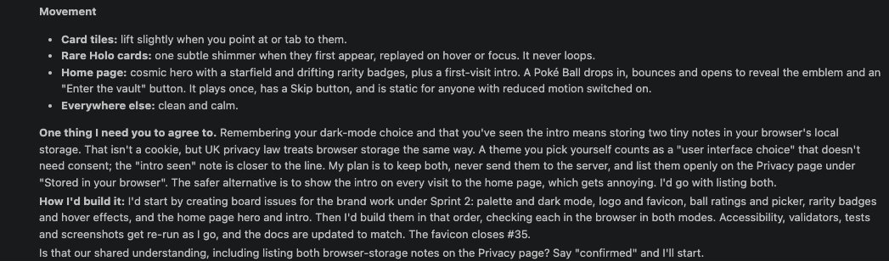

**18:24**: The new brand live: emblem, favicon, light and dark mode, Poké Ball ratings, 1999 rarity badges and the first-visit intro

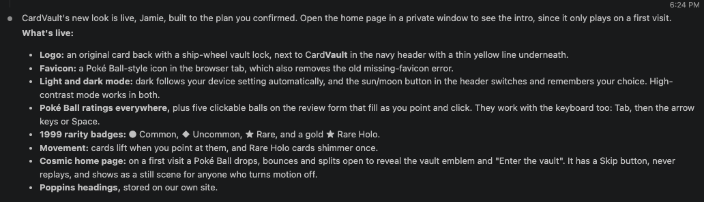

**18:26**: The brand's checks (contrast, validators, accessibility, 150 tests, 57 browser checks) and a keyboard bug in the ball picker caught and fixed

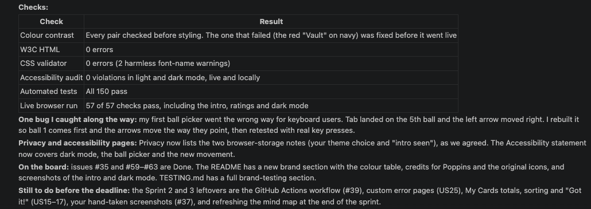

**18:37**: Full CRUD on both user-owned tables, from the front end; credit for the design ideas shared with Jamie

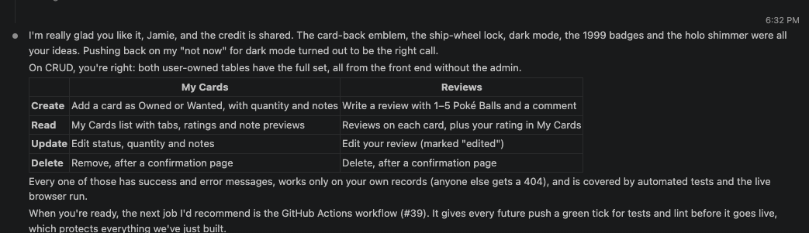

## Friday 16 October 2026

**12:29**: Advice on the Home link and Contact page, and why an automatic email reply was left out (abuse, junk folders, a secret to keep, testing work)

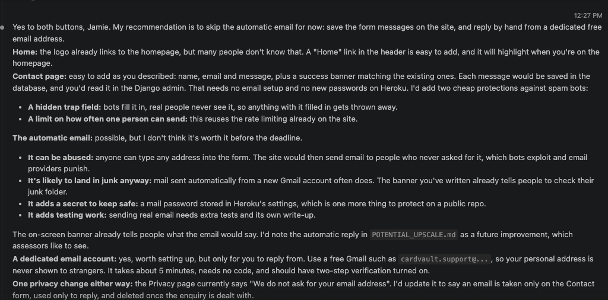

## Monday 19 October 2026

**12:11**: The security hardening summary: bug #66 (shared login limits), no database backups, bug #67 (long searches), the new limits and the load test

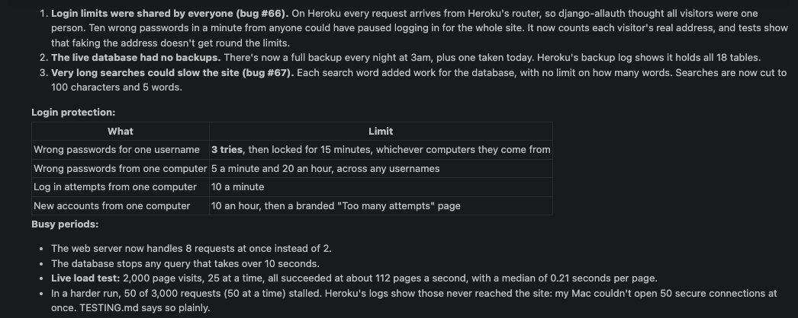

**12:12**: Database security, the IP addresses allauth leaves in the cache (now cleared on every deploy), and three honest trade-offs with their fixes in the upscale plan

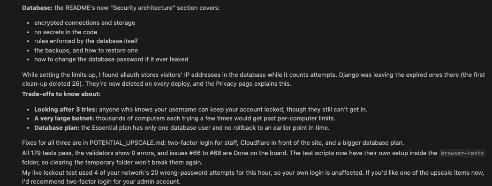

**16:03**: The repo and board made private for a week: what stops working (CodeQL, push protection), what keeps working, and a saved checklist for switching back

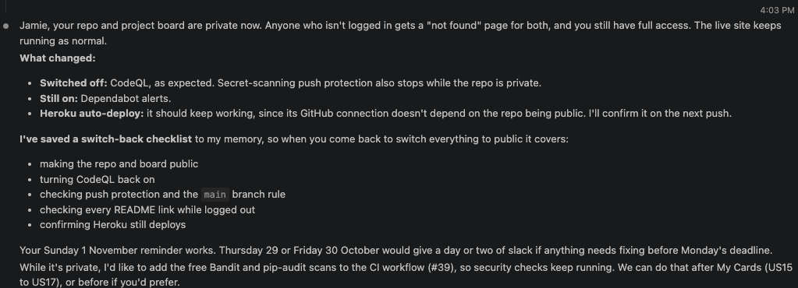

**16:26**: The CI workflow passes first time (191 tests in 40 seconds), and the one Heroku setting Jamie has to switch on himself

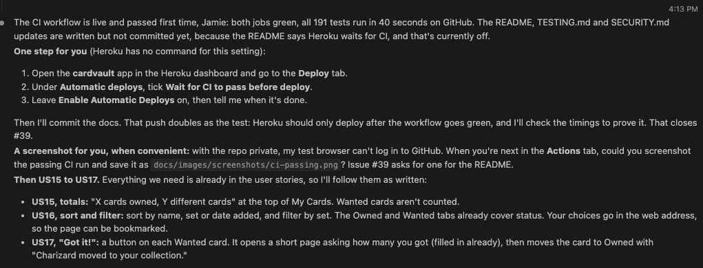

**17:10**: During a GitHub Actions outage: why the "passing" badge did not yet cover the newest commits, and holding until confirmed

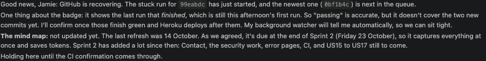

**17:45**: CI confirmed: both stuck runs passed, and Heroku deployed 33 seconds after the checks passed (#39 closed)

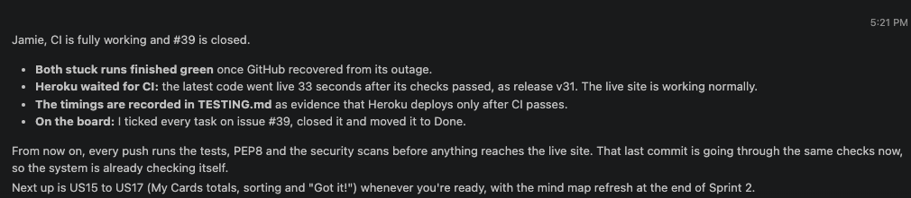

## Monday 26 October 2026

**13:29**: Sprint 1 and 2 closed; US15 to US17 live, with a layout bug the browser check caught and one of Claude's own mistakes

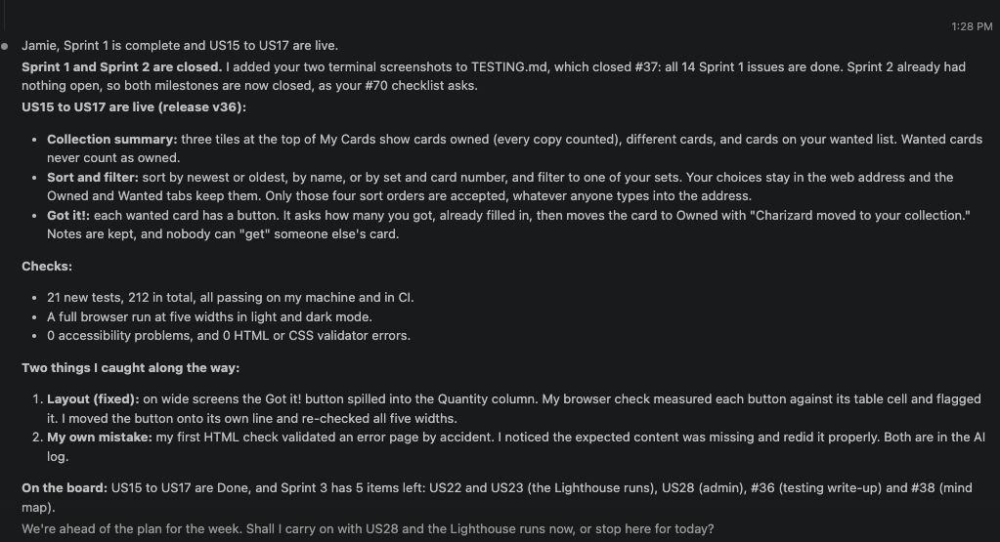

## Wednesday 28 October 2026

**13:55**: US28 (a superuser-only admin and its walkthrough) and the Lighthouse results for every public page

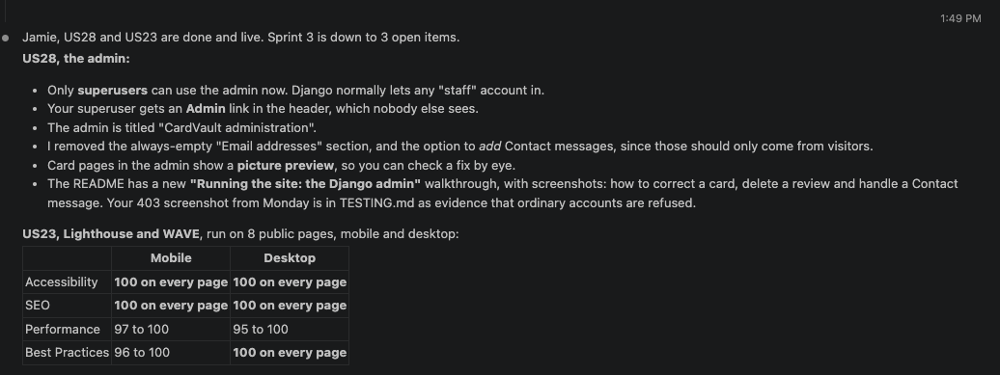

**13:56**: The Best Practices trade-off, WAVE's false alarm, Claude's own `path` mistake, and three short jobs for Jamie (Lighthouse, a real phone, VoiceOver)

## Thursday 29 October 2026

**11:42**: Two helpers dispatched in parallel to read the changed documents and templates for the mind map refresh

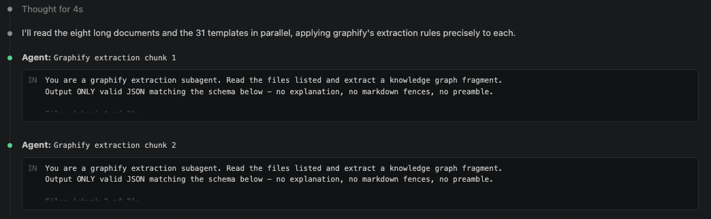

**11:44**: A helper finishes; Claude logs its token cost for the mind map's cost record

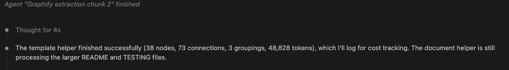

**11:49**: The mind map refreshed for the end of the sprints: 1,052 nodes, its cost, its health check, and the most connected parts

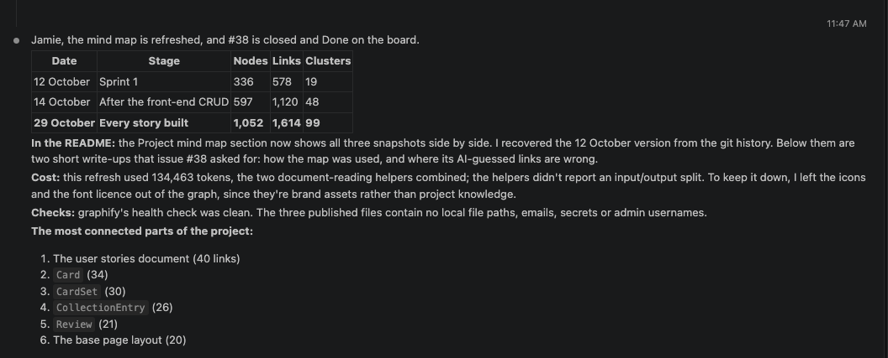

**11:49**: The refreshed graph's surprising connections, with Claude judging which are right and which are guesses, and its suggested questions

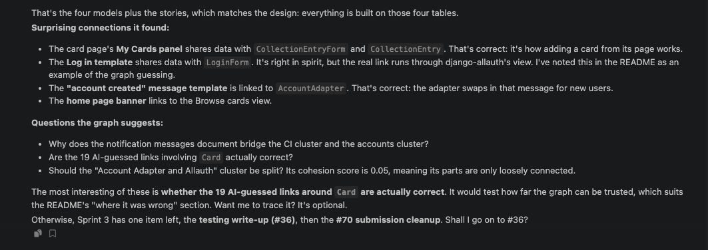

**12:29**: Tracing whether the graph can be trusted (19 of 19 correct, 2 missed, two blind spots), and the finished testing write-up

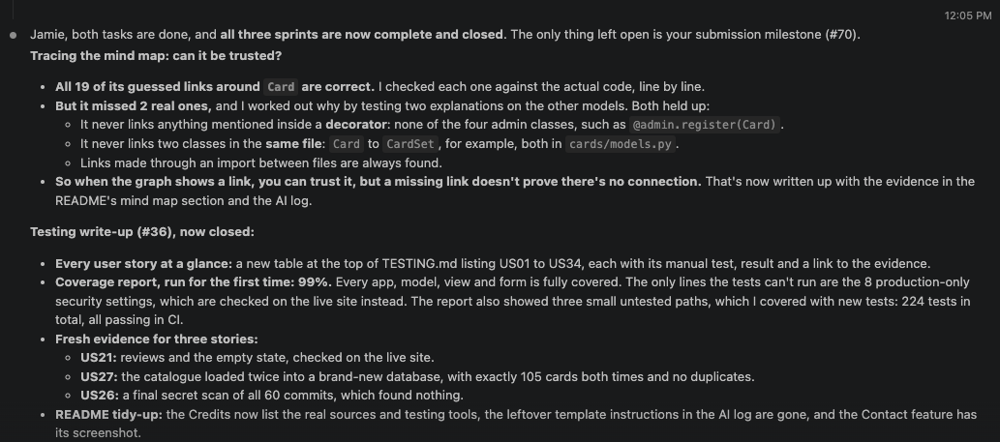

**12:30**: A mistake Claude found in its own earlier edit, the honest VoiceOver gap, and what was left for submission

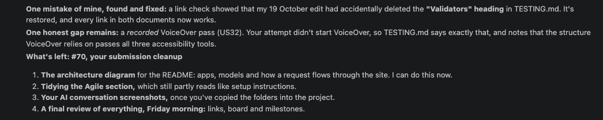
