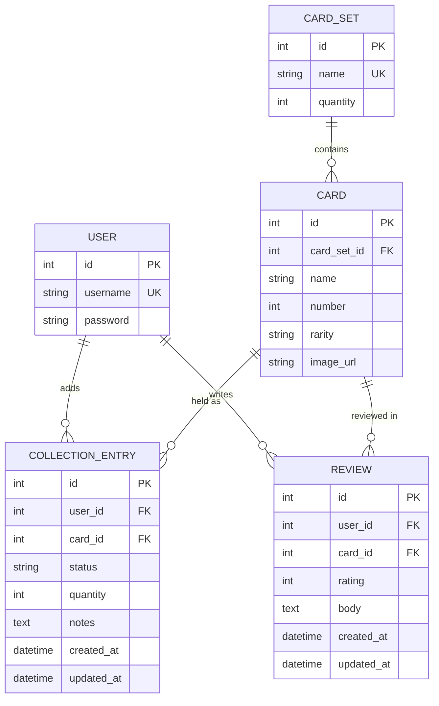

# Database schema

CardVault uses PostgreSQL in every environment, both locally and on
Heroku, reached entirely through Django's models and the ORM, with no
hand-written SQL. This file describes the models as they are actually
built in `cards/models.py` and `collection/models.py`. If the code
changes, this file and the diagram below change with it.

The schema is Django's own `User` model plus four tables the project
builds: `CardSet`, `Card`, `CollectionEntry` and `Review`.

## Entity-relationship diagram

GitHub renders this Mermaid diagram directly:



## Tables

| Table | App | What it stores | CRUD owner |
|---|---|---|---|
| `User` | Django's own `django.contrib.auth` | Login credentials, no custom fields | django-allauth (register, log in, log out) |
| `CardSet` | `cards` | A released set: its name and how many cards it contains | Seeded via fixture/admin, read-only in the UI |
| `Card` | `cards` | One card: name, set, number, rarity and an optional image | Seeded via fixture/admin, read-only in the UI |
| `CollectionEntry` | `collection` | A card on a user's list, as `OWNED` or `WANTED`, with a quantity and notes | Full CRUD (US11&ndash;US14, US17) |
| `Review` | `cards` | A user's rating (1 to 5) and text review of a card | Full CRUD (US18&ndash;US20) |

`CardSet` and `Card` are shared reference data: the same rows for
every user, loaded from a fixture or Django admin (see
[Populating the catalogue](#populating-the-catalogue)) rather than
typed in per user, so they are not part of the CRUD showcase.
`CollectionEntry` and `Review` are the two tables a logged-in user
actually creates, edits and deletes, each scoped to `request.user`.

## Why simplify

The first draft of this schema had six tables: a custom `User` model,
`CardSet`, `Card`, `CollectionItem`, `WishlistItem` and `Review`. It
was then cut to four, and one table was later brought back. The
reasoning at each step:

- **Django's built-in `User`** already gives register, log in and
  log out, so a custom user model earns nothing against the checklist.
  This cut stands.
- **One `CollectionEntry` table with a `status` field** (`OWNED` or
  `WANTED`) replaces two near-identical tables, forms and view sets
  with one, and still shows the same two user-facing lists. This cut
  stands.
- **`CardSet` was cut, then restored (12 October 2026).** The
  simplified draft stored the set as a plain `set_name` string on
  `Card`. When the catalogue data was prepared as a fixture, the set
  was the natural first thing to seed (Base Set, 102 cards), and a
  string field had nowhere to hold the size of the set. A small
  two-field table fixes that, removes the risk of the same set being
  spelt two ways, and makes the "filter by set" story (US09) a
  foreign-key lookup.

## Design decisions worth knowing

- **One review per user per card.** `Review` has a unique constraint
  on `(user, card)`. The UI reflects this: the review form becomes an
  edit form once you have already reviewed a card (US18).
- **Ratings are 1 to 5 in the database, not only in the form.** A
  check constraint backs up the field validators, so a bad rating
  cannot be saved by any route.
- **One list entry per user per card.** `CollectionEntry` is unique on
  `(user, card)`, not `(user, card, status)`. A card is either `OWNED`
  or `WANTED` at any one time, never both, which is what makes
  "Got it!" (US17) a one-field status change instead of a move between
  tables.
- **Many collectors, one card: no duplicates.** There is exactly one
  `Card` row for each printed card, shared by everyone. When a user
  adds Charizard to My Cards, the database stores one small
  `CollectionEntry` row (user, card, status, quantity), not a copy of
  the card or its picture. So 10,000 users owning Charizard means one
  Charizard row, one picture link and 10,000 rows of a few numbers
  each. This is why `Card` and `CollectionEntry` are separate tables.
- **Quantity can't go to zero.** A check constraint keeps `quantity`
  at 1 or more. "I no longer have this card" means deleting the row
  (US14), not setting quantity to 0, which keeps "do I own this
  card?" a simple existence check.
- **A card number is unique within its set.** `Card` is unique on
  `(card_set, number)`, so loading the same card twice is impossible.
- **A set that still has cards cannot be deleted.** `Card.card_set`
  uses `on_delete=PROTECT`. Deleting a user, by contrast, cascades to
  their own entries and reviews.
- **The image is optional.** `image_url` may be blank, and a
  placeholder is shown instead (US07).
- **No prices (decided 15 October 2026).** An earlier version had a
  `market_price` field. It was removed (migration
  `cards/0002_remove_card_market_price`) because prices bring
  currencies, exchange rates and keeping values up to date, none of
  which the project needs; see
  [Potential upscale](./POTENTIAL_UPSCALE.md) for what adding them
  back would take.

## Populating the catalogue

Reference data is seeded from JSON fixtures, which are repeatable and
easy to reset during testing. Fixtures carry explicit primary keys, so
loading one twice updates the existing rows instead of duplicating
them (there is an automated test for this).

```bash
python manage.py loaddata pokemon_cardsets
python manage.py loaddata base_set_cards
python manage.py loaddata tester_cards
```

| Fixture | What it seeds | Primary keys used |
|---|---|---|
| `cards/fixtures/pokemon_cardsets.json` | The Base Set (102 cards), as a `CardSet` only | `CardSet` 1 |
| `cards/fixtures/base_set_cards.json` | All 102 Base Set cards: name, number, rarity and image link. Built once from the [Pokémon TCG API](https://pokemontcg.io) by `scripts/build_base_set_fixture.py` | `Card` 4 to 105 (Base Set card N is pk N + 3) |
| `cards/fixtures/tester_cards.json` | A "Tester Set" with three placeholder cards, AAA (Common), BBB (Uncommon) and CCC (Rare Holo), for testing the front-end CRUD | `CardSet` 2, `Card` 1 to 3 |

The tester cards have no image, so the site shows its placeholder
image.
The API gives the six basic Energy cards no rarity; the script marks
them Common, as the printed set does. Load `pokemon_cardsets` before
`base_set_cards`, because each card points at the Base Set row.

## PEP8 and the models

The checklist asks for PEP8-compliant Python, which caps line length
at 79 characters. Model field definitions are the easiest place to
break this rule without noticing: a `ForeignKey` with several keyword
arguments on one line goes over 79 characters very easily. Each
field's arguments are wrapped across lines once they get close to the
limit, for example:

```python
card = models.ForeignKey(
    Card, on_delete=models.CASCADE, related_name="collection_entries"
)
```

`flake8 .` (see [TESTING.md](../TESTING.md)) is run regularly
while building, not just at the end. Generated migration files are
excluded in `.flake8`.

## Keeping this in sync

This file was rewritten on 12 October 2026 to match the models as
built. The earlier four-table diagram (`docs/images/erd.png`) predates
the return of `CardSet` and is kept only as a record of the plan.
